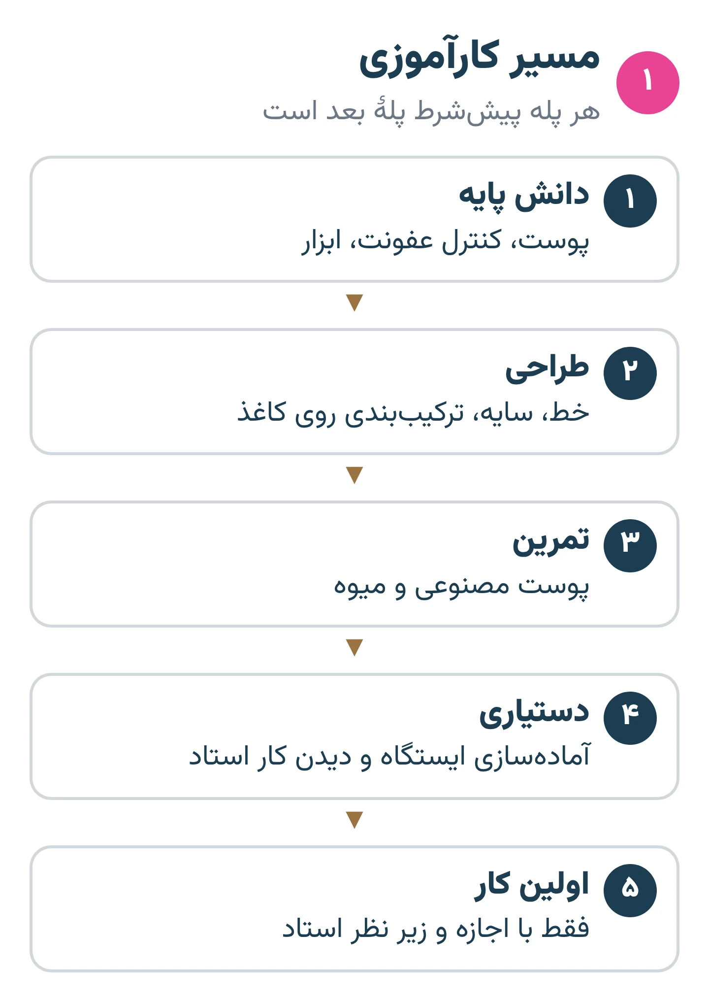
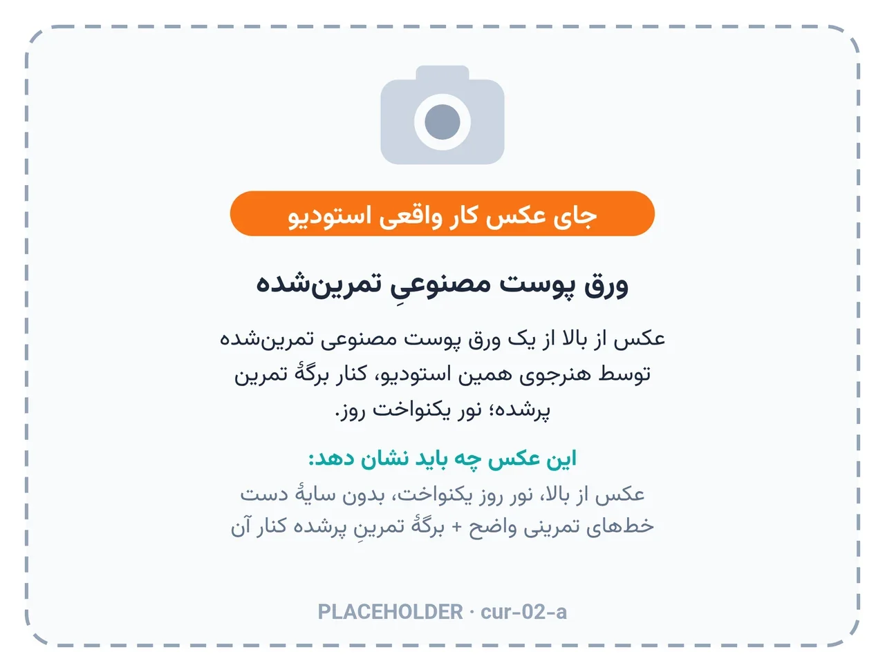

# فصل ۱ — ورود به حرفه

*بخش ۱ — پایه و ایمنی*

## درس ۱: مسیر کارآموزی، اخلاق حرفه‌ای و حد کارآموز

<!-- id: cur-01 -->
**سطح:** مبتدی

کارآموزی تاتو یک مسیر مرحله‌به‌مرحله است: اول ایمنی و شناخت پوست، بعد ابزار و طراحی، بعد تمرین روی پوست مصنوعی، و فقط در پایان و با نظر استاد کار روی انسان.

**در این درس یاد می‌گیری:**

- مراحل مسیر کارآموزی این استودیو را به ترتیب نام ببری.
- مرز کاری کارآموز را با کار استاد و کار پزشک تشخیص بدهی.
- اصول اخلاق حرفه‌ای در برخورد با مشتری، طرح و اطلاعات شخصی را توضیح بدهی.

### مسیر، نه میان‌بُر

تاتو یعنی ایجاد زخم کنترل‌شده و گذاشتن رنگدانه در میان‌پوست. هر خطای فنی روی بدن یک انسان باقی می‌ماند؛ برای همین آموزش در این استودیو پله‌ای است و هیچ پله‌ای با پله‌ی بعد جابه‌جا نمی‌شود.

ترتیب درس‌نامه همان ترتیب کار است: پوست و ترمیم ← کنترل عفونت ← دستگاه، سوزن و رنگ ← طراحی و بدن ← مشتری و اجرا ← مراقبت و عوارض ← کار پیشرفته و حرفه.

- مرحلهٔ ۱: دانش پایه (پوست، بهداشت، ابزار) و آزمون شفاهی با استاد.
- مرحلهٔ ۲: طراحی روی کاغذ و آماده‌سازی استنسیل.
- مرحلهٔ ۳: تمرین خط، سایه و رنگ روی پوست مصنوعی، با چیدمان کامل بهداشتی، انگار مشتری واقعی است.
- مرحلهٔ ۴: دستیاری استاد در جلسه‌های واقعی (چیدمان، پوشش محافظ، جمع‌آوری) بدون دست زدن به دستگاه روی پوست مشتری.
- مرحلهٔ ۵: فقط با تصمیم استاد و پس از قبولی در همهٔ آزمون‌ها، اولین کار کوچک و ساده زیر نظر مستقیم.

*مسیر کارآموزی: هر پله پیش‌شرط پلهٔ بعد است.*

### قانون همین استودیو

- کارآموز روی پوست مشتری تاتو نمی‌زند؛ کار مشتری را خود پیمان زیبائی‌فر انجام می‌دهد.
- پنجشنبه‌ها روز کلاس است و نوبت مشتری ثبت نمی‌شود.
- قیمت، بیعانه و زمان نوبت مشتری را کارآموز تعیین یا وعده نمی‌کند.
- هر جا جواب در درس نیست، از استاد پرسیده می‌شود؛ حدس زدن در کار با پوست و خون جایی ندارد.

### اخلاق حرفه‌ای

مشتری بدنش را به تو می‌سپارد. صداقت درباره‌ی محدودیت طرح، اندازه، جای بدن و ماندگاری رنگ، بخشی از کار فنی است، نه تعارف.

- طرح دیگران را بدون اجازه کپی نکن (فصل ۷).
- عکس مشتری فقط با رضایت کتبی و بدون نشانهٔ هویتی منتشر می‌شود.
- اطلاعات سلامت مشتری محرمانه است و فقط برای ایمنی همان جلسه پرسیده می‌شود.
- تشخیص بیماری و تجویز دارو کار پزشک است؛ کار تو دیدن نشانهٔ هشدار و ارجاع است.
- زیر اثر الکل یا مواد، یا با فرد زیر سن قانونی و بدون شرایط قانونی، کار انجام نمی‌شود.

> **هشدار**
>
> - کارآموز روی پوست مشتری تاتو نمی‌زند؛ همهٔ تمرین‌ها روی کاغذ، پوست مصنوعی یا میوه انجام می‌شود.

**نکته‌های کلیدی:**

- ترتیب: ایمنی ← ابزار ← طراحی ← تمرین مصنوعی ← دستیاری ← کار کوچک با اجازهٔ استاد.
- کارآموز روی مشتری تاتو نمی‌زند.
- تشخیص و درمان پزشکی بیرون از حد کار تاتو است.

### تمرین

**هدف:** مسیر کارآموزی و مرزهای کاری را بدون نگاه به متن توضیح بدهی.

**ابزار:** کاغذ

۱. پنج مرحلهٔ مسیر را به ترتیب بنویس و جلوی هر کدام یک معیار قبولی بگذار.
۲. سه موقعیت بنویس که باید کار را به استاد یا پزشک بسپاری.
۳. یک جملهٔ مؤدبانه بنویس برای وقتی مشتری از تو قیمت یا نوبت می‌خواهد.

**معیار قبولی:**

- ترتیب مراحل درست باشد.
- هیچ‌کدام از موقعیت‌ها شامل تشخیص یا تجویز دارو توسط تو نباشد.

**واژه‌ها:** پوست مصنوعی (Practice skin)، رضایت‌نامهٔ آگاهانه (Informed consent)

**مرتبط:** درس ۲، درس ۶، درس ۳۹

**منابع:**

- استودیو پیمان زیبائی‌فر، «روش و قانون کارگاهی همین استودیو (تجربهٔ استاد؛ منبع بیرونی ندارد)»
- CEN / BSI، «EN 17169:2020 Tattooing — Safe and hygienic practice» — <https://knowledge.bsigroup.com/products/tattooing-safe-and-hygienic-practice>

---

## درس ۲: برنامهٔ تمرین و پوست مصنوعی

<!-- id: cur-02 -->
**سطح:** مبتدی

تمرین منظم روی پوست مصنوعی، مهارت دست را پیش از کار روی انسان می‌سازد؛ به شرط آنکه هر جلسهٔ تمرین با همان چیدمان بهداشتی و همان دقت جلسهٔ واقعی انجام شود.

**در این درس یاد می‌گیری:**

- تفاوت تمرین روی کاغذ، پوست مصنوعی و پوست میوه را بدانی.
- یک جلسهٔ تمرین را از چیدمان تا جمع‌آوری کامل اجرا کنی.
- پیشرفت خود را با برگهٔ تمرین ثبت و ارزیابی کنی.

### ابزار تمرین و محدودیت هر کدام

پوست مصنوعی «بخشنده‌تر» از پوست انسان است. خطی که روی آن خوب است، روی انسان ممکن است بیش از حد عمیق یا سطحی باشد. برای همین تمرین مصنوعی پیش‌نیاز است، نه مجوز.

- کاغذ و قلم: کنترل خط، ترکیب‌بندی و ارزش رنگی؛ بدون عمق.
- پوست مصنوعی (سیلیکونی یا لاستیکی): تمرین کشش، زاویه، سرعت دست و یکنواختی خط. واکنش آن با پوست انسان یکی نیست؛ خونریزی، تورم و پس‌زدن رنگ ندارد.
- پوست میوه (مثل پرتقال یا طالبی): تمرین روی سطح منحنی؛ آن هم مانند پوست زنده رفتار نمی‌کند.

*نمونهٔ تمرین ثبت‌شده: هر جلسه یک عکس و یک برگه.* — جای عکس واقعی استودیو

### جلسهٔ تمرین مثل جلسهٔ واقعی

- شستن دست، دستکش، پوشش محافظ روی دستگاه و سیم، کاپ یک‌بارمصرف.
- کارتریج نو برای هر جلسه؛ کارتریجی که پوست مصنوعی را سوراخ کرده هم در ظرف تیز می‌رود.
- پایان جلسه: جمع‌آوری از تمیز به کثیف، دور انداختن پوشش‌ها، ضدعفونی سطح.

### برنامهٔ پیشنهادی هفتگی

- طراحی روزانه: ۲۰ دقیقه خط و دایرهٔ آزاد، ۲۰ دقیقه نوار ارزش رنگی.
- دو جلسهٔ پوست مصنوعی در هفته: خط مستقیم، منحنی، دایره؛ بعد سایهٔ ساده.
- هر جلسه عکس با نور یکسان و برگهٔ تمرین: کارتریج، تنظیم دستگاه، مشکل اصلی، اصلاح جلسهٔ بعد.
- بازبینی هفتگی با استاد در کلاس پنجشنبه.

> **هشدار**
>
> - کارتریج و سوزن تمرینی را دوباره به کار نبر و روی بدن خودت یا دوستان «امتحان» نکن.

**نکته‌های کلیدی:**

- تمرین مصنوعی پیش‌نیاز است، نه مجوز کار روی انسان.
- چیدمان بهداشتی در تمرین هم کامل اجرا می‌شود تا عادت شود.
- پیشرفت با برگهٔ تمرین و عکس ثبت می‌شود، نه با حافظه.

### تمرین

**هدف:** یک جلسهٔ کامل تمرین را از چیدمان تا جمع‌آوری اجرا و ثبت کنی.

**ابزار:** پوست مصنوعی، کارتریج لاینر، رنگ مشکی، کاپ، دستکش، پوشش محافظ

۱. چیدمان کامل میز را انجام بده و از آن عکس بگیر.
۲. ده خط مستقیم ۵ سانتی و پنج دایره بزن.
۳. میز را به ترتیب درست جمع کن.
۴. برگهٔ تمرین را پر کن.

**معیار قبولی:**

- در هیچ مرحله دستکش آلوده به وسیلهٔ تمیز نخورد.
- برگهٔ تمرین کامل و عکس‌ها با نور یکسان باشد.

**واژه‌ها:** پوست مصنوعی (Practice skin)، پوشش محافظ (Barrier film)، ظرف تیز (سیفتی‌باکس) (Sharps container)

**مرتبط:** درس ۸، درس ۲۳، درس ۲۵

**منابع:**

- استودیو پیمان زیبائی‌فر، «روش و قانون کارگاهی همین استودیو (تجربهٔ استاد؛ منبع بیرونی ندارد)»
- CEN / BSI، «EN 17169:2020 Tattooing — Safe and hygienic practice» — <https://knowledge.bsigroup.com/products/tattooing-safe-and-hygienic-practice>

---
