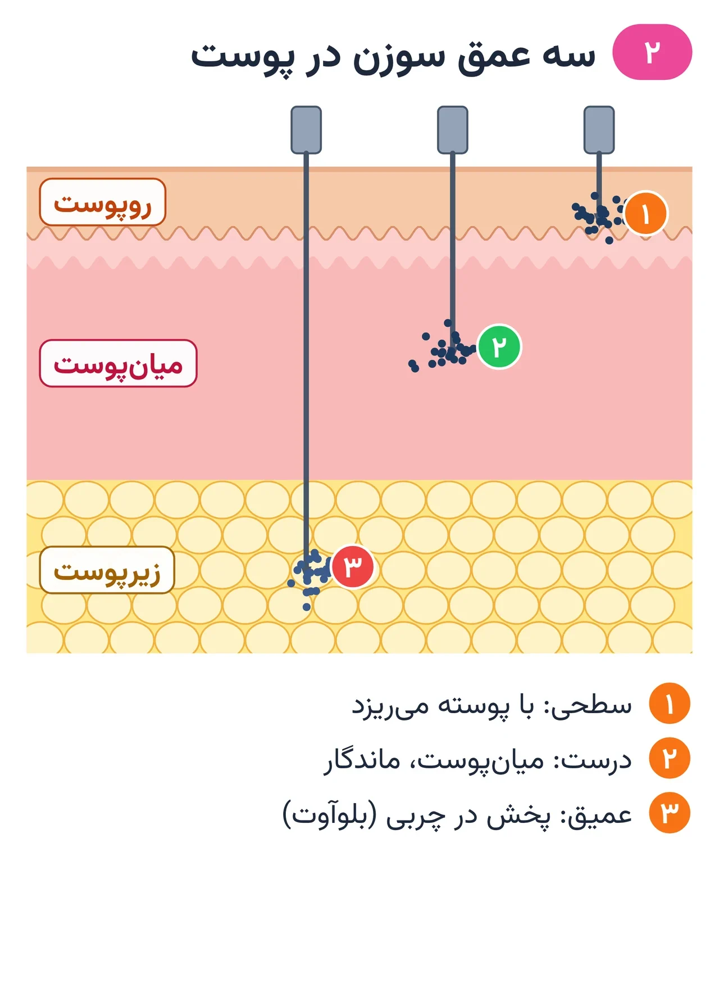
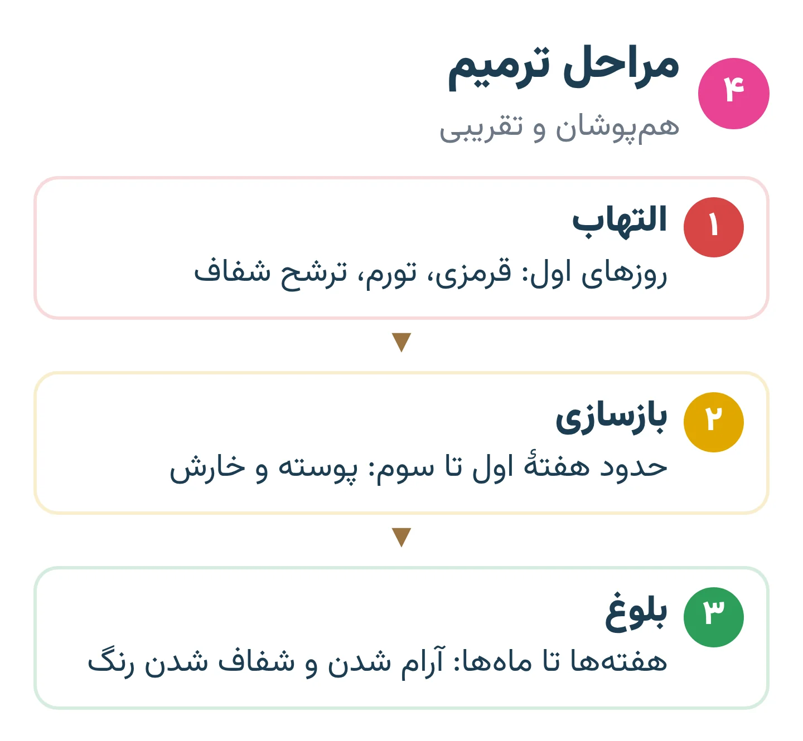
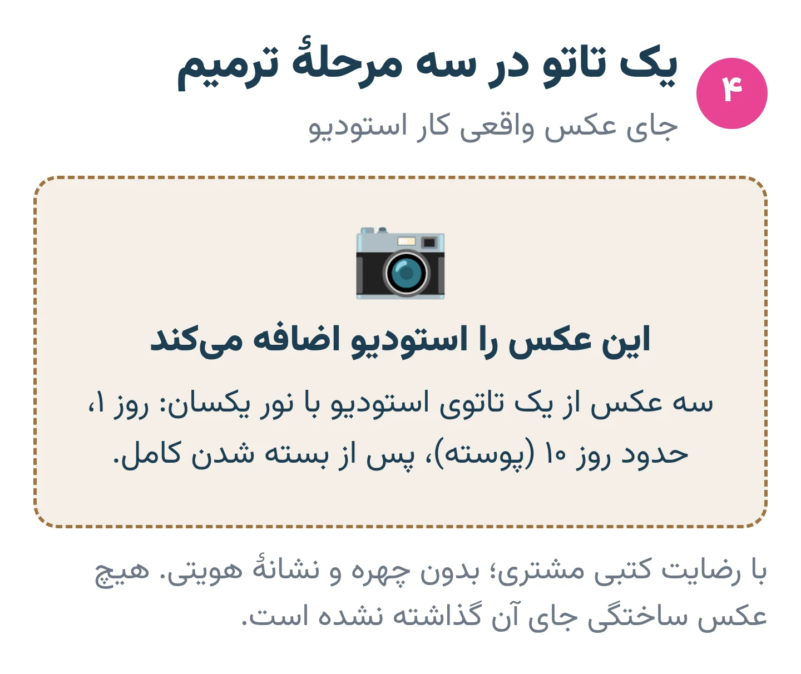
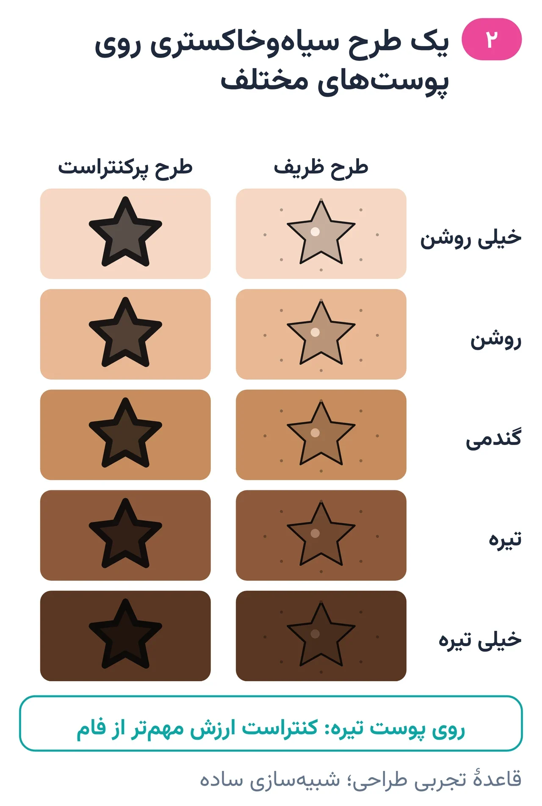

# فصل ۲ — پوست و ترمیم

*بخش ۱ — پایه و ایمنی*

## درس ۳: ساختار پوست و جای نشستن رنگ

<!-- id: cur-03 -->
**سطح:** مبتدی

پوست سه لایهٔ اصلی دارد: روپوست، میان‌پوست و زیرپوست. رنگ تاتو فقط وقتی ماندگار می‌شود که در میان‌پوست بنشیند؛ سطحی‌تر می‌ریزد و عمیق‌تر پخش می‌شود.

**در این درس یاد می‌گیری:**

- سه لایهٔ پوست و نقش هر کدام را در تاتو توضیح بدهی.
- بگویی چرا رنگ در روپوست نمی‌ماند و در زیرپوست پخش می‌شود.
- تفاوت ضخامت پوست در نقاط مختلف بدن را در برنامهٔ کار در نظر بگیری.

### روپوست (Epidermis)

روپوست لایهٔ بیرونی و بدون رگ خونی است. سلول‌های آن در لایهٔ پایه (لایهٔ زاینده) ساخته می‌شوند، به‌تدریج بالا می‌آیند و در لایهٔ شاخی به سلول مردهٔ پرکراتین تبدیل می‌شوند و می‌ریزند. سلول‌های رنگ‌ساز پوست (ملانوسیت‌ها) هم در همین لایهٔ پایه‌اند.

چون روپوست مدام نو می‌شود، رنگی که فقط در آن بنشیند در دورهٔ پوسته‌ریزی می‌رود. کم‌رنگ‌شدن طبیعی چند روز اول بخشی از همین رنگ سطحی است.

*رنگ فقط در میان‌پوست ماندگار است.*

### میان‌پوست (Dermis)

میان‌پوست از بافت همبند (کلاژن و الاستین) ساخته شده و رگ خونی، عصب، فولیکول مو و غدد را در خود دارد. دو بخش دارد: بخش پاپیلاری (بالایی، نازک‌تر) و بخش رتیکولار (عمیق‌تر و ضخیم‌تر).

ذرات رنگدانه در میان‌پوست می‌مانند؛ بخشی از آن‌ها را سلول‌های ایمنی (ماکروفاژها) و سلول‌های بافت همبند در خود نگه می‌دارند. همین است که تاتو را دائمی می‌کند. خون‌آمدن حین کار نشان می‌دهد سوزن به میان‌پوست رسیده؛ خونریزی زیاد اما نشانهٔ کار درست نیست.

### زیرپوست (Hypodermis)

زیر میان‌پوست لایهٔ چربی است. رنگی که به این لایه برسد پخش می‌شود و دور خط هالهٔ آبی‌خاکستری می‌سازد (بلوآوت). این خطا معمولاً قابل پاک کردن با سوزن نیست.

### ضخامت پوست در بدن یکسان نیست

- کف دست و کف پا روپوست ضخیم دارند و رنگ را خوب نگه نمی‌دارند.
- پلک، مچ داخلی، پشت گوش، روی استخوان‌ها و پوست افراد مسن نازک‌اند؛ بلوآوت آسان‌تر رخ می‌دهد.
- پشت، ران و بازوی بیرونی معمولاً ضخیم‌ترند.
- در آموزش رایج عمق کار را «حدود ۱ تا ۲ میلی‌متر» می‌گویند. این عدد فقط تصویر ذهنی است، نه دستور: معیار درست، خواندن نتیجه است (فصل ۱۰).

> **هشدار**
>
> - این درس آموزش کالبدشناسی برای تاتو است و جای تشخیص بیماری پوست نیست؛ هر ضایعهٔ مشکوک به پزشک ارجاع می‌شود.

**نکته‌های کلیدی:**

- رنگ ماندگار = رنگ در میان‌پوست.
- خیلی سطحی: ریزش رنگ. خیلی عمیق: بلوآوت.
- عمق ثابت برای همهٔ بدن وجود ندارد.

### تمرین

**هدف:** مقطع پوست را بکشی و جای درست رنگ را نشان بدهی.

**ابزار:** کاغذ و مداد رنگی

۱. مقطع پوست را با سه لایه بکش و نام فارسی هر لایه را بنویس.
۲. سه سوزن بکش: یکی در روپوست، یکی در میان‌پوست، یکی در چربی؛ نتیجهٔ هر کدام را کنارش بنویس.
۳. پنج نقطه از بدن را از نازک به ضخیم مرتب کن.

**معیار قبولی:**

- بتوانی بگویی چرا رنگ سطحی می‌ریزد و رنگ عمیق پخش می‌شود.

**واژه‌ها:** روپوست (Epidermis)، میان‌پوست (Dermis)، زیرپوست (لایهٔ چربی) (Hypodermis)، بلوآوت (پخش‌شدگی رنگ) (Blowout)، ملانین (Melanin)

**مرتبط:** درس ۴، درس ۵، درس ۲۳، درس ۲۴

**منابع:**

- StatPearls / NCBI Bookshelf، «Anatomy, Skin (Integument), Epidermis» — <https://www.ncbi.nlm.nih.gov/books/NBK470464/>
- StatPearls / NCBI Bookshelf، «Anatomy, Skin (Integument)» — <https://www.ncbi.nlm.nih.gov/books/NBK441980/>
- U.S. FDA، «Tattoos, Temporary Tattoos & Permanent Makeup» — <https://www.fda.gov/cosmetics/cosmetic-products/tattoos-temporary-tattoos-permanent-makeup>

---

## درس ۴: ترمیم زخم تاتو: مراحل و زمان

<!-- id: cur-04 -->
**سطح:** مبتدی

تاتوی تازه یک زخم سطحی گسترده است و مانند هر زخمی از سه مرحلهٔ هم‌پوشان می‌گذرد: التهاب، بازسازی و بلوغ. سطح در چند هفته بسته می‌شود، ولی بلوغ لایه‌های عمیق ماه‌ها طول می‌کشد.

**در این درس یاد می‌گیری:**

- سه مرحلهٔ ترمیم زخم و نشانهٔ طبیعی هر کدام را بشناسی.
- زمان مناسب قضاوت دربارهٔ رنگ نهایی و ترمیم را بدانی.
- نشانه‌های طبیعی را از نشانه‌های هشدار جدا کنی.

### سه مرحلهٔ ترمیم

- التهاب (چند روز اول): قرمزی، گرمی، تورم خفیف، ترشح شفاف یا کمی رنگی، حساسیت به لمس. بدن خونریزی را بند می‌آورد و سلول‌های ایمنی محل را پاک می‌کنند.
- بازسازی (از روزهای اول تا چند هفته): پوست نو از لبه‌ها و فولیکول‌ها رشد می‌کند، پوسته و خارش ظاهر می‌شود و پوسته‌ها خودبه‌خود می‌افتند.
- بلوغ (از چند هفته تا ماه‌ها): کلاژن مرتب می‌شود؛ سطح ممکن است تا مدتی براق یا «شیری» به نظر برسد و بعد شفاف شود.

*مراحل ترمیم هم‌پوشان‌اند و زمان‌ها تقریبی‌اند.*

### زمان‌بندی کاربردی

سطح بیشتر تاتوها در حدود دو تا چهار هفته بسته به نظر می‌رسد. این زمان به اندازه و جای کار، مقدار ضربه به پوست، سلامت فرد و مراقبت بستگی دارد. رنگ نهایی و نیاز به ترمیم معمولاً پس از بسته‌شدن کامل و آرام شدن پوست قضاوت می‌شود؛ در این استودیو ترمیم را زودتر از پایان دورهٔ ترمیم وعده نده.

*همان کار در سه زمان: تازه، پوسته، خوب‌شده.* — جای عکس واقعی استودیو

### طبیعی یا هشدار؟

- طبیعی: قرمزی و تورم که هر روز کمتر می‌شود، پوسته و خارش، کدر بودن موقت رنگ.
- هشدار: قرمزی یا دردی که هر روز بیشتر و گسترده‌تر شود، چرک، بوی بد، تب یا لرز، زخم باز، تاول یا جوش‌های دردناک در طرح.
- نشانهٔ هشدار با «پماد بزن» جواب داده نمی‌شود؛ مشتری به پزشک ارجاع می‌شود (درس عوارض).

> **هشدار**
>
> - زمان‌ها تقریبی‌اند. برای مشتری فقط برگهٔ مراقبت همین استودیو داده می‌شود (درس ۳۰).

**نکته‌های کلیدی:**

- سه مرحله: التهاب ← بازسازی ← بلوغ.
- بسته شدن سطح ≠ پایان ترمیم.
- قرمزیِ رو به افزایش و تب = ارجاع به پزشک.

### تمرین

**هدف:** روند ترمیم را برای مشتری با زبان ساده توضیح بدهی.

**ابزار:** کاغذ

۱. یک خط زمانی بکش و سه مرحله را روی آن بنویس.
۲. برای هر مرحله یک نشانهٔ طبیعی و یک نشانهٔ هشدار بنویس.
۳. توضیح شفاهی یک‌دقیقه‌ای برای مشتری تمرین کن.

**معیار قبولی:**

- هیچ نشانهٔ هشداری در ستون «طبیعی» نیامده باشد.

**واژه‌ها:** کلوئید (Keloid)

**مرتبط:** درس ۳، درس ۳۰، درس ۳۱، درس ۳۲

**منابع:**

- StatPearls / NCBI Bookshelf، «Physiology, Wound Healing» — <https://www.ncbi.nlm.nih.gov/books/NBK535406/>
- American Academy of Dermatology، «Tattoos: 7 unexpected skin reactions and what to do about them» — <https://www.aad.org/public/everyday-care/skin-care-basics/tattoos/tattoo-skin-reactions>
- American Academy of Dermatology، «Caring for tattooed skin» — <https://www.aad.org/public/everyday-care/skin-care-basics/tattoos/caring-for-tattooed-skin>

---

## درس ۵: تنوع پوست: تیره، نازک، مسن، آفتاب و خال

<!-- id: cur-05 -->
**سطح:** مبتدی

رنگ پوست، سن، آفتاب‌سوختگی و خال‌ها روی دیده شدن رنگ، ترمیم و ایمنی کار اثر دارند. طرح و برنامهٔ کار باید با همان پوست هماهنگ شود.

**در این درس یاد می‌گیری:**

- اثر ملانین بر دیده شدن رنگ تاتو را توضیح بدهی.
- احتیاط‌های پوست نازک و مسن را بدانی.
- بدانی چرا روی خال و پوست آفتاب‌سوخته کار نمی‌شود.

### پوست تیره و گندمی

ملانین در روپوست ساخته و ذخیره می‌شود و رنگ تاتو در میان‌پوست می‌نشیند؛ پس رنگ تاتو از پشت لایه‌ای رنگدانه‌دار دیده می‌شود. نتیجهٔ عملی‌ای که هنرمندان گزارش می‌کنند: روی پوست تیره، مشکی و ارزش‌های تیره کنتراست خوبی دارند، ولی رنگ‌های خیلی روشن (زرد کم‌رنگ، سفید، پاستلی) کمتر دیده می‌شوند. این یک قاعدهٔ تجربی طراحی است، نه یافتهٔ پزشکی.

لک تیرهٔ پس از التهاب (هایپرپیگمانتاسیون پس از التهاب) بعد از هر آسیب یا التهاب پوست ممکن است رخ دهد و در پوست‌های تیره‌تر شایع‌تر، شدیدتر و ماندگارتر است. انجمن پوست آمریکا هم به کسی که زمینهٔ جوشگاه برجسته (کلوئید) دارد توصیه می‌کند در تاتو کردن تجدیدنظر کند. پس پرسیدن سابقهٔ جوشگاه در مشاوره و پرهیز از آسیب بی‌مورد به پوست مهم است.

*رنگ‌های روشن روی پوست تیره کنتراست کمتری دارند.*

### پوست نازک و مسن

- روش استودیو: پوست نازک (مچ داخلی، روی استخوان، پوست مسن) را محتاط‌تر کار می‌کنیم، چون به تجربهٔ ما کشش کمتری را تحمل می‌کند و بلوآوت آسان‌تر رخ می‌دهد.
- دست سبک‌تر، عبور کمتر روی یک نقطه، طرح ساده‌تر با فاصلهٔ خط بیشتر.
- در پوست مسن ترمیم ممکن است کندتر باشد؛ این را پیش از کار به مشتری بگو.

### آفتاب و خال

- قاعدهٔ استودیو: روی پوست آفتاب‌سوخته، پوسته‌دار یا تحریک‌شده کار نمی‌شود؛ جلسه عقب می‌افتد.
- انجمن پوست آمریکا توصیه می‌کند هنرمند دور خال‌ها، کک‌مک و لکه‌ها کار کند، چون رنگ تاتو ظاهر خال را تغییر می‌دهد و تشخیص زودهنگام سرطان پوست را سخت‌تر می‌کند. دور خال فاصله بگذار یا طرح را جابه‌جا کن.
- خالی که تغییر اندازه، رنگ یا شکل داده، خونریزی یا خارش دارد، اول باید پزشک پوست ببیند.

> **هشدار**
>
> - این درس تشخیص پوستی نیست. ضایعهٔ مشکوک فقط با نظر پزشک بررسی می‌شود.

**نکته‌های کلیدی:**

- روی پوست تیره، کنتراست و ارزش رنگی مهم‌تر از فام است.
- پوست نازک = دست سبک و عبور کمتر.
- روی خال و پوست آفتاب‌سوخته کار نکن.

### تمرین

**هدف:** یک طرح را برای سه نوع پوست تطبیق بدهی.

**ابزار:** کاغذ، مداد و ماژیک خاکستری

۱. یک طرح گل ساده بکش.
۲. نسخه‌ای برای پوست تیره بکش: خط محکم‌تر، ارزش‌های تیره‌تر، بدون جزئیات خیلی روشن.
۳. نسخه‌ای برای پوست نازک بکش: جزئیات کمتر و فاصلهٔ خط بیشتر.

**معیار قبولی:**

- تفاوت سه نسخه با دلیل فنی توضیح داده شود.

**واژه‌ها:** ملانین (Melanin)، کلوئید (Keloid)، ارزش رنگی (روشنی و تیرگی) (Value)

**مرتبط:** درس ۳، درس ۱۴، درس ۲۱

**منابع:**

- American Academy of Dermatology، «Do tattoos cause skin cancer?» — <https://www.aad.org/public/diseases/skin-cancer/do-tattoos-cause-skin-cancer>
- American Academy of Dermatology، «Tattoos: 7 unexpected skin reactions and what to do about them» — <https://www.aad.org/public/everyday-care/skin-care-basics/tattoos/tattoo-skin-reactions>
- StatPearls / NCBI Bookshelf، «Anatomy, Skin (Integument), Epidermis» — <https://www.ncbi.nlm.nih.gov/books/NBK470464/>
- StatPearls / NCBI Bookshelf، «Postinflammatory Hyperpigmentation» — <https://pubmed.ncbi.nlm.nih.gov/32644576/>

---
