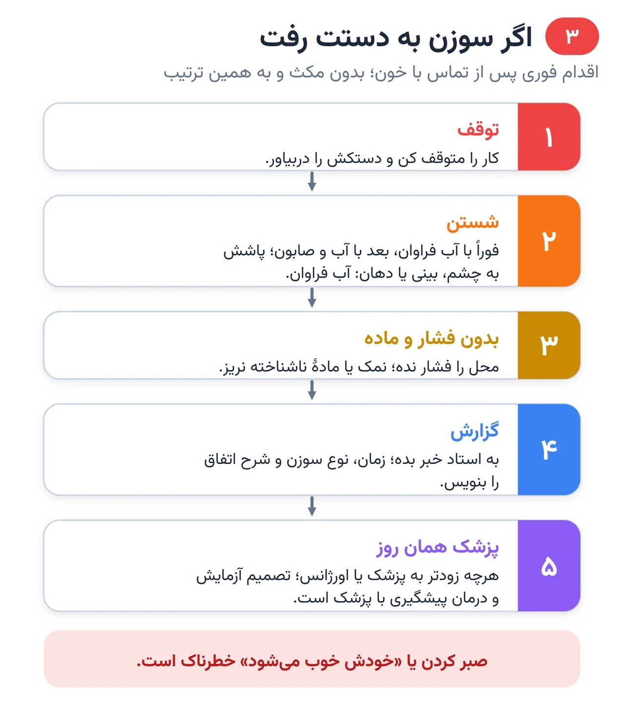
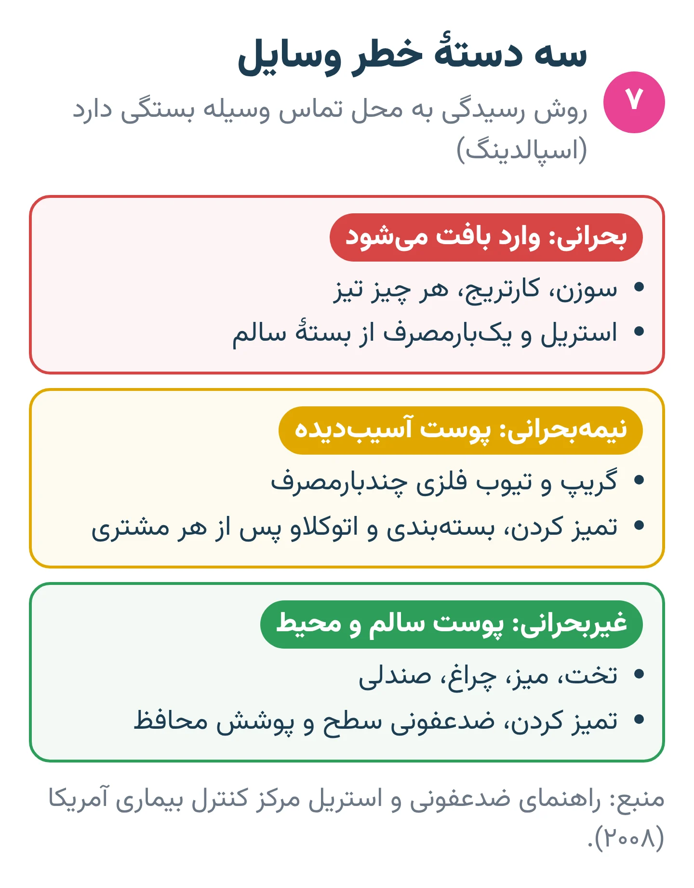
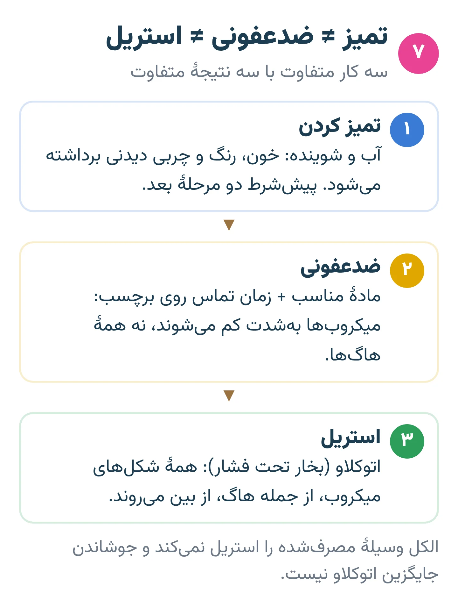
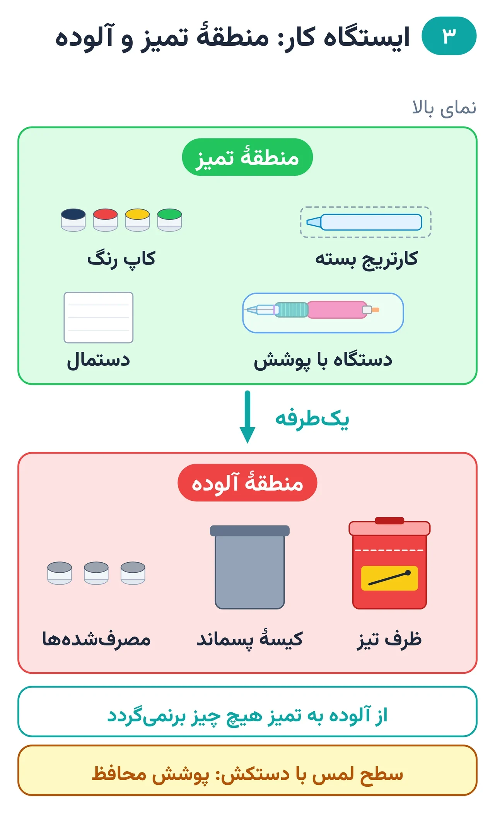
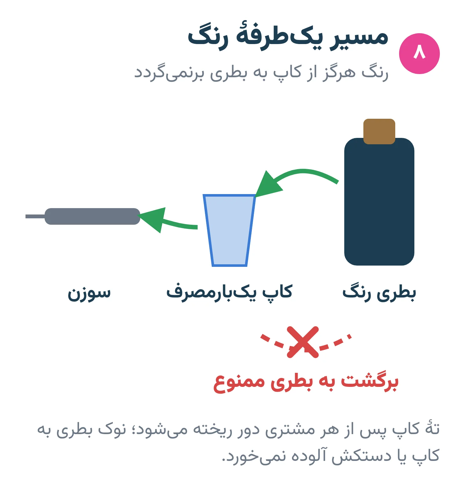

# فصل ۳ — کنترل عفونت

*بخش ۱ — پایه و ایمنی*

## درس ۶: عوامل بیماری‌زای خونی، احتیاط استاندارد و فرو رفتن سوزن

<!-- id: cur-06 -->
**سطح:** مبتدی

هپاتیت B، هپاتیت C و اچ‌آی‌وی از راه خون منتقل می‌شوند. در تاتو با خون هر فرد طوری رفتار می‌شود که انگار آلوده است؛ این «احتیاط استاندارد» است.

**در این درس یاد می‌گیری:**

- سه عامل بیماری‌زای خونی مهم و راه انتقال آن‌ها را نام ببری.
- اصول احتیاط استاندارد را در تاتو به کار ببری.
- اقدام فوری پس از فرو رفتن سوزن آلوده را به ترتیب انجام بدهی.

### خطر چیست؟

عوامل بیماری‌زای خونی میکروب‌هایی در خون انسان‌اند که بیماری ایجاد می‌کنند؛ مهم‌ترینشان ویروس هپاتیت B، هپاتیت C و اچ‌آی‌وی است. فرو رفتن سوزن یا تیغ آلوده، یا پاشیدن خون به چشم، دهان، بینی یا پوست زخمی، راه اصلی انتقال در محیط کار است.

بسیاری از ناقلان علامت ندارند یا از بیماری خود خبر ندارند. پس «مشتری سالم به نظر می‌رسد» هیچ ارزشی در تصمیم بهداشتی ندارد.

*اقدام فوری پس از تماس با خون.*

### احتیاط استاندارد در تاتو

- خون و ترشح هر مشتری را آلوده فرض کن.
- پیش از دستکش و بلافاصله پس از درآوردن آن، بهداشت دست.
- دستکش یک‌بارمصرف برای هر مشتری؛ تعویض در صورت پارگی یا لمس سطح غیرتمیز.
- سوزن و هر چیز تیز مستقیم در ظرف تیز؛ هرگز درپوش‌گذاری دوباره یا خم کردن با دست.
- پوشش محافظ روی هر سطحی که با دستکش آلوده لمس می‌شود.
- زخم یا خراش دست خودت با پوشش ضدآب بسته شود.

### اگر سوزن به دست خودت رفت

- کار را متوقف کن و دستکش را دربیاور.
- محل را فوراً با آب فراوان بشوی و با آب و صابون تمیز کن؛ اگر خون به چشم، بینی یا دهان پاشید، با آب فراوان بشوی.
- محل را فشار نده، نمک و مادهٔ ناشناخته نریز.
- به استاد خبر بده؛ زمان، نوع سوزن و شرح اتفاق را بنویس.
- همان روز و هرچه زودتر به پزشک یا اورژانس مراجعه کن. تصمیم دربارهٔ آزمایش و درمان پیشگیری با پزشک است و زمان در آن اهمیت دارد.

### واکسن هپاتیت B

واکسن هپاتیت B برای کسانی که در تماس شغلی با خون هستند توصیهٔ استاندارد است؛ در قانون کار آمریکا کارفرما باید آن را به کارکنان در معرض خطر پیشنهاد کند. برای وضعیت واکسن خود با پزشک یا مرکز بهداشت مشورت کن. واکسن جای دستکش، ظرف تیز و استریل را نمی‌گیرد.

> **هشدار**
>
> - پس از تماس با خون، صبر کردن یا «خودش خوب می‌شود» خطرناک است؛ مراجعهٔ پزشکی فوری لازم است.

**نکته‌های کلیدی:**

- خون همه را آلوده فرض کن.
- تیز مستقیم به ظرف تیز؛ بدون درپوش‌گذاری.
- فرو رفتن سوزن: شستن ← گزارش ← پزشک همان روز.

### تمرین

**هدف:** اقدام‌های پس از تماس با خون را بدون مکث اجرا کنی.

**ابزار:** کاغذ، دستکش، ظرف تیز تمرینی

۱. سناریوی «سوزن به انگشتم رفت» را با هم‌کلاسی نقش‌آفرینی کن.
۲. پنج اقدام را به ترتیب بگو و اجرا کن.
۳. فرم ثبت حادثه را پر کن.

**معیار قبولی:**

- ترتیب اقدام‌ها درست و مراجعه به پزشک جزو آن باشد.
- سوزن در هیچ مرحله درپوش‌گذاری نشود.

**واژه‌ها:** احتیاط استاندارد (Standard precautions)، ظرف تیز (سیفتی‌باکس) (Sharps container)، پوشش محافظ (Barrier film)

**مرتبط:** درس ۷، درس ۸

**منابع:**

- OSHA (U.S. Department of Labor)، «Bloodborne Pathogens and Needlestick Prevention» — <https://www.osha.gov/bloodborne-pathogens>
- OSHA، «Standard 29 CFR 1910.1030 — Bloodborne pathogens» — <https://www.osha.gov/laws-regs/regulations/standardnumber/1910/1910.1030>
- World Health Organization، «Hepatitis B — fact sheet» — <https://www.who.int/news-room/fact-sheets/detail/hepatitis-b>
- CDC، «Clinical Safety: Hand Hygiene for Healthcare Workers» — <https://www.cdc.gov/clean-hands/hcp/clinical-safety/index.html>
- CEN / BSI، «EN 17169:2020 Tattooing — Safe and hygienic practice» — <https://knowledge.bsigroup.com/products/tattooing-safe-and-hygienic-practice>

---

## درس ۷: تمیز کردن، ضدعفونی و استریل

<!-- id: cur-07 -->
**سطح:** مبتدی

تمیز کردن، ضدعفونی و استریل سه کار متفاوت‌اند. نوع رسیدگی به هر وسیله به خطر آن بستگی دارد: آنچه پوست را سوراخ می‌کند یا استریل و یک‌بارمصرف است، یا باید استریل شود.

**در این درس یاد می‌گیری:**

- سه مفهوم تمیز کردن، ضدعفونی و استریل را دقیق تعریف کنی.
- وسایل استودیو را بر اساس خطر دسته‌بندی کنی.
- پایش اتوکلاو و معنای آزمون اسپور را توضیح بدهی.

### سه کار متفاوت

الکل وسیلهٔ مصرف‌شده را استریل نمی‌کند و جوشاندن جایگزین اتوکلاو نیست.

- تمیز کردن: برداشتن خون، رنگ، چربی و آلودگی قابل‌دیدن با آب و شوینده. بدون تمیز کردن، ضدعفونی و استریل هم کامل اثر نمی‌کنند.
- ضدعفونی: کاهش شدید میکروب‌ها روی سطح یا وسیله با مادهٔ مناسب و زمان تماس درج‌شده روی برچسب. هاگ را به‌طور کامل از بین نمی‌برد.
- استریل کردن: از بین بردن همهٔ شکل‌های میکروب، از جمله هاگ. برای وسیلهٔ فلزی مقاوم به حرارت، روش رایج بخار تحت فشار (اتوکلاو) است.

*روش رسیدگی به خطر وسیله بستگی دارد.*

### دسته‌بندی بر اساس خطر (روش اسپالدینگ)

مرکز کنترل بیماری آمریکا برای انتخاب روش، وسایل را در سه دسته می‌گذارد. در تاتو می‌توان آن را چنین به کار برد:

- بحرانی (وارد بافت می‌شود): سوزن، کارتریج و هر چیز تیز ⇐ استریل و یک‌بارمصرف از بستهٔ سالم.
- نیمه‌بحرانی (تماس با پوست آسیب‌دیده): گریپ و تیوب فلزی چندبارمصرف ⇐ تمیز کردن، بسته‌بندی و اتوکلاو پس از هر مشتری؛ یا نوع یک‌بارمصرف.
- غیربحرانی (تماس با پوست سالم یا محیط): تخت، میز، چراغ، صندلی ⇐ تمیز کردن و ضدعفونی سطح، به‌علاوهٔ پوشش محافظ.

*سه کار متفاوت با سه نتیجهٔ متفاوت.*

### اتوکلاو و پایش آن

- وسیله پیش از اتوکلاو کاملاً تمیز و خشک و در بستهٔ مخصوص استریل گذاشته می‌شود.
- چرخه طبق دفترچهٔ همان دستگاه انتخاب می‌شود.
- پایش سه‌گانه: مکانیکی (زمان، دما، فشار هر چرخه)، شیمیایی (نشانگر روی بسته فقط می‌گوید بسته در معرض حرارت بوده) و زیستی (آزمون اسپور).
- مرکز کنترل بیماری آمریکا پایش اتوکلاو با نشانگر زیستی را دست‌کم هفته‌ای یک بار توصیه می‌کند؛ اگر آزمون مثبت شد، دستگاه از کار خارج و طبق دستور بررسی می‌شود.
- تاریخ و شمارهٔ چرخه روی بسته و در دفتر ثبت می‌شود.

### ضدعفونی سطح

- اول تمیز کن، بعد ضدعفونی کن.
- محصول مناسب سطح و زمان تماس روی برچسب را رعایت کن؛ زودتر خشک کردن یعنی ضدعفونی ناقص.
- ظرف شوینده یا محلول را روی ته‌ماندهٔ قبلی پر نکن.

> **هشدار**
>
> - سوزن و کارتریج مصرف‌شده هرگز دوباره استریل و استفاده نمی‌شود.
> - دستور مرجع بهداشت محل کار تو بر این متن مقدم است.

**نکته‌های کلیدی:**

- تمیز کردن ≠ ضدعفونی ≠ استریل.
- هر چه پوست را سوراخ می‌کند: استریل و یک‌بارمصرف.
- نشانگر روی بسته کافی نیست؛ آزمون اسپور دوره‌ای لازم است.

### تمرین

**هدف:** وسایل استودیو را درست دسته‌بندی کنی.

**ابزار:** فهرست ۱۵ وسیلهٔ استودیو

۱. هر وسیله را در یکی از سه دستهٔ بحرانی، نیمه‌بحرانی و غیربحرانی بگذار.
۲. جلوی هر وسیله روش رسیدگی را بنویس.
۳. سه نوع پایش اتوکلاو و کار هر کدام را توضیح بده.

**معیار قبولی:**

- هیچ وسیلهٔ بحرانی با «ضدعفونی» رسیدگی نشده باشد.

**واژه‌ها:** تمیز کردن (Cleaning)، ضدعفونی (Disinfection)، استریل کردن (Sterilization)، اتوکلاو (Autoclave)، آزمون اسپور (Biological indicator / spore test)

**مرتبط:** درس ۶، درس ۸، درس ۳۸

**منابع:**

- CDC، «A Rational Approach to Disinfection and Sterilization (Spaulding classification), Guideline for Disinfection and Sterilization in Healthcare Facilities 2008» — <https://www.cdc.gov/infection-control/hcp/disinfection-sterilization/rational-approach.html>
- CDC، «Sterilizing Practices — monitoring with mechanical, chemical and biological indicators» — <https://www.cdc.gov/infection-control/hcp/disinfection-sterilization/sterilizing-practices.html>
- CDC، «Steam Sterilization» — <https://www.cdc.gov/infection-control/hcp/disinfection-sterilization/steam-sterilization.html>
- CEN / BSI، «EN 17169:2020 Tattooing — Safe and hygienic practice» — <https://knowledge.bsigroup.com/products/tattooing-safe-and-hygienic-practice>

---

## درس ۸: ایستگاه کار، دستکش و جلوگیری از آلودگی متقاطع

<!-- id: cur-08 -->
**سطح:** مبتدی

چیدمان درست ایستگاه کار مسیر آلودگی را قطع می‌کند: منطقهٔ تمیز و آلوده جدا، همه‌چیز پیش از پوشیدن دستکش آماده، و هر سطحی که با دستکش لمس می‌شود پوشیده.

**در این درس یاد می‌گیری:**

- ایستگاه کار را با منطقهٔ تمیز و آلودهٔ مشخص بچینی.
- زمان‌های تعویض دستکش و بهداشت دست را بدانی.
- راه‌های رایج آلودگی متقاطع را شناسایی و حذف کنی.

### ترتیب چیدمان

- سطح میز و تخت را تمیز و ضدعفونی کن.
- دست را بشوی و دستکش بپوش.
- پوشش محافظ روی دستگاه، سیم کلیپ، منبع تغذیه، بطری‌ها و چراغ.
- همهٔ وسایل لازم را از قبل بچین: کاپ‌ها، رنگ، کارتریج‌های بسته، دستمال، وازلین یا مادهٔ لغزنده در ظرف کوچک یک‌بارمصرف.
- رنگ از بطری به کاپ ریخته می‌شود؛ سر بطری به کاپ و دستکش آلوده نمی‌خورد و هیچ رنگی به بطری برنمی‌گردد.

*مسیر وسایل یک‌طرفه است: از تمیز به آلوده.*

### منطقهٔ تمیز و آلوده

میز را به دو منطقه تقسیم کن: منطقهٔ تمیز برای وسایل باز نشده و منطقهٔ آلوده برای وسایل مصرف‌شده. هیچ چیزی از منطقهٔ آلوده به تمیز برنمی‌گردد. ظرف تیز در دسترس دست کار و نزدیک ایستگاه است.

*رنگ هرگز از کاپ به بطری برنمی‌گردد.*

### دستکش و دست

- دستکش جای شستن دست را نمی‌گیرد: پیش از پوشیدن و پس از درآوردن، بهداشت دست.
- تعویض دستکش: پارگی، لمس تلفن، صورت، مو، بطری بدون پوشش، دستگیره یا هر سطح بدون پوشش؛ و پیش از رفتن از کار آلوده به کار تمیز.
- ناخن کوتاه؛ انگشتر و دستبند هنگام کار درآورده شود.
- دستکش نیتریل گزینهٔ رایج است؛ حساسیت به لاتکس را در مشتری و خودت بپرس.

### آماده‌سازی پوست مشتری

- اصلاح مو با تیغ یک‌بارمصرف، آرام و بدون خراش.
- پاک کردن پوست با مادهٔ ضدعفونی پوستِ مناسب، روی گاز تمیز و نه مستقیم از سر بطری روی پوست.
- اگر پوست حین کار با سطح آلوده تماس پیدا کرد، دستکش عوض و ناحیه دوباره تمیز شود.

### جمع‌آوری پس از کار

- تیزها اول و مستقیم به ظرف تیز.
- کاپ‌ها، دستمال‌ها و پوشش‌ها در کیسهٔ پسماند طبق قاعدهٔ محلی.
- دستکش آلوده را درآور، دست را بشوی، دستکش تمیز بپوش و سطح‌ها را تمیز و ضدعفونی کن.

> **هشدار**
>
> - خوردن، آشامیدن و سیگار در محدودهٔ کار ممنوع است.
> - ظرف تیز را بیش از خط پر شدن پر نکن و با دست فشار نده.

**نکته‌های کلیدی:**

- همه‌چیز پیش از شروع آماده؛ وسط کار دنبال وسیله نگرد.
- رنگ از کاپ به بطری برنمی‌گردد.
- دستکشی که به چیز بدون پوشش خورد دیگر تمیز نیست.

### تمرین

**هدف:** یک ایستگاه کار کامل را بچینی و جمع کنی.

**ابزار:** میز، پوشش محافظ، دستکش، کاپ، کارتریج بسته، ظرف تیز

۱. ایستگاه را با منطقهٔ تمیز و آلودهٔ مشخص بچین.
۲. استاد در میانهٔ تمرین سه «اتفاق» ایجاد می‌کند (مثلاً زنگ تلفن)؛ واکنش درست را انجام بده.
۳. جمع‌آوری را به ترتیب انجام بده.

**معیار قبولی:**

- هیچ آلودگی متقاطعی دیده نشود.
- ترتیب جمع‌آوری درست باشد.

**واژه‌ها:** آلودگی متقاطع (Cross-contamination)، پوشش محافظ (Barrier film)، ظرف تیز (سیفتی‌باکس) (Sharps container)، احتیاط استاندارد (Standard precautions)

**مرتبط:** درس ۶، درس ۷، درس ۲۰

**منابع:**

- CDC، «Clinical Safety: Hand Hygiene for Healthcare Workers» — <https://www.cdc.gov/clean-hands/hcp/clinical-safety/index.html>
- World Health Organization، «WHO Guidelines on Hand Hygiene in Health Care (2009)» — <https://www.who.int/publications/i/item/9789241597906>
- CEN / BSI، «EN 17169:2020 Tattooing — Safe and hygienic practice» — <https://knowledge.bsigroup.com/products/tattooing-safe-and-hygienic-practice>
- OSHA، «Standard 29 CFR 1910.1030 — Bloodborne pathogens» — <https://www.osha.gov/laws-regs/regulations/standardnumber/1910/1910.1030>

---
