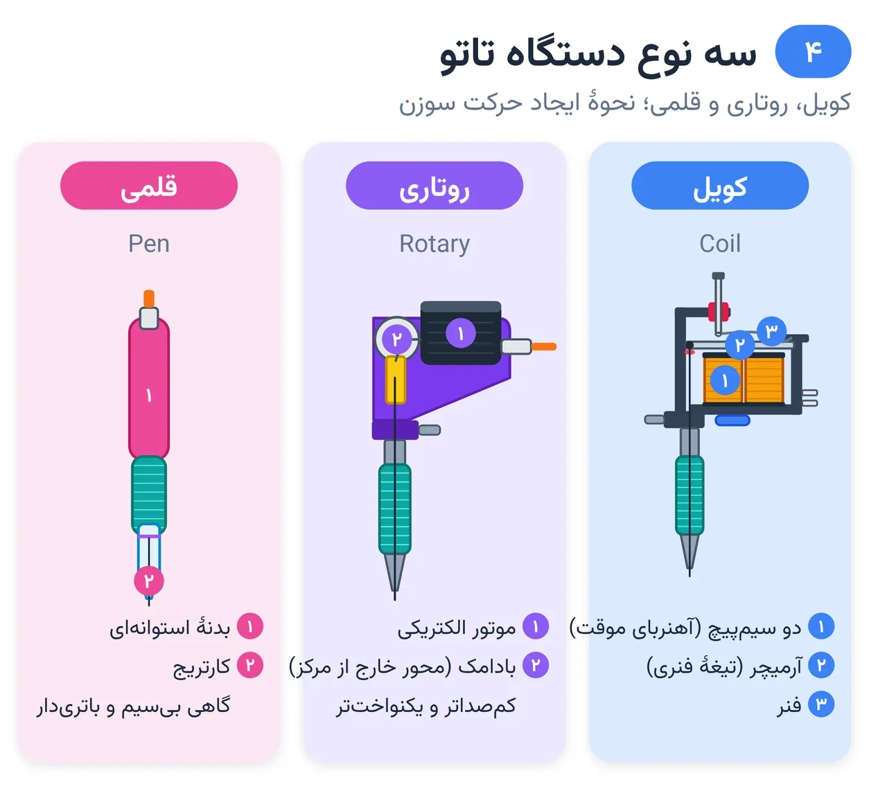
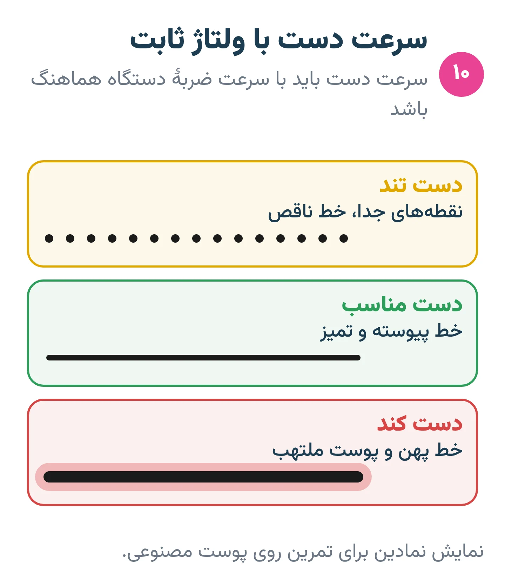

# فصل ۴ — دستگاه تاتو

*بخش ۲ — ابزار و مواد*

## درس ۹: دستگاه تاتو: کویل، روتاری، قلمی و منبع تغذیه

<!-- id: cur-09 -->
**سطح:** مبتدی

سه خانوادهٔ اصلی دستگاه تاتو با سازوکار متفاوت سوزن را بالا و پایین می‌برند. شناخت سازوکار، رفتار هر دستگاه را روی پوست قابل پیش‌بینی می‌کند.

**در این درس یاد می‌گیری:**

- سازوکار دستگاه کویل، روتاری و قلمی را توضیح بدهی.
- اجزای اصلی سامانهٔ برق (منبع تغذیه، پدال، کابل) را بشناسی.
- ایمنی برق و پوشش محافظ دستگاه را رعایت کنی.

### کویل (Coil)

دو سیم‌پیچ الکتریکی آهنربای موقت می‌سازند و یک تیغهٔ فنری (آرمیچر) را پایین می‌کشند؛ با قطع مدار فنر آن را برمی‌گرداند. صدای وزوز آشنا از همین چرخه است. کویل‌ها معمولاً برای لاینر یا شیدر تنظیم می‌شوند و تنظیم فنر و فاصلهٔ تماس مهارت جداگانه‌ای می‌خواهد.

*سه سازوکار برای یک کار: حرکت رفت‌وبرگشتی سوزن.*

### روتاری (Rotary)

یک موتور الکتریکی می‌چرخد و یک بادامک یا محور خارج از مرکز، چرخش را به حرکت رفت‌وبرگشتی تبدیل می‌کند. معمولاً سبک‌تر، کم‌صداتر و یکنواخت‌ترند و برای شروع کنترل‌پذیرتر به نظر می‌رسند.

### قلمی (Pen)

روتاری‌ای که در بدنهٔ استوانه‌ای شبیه قلم ساخته شده و با کارتریج کار می‌کند. بعضی مدل‌ها بی‌سیم و باتری‌دارند و بعضی طول ضربهٔ قابل تغییر دارند. شکل قلمی گرفتن آن را آسان می‌کند، ولی جای مهارت کشش و عمق را نمی‌گیرد.

### سامانهٔ برق و ایمنی

- منبع تغذیه ولتاژ را تنظیم می‌کند؛ پدال یا کلید دستگاه را روشن و خاموش می‌کند.
- کابل و منبع تغذیه از آب و مایع دور باشند؛ کابل فرسوده یا لخت تعویض شود.
- دستگاه، کلیپ کابل و منبع تغذیه پیش از هر مشتری با پوشش محافظ یک‌بارمصرف پوشیده شوند.
- دستگاه کسی را بدون اجازه باز یا تنظیم نکن؛ نگهداری فقط طبق دستور سازنده.

> **هشدار**
>
> - دستگاه، کابل و منبع تغذیه نباید در تماس با مایع یا دست خیس روشن شوند.

**نکته‌های کلیدی:**

- کویل: آهنربا و فنر. روتاری: موتور و بادامک. قلمی: روتاری با بدنهٔ قلم و کارتریج.
- دستگاه بهتر جای دست درست را نمی‌گیرد.
- برق و مایع از هم دور؛ همه‌چیز زیر پوشش محافظ.

### تمرین

**هدف:** سازوکار سه دستگاه را با شکل توضیح بدهی و یک دستگاه را درست بپوشانی.

**ابزار:** کاغذ، دستگاه تمرینی، پوشش محافظ

۱. شکل سادهٔ سه دستگاه را بکش و قطعهٔ ایجادکنندهٔ حرکت را علامت بزن.
۲. یک دستگاه روتاری و کابلش را کامل با پوشش محافظ بپوشان.
۳. پنج خطر برق در ایستگاه را نام ببر.

**معیار قبولی:**

- پوشش بدون درز باشد و دکمه‌ها قابل استفاده بمانند.

**واژه‌ها:** طول ضربه (Stroke)، ولتاژ (Voltage)، پوشش محافظ (Barrier film)، کارتریج (Cartridge)

**مرتبط:** درس ۱۰، درس ۱۲، درس ۳۸

**منابع:**

- CEN / BSI، «EN 17169:2020 Tattooing — Safe and hygienic practice» — <https://knowledge.bsigroup.com/products/tattooing-safe-and-hygienic-practice>
- Melbourne Tattoo Supplies، «Tattoo Needle Configuration Guide: Gauges, Tapers and Types Explained» — <https://melbournetattoosupplies.com/pages/tattoo-needle-configuration-guide-gauges-tapers-and-types-explained>

---

## درس ۱۰: ولتاژ، طول ضربه و سرعت دست

<!-- id: cur-10 -->
**سطح:** مبتدی

کیفیت خط از هماهنگی سه چیز می‌آید: سرعت ضربهٔ دستگاه (ولتاژ)، قدرت ضربه (طول ضربه) و سرعت حرکت دست. هیچ عدد ثابتی برای همهٔ کارها وجود ندارد.

**در این درس یاد می‌گیری:**

- رابطهٔ ولتاژ، طول ضربه و سرعت دست را توضیح بدهی.
- علت خط نقطه‌نقطه، خط کم‌رنگ و پوست جویده‌شده را تشخیص بدهی.
- تنظیم را روی پوست مصنوعی، با یک متغیر در هر بار، انجام بدهی.

### سه متغیر

- ولتاژ: در روتاری عمدتاً سرعت چرخش و تعداد ضربه در ثانیه را تغییر می‌دهد.
- طول ضربه: مسافت رفت‌وبرگشت سوزن. ضربهٔ کوتاه نرم‌تر و برای سایهٔ ملایم، ضربهٔ بلندتر قوی‌تر و برای خط و اشباع رایج‌تر است.
- سرعت دست: مسافتی که دست در هر ثانیه روی پوست طی می‌کند.

*سرعت دست باید با سرعت ضربهٔ دستگاه هماهنگ باشد.*

### خواندن نتیجه

- خط نقطه‌نقطه یا بریده: دست برای سرعت دستگاه زیادی تند است.
- پوست جویده، ورم‌کرده یا خط پهن و تار: دست زیادی کند است یا چند بار روی یک خط رفته‌ای.
- رنگ ننشسته با وجود سرعت درست: اول کشش پوست و عمق را بررسی کن، بعد ولتاژ.

### روش تنظیم

عدد ولتاژ مناسب به دستگاه، طول ضربه، سوزن، تیپر و پوست بستگی دارد. نقطهٔ شروع، دفترچهٔ سازندهٔ همان دستگاه است. روی پوست مصنوعی هر بار فقط یک متغیر را تغییر بده و نتیجه را در برگهٔ تمرین ثبت کن. تنظیم نهایی روی مشتری با استاد است.

> **هشدار**
>
> - بالا بردن ولتاژ یا فشار دست برای جبران پوست شل یا سوزن نامناسب، پوست را آسیب می‌زند.

**نکته‌های کلیدی:**

- ولتاژ = سرعت؛ طول ضربه = قدرت؛ دست = مسافت در زمان.
- اول کشش و عمق، بعد سرعت دست، آخر ولتاژ.
- هر بار فقط یک متغیر را تغییر بده.

### تمرین

**هدف:** اثر سرعت دست را با ولتاژ ثابت ببینی.

**ابزار:** پوست مصنوعی، لاینر ۷ یا ۹، رنگ مشکی

۱. با ولتاژ ثابت سه خط ۵ سانتی بزن: یکی تند، یکی متوسط، یکی کند.
۲. سپس با سرعت دست ثابت، ولتاژ را دو پله تغییر بده و دو خط دیگر بزن.
۳. نتیجه‌ها را عکس بگیر و توضیح بده.

**معیار قبولی:**

- بتوانی خط پیوسته، نقطه‌نقطه و جویده را از هم تشخیص بدهی و علت هر کدام را بگویی.

**واژه‌ها:** ولتاژ (Voltage)، طول ضربه (Stroke)

**مرتبط:** درس ۹، درس ۲۳، درس ۲۵

**منابع:**

- Melbourne Tattoo Supplies، «Tattoo Needle Configuration Guide: Gauges, Tapers and Types Explained» — <https://melbournetattoosupplies.com/pages/tattoo-needle-configuration-guide-gauges-tapers-and-types-explained>
- استودیو پیمان زیبائی‌فر، «روش و قانون کارگاهی همین استودیو (تجربهٔ استاد؛ منبع بیرونی ندارد)»

---
