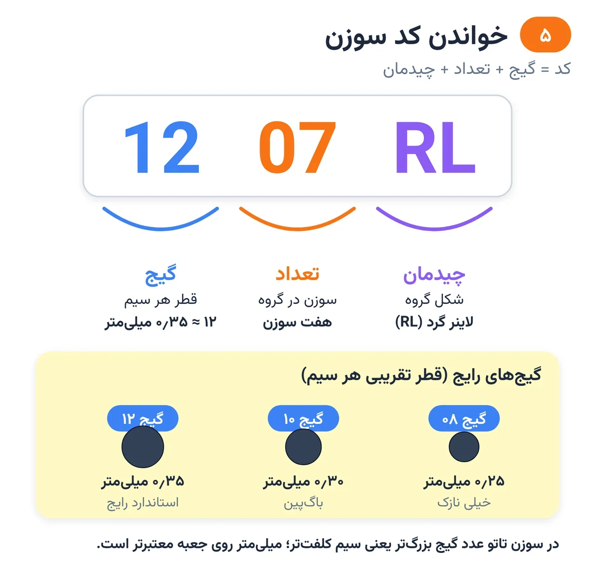
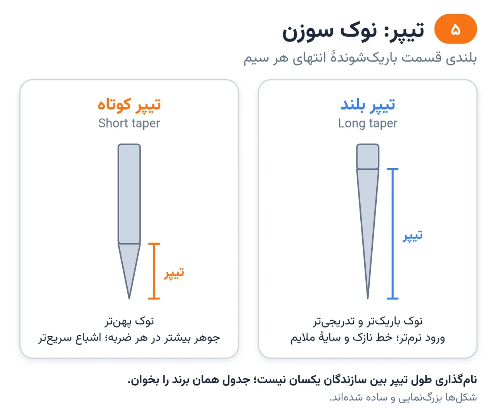
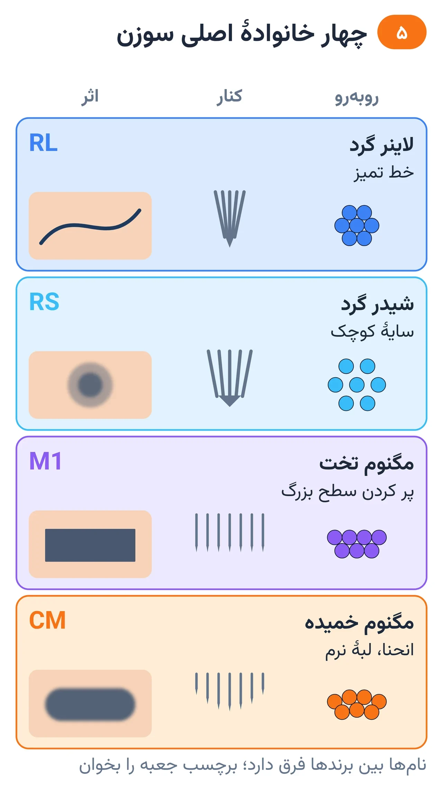

# فصل ۵ — سوزن و کارتریج

*بخش ۲ — ابزار و مواد*

## درس ۱۱: کد سوزن، گیج و تیپر

<!-- id: cur-11 -->
**سطح:** مبتدی

روی جعبهٔ سوزن یک کد کوتاه است که گیج، تعداد سوزن و نوع چیدمان را می‌گوید. گیج قطر هر سیم است و تیپر بلندی نوک تیز آن.

**در این درس یاد می‌گیری:**

- کدهایی مثل 1205RL و 1207CM را درست بخوانی.
- گیج‌های رایج و قطر تقریبی هر کدام را بدانی.
- اثر تیپر بلند و کوتاه را توضیح بدهی.

### خواندن کد

- مثال 1205RL: دو رقم اول گیج (۱۲)، دو رقم بعد تعداد سوزن (۵)، حروف چیدمان (RL = لاینر گرد).
- 1207CM: گیج ۱۲، هفت سوزن، مگنوم خمیده.
- 1003RL: گیج ۱۰، سه سوزن، لاینر گرد.
- بعضی سازندگان کد را کمی متفاوت می‌نویسند؛ اگر میلی‌متر روی جعبه درج شده، همان معتبرتر است.

*خواندن کد سوزن: گیج، تعداد، چیدمان.*

### گیج (قطر سیم)

گیج یعنی قطر هر سیم، نه تعداد سوزن‌ها. در سوزن تاتو عدد بزرگ‌تر یعنی سیم کلفت‌تر؛ این را با گیج سیم برق قاطی نکن.

- گیج ۰۸ ≈ ۰٫۲۵ میلی‌متر: خیلی نازک؛ جزئیات ریز.
- گیج ۱۰ ≈ ۰٫۳۰ میلی‌متر (در جدول بسیاری از سازندگان «باگ‌پین» نامیده می‌شود): خط ظریف و سایهٔ نرم.
- گیج ۱۲ ≈ ۰٫۳۵ میلی‌متر: استاندارد رایج؛ خط خوانا و پر کردن.
- سیم نازک جوهر کمتری در هر ضربه می‌گذارد و برای جزئیات است؛ سیم کلفت زودتر پر می‌کند ولی با دست سنگین پوست را بیشتر می‌آزارد.

*تیپر بلند نوک باریک‌تر دارد.*

### تیپر (نوک سوزن)

- تیپر بلند: نوک باریک‌تر و تدریجی‌تر. طبق توضیح سازندگان برای خط نازک و سایهٔ ملایم به کار می‌رود.
- تیپر کوتاه: نوک پهن‌تر. سازندگان آن را برای رنگ‌گذاری بیشتر در هر ضربه و پر کردن سریع‌تر معرفی می‌کنند؛ این مقایسه توصیف سازندگان است و آزمون مستقل علمی برایش پیدا نشد.
- نام‌گذاری طول تیپر بین سازندگان یکسان نیست؛ جدول همان برند را بخوان.
- تیپر جای کشش و عمق درست را نمی‌گیرد.

> **هشدار**
>
> - برای تمرین خط، لاینر ۷ یا ۹ با گیج ۱۲ خواناتر از لاینر ۳ خیلی نازک است؛ لاینر خیلی نازک خطا را دیر نشان می‌دهد.

**نکته‌های کلیدی:**

- کد = گیج + تعداد + چیدمان.
- ۰۸≈۰٫۲۵، ۱۰≈۰٫۳۰، ۱۲≈۰٫۳۵ میلی‌متر.
- میلی‌متر روی جعبه از نام گیج معتبرتر است.

### تمرین

**هدف:** ده کد سوزن را بدون خطا بخوانی.

**ابزار:** ده جعبهٔ سوزن یا کارت کد

۱. هر کد را به گیج، تعداد و چیدمان تجزیه کن.
۲. برای هر کد یک کاربرد مناسب بنویس.
۳. دو سوزن با تیپر متفاوت را زیر ذره‌بین مقایسه کن.

**معیار قبولی:**

- ده از ده کد درست خوانده شود.

**واژه‌ها:** گیج (Gauge)، تیپر (Taper)، لاینر گرد (Round Liner, RL)، شیدر گرد (Round Shader, RS)، مگنوم بافته (Weaved Magnum, M1)، مگنوم خمیده (Curved Magnum, CM/RM)

**مرتبط:** درس ۱۲، درس ۲۵

**منابع:**

- Melbourne Tattoo Supplies، «Tattoo Needle Configuration Guide: Gauges, Tapers and Types Explained» — <https://melbournetattoosupplies.com/pages/tattoo-needle-configuration-guide-gauges-tapers-and-types-explained>
- Lineage Needle Co، «Tattoo Needle Size Chart & Configuration Guide» — <https://lineageneedles.com/pages/tattoo-needle-size-guide>

---

## درس ۱۲: گروه‌بندی سوزن، کارتریج و گریپ

<!-- id: cur-12 -->
**سطح:** مبتدی

چیدمان سوزن‌ها شکل اثر روی پوست را تعیین می‌کند: لاینر برای خط، شیدر گرد برای سایهٔ کوچک، مگنوم برای سطح. کارتریج و گریپ هم بخشی از سامانهٔ بهداشتی‌اند.

**در این درس یاد می‌گیری:**

- RL، RS، M1 و CM را از روی شکل و کاربرد بشناسی.
- سوزن مناسب هر بخش طرح را انتخاب کنی.
- تفاوت سیستم کارتریج و سوزن-تیوب سنتی و قواعد بهداشتی هر کدام را بدانی.

### خانواده‌های اصلی

- لاینر گرد (RL): دایرهٔ فشرده؛ خط تمیز. تعداد بیشتر = خط پهن‌تر.
- شیدر گرد (RS): دایرهٔ بازتر؛ سایهٔ کوچک، پر کردن جای تنگ، خط نرم.
- مگنوم بافته (M1): دو ردیف سوزن درهم؛ پر کردن و سایهٔ سطح بزرگ. با «فلت» (F، یک ردیف سوزن صاف) اشتباه نشود.
- مگنوم خمیده (CM یا RM): لبهٔ قوسی؛ تماس یکنواخت‌تر روی انحنا و لبهٔ سایهٔ نرم‌تر.
- انواع دیگر (مثل لاینر تخت یا سوزن‌های بافت‌دار) کاربرد خاص دارند و پس از تسلط بر این چهار خانواده بررسی می‌شوند.

*چهار خانوادهٔ اصلی سوزن و کاربردشان.*

### انتخاب سوزن

- اندازهٔ سوزن متناسب با اندازهٔ بخش طرح: مگنوم بزرگ در فضای تنگ لبه را کثیف می‌کند.
- طرح کوچک با سوزن خیلی پهن خوانایی ندارد.
- طبق توضیح سازندگان، لبهٔ نرم مگنوم خمیده در سایه کمتر از لبهٔ مگنوم صاف ردّ تیز به جا می‌گذارد.

### کارتریج و گریپ

- کارتریج: سوزن و بدنهٔ یک‌بارمصرف؛ بسیاری غشای جلوگیری از برگشت مایع دارند. کارتریج برای یک مشتری است و پس از مصرف در ظرف تیز می‌رود.
- سوزن و تیوب سنتی: سوزن یک‌بارمصرف است؛ تیوب و گریپ یا یک‌بارمصرف‌اند یا فلزی که پس از هر مشتری تمیز، بسته‌بندی و اتوکلاو می‌شود.
- بستهٔ آسیب‌دیده، خیس یا تاریخ‌گذشته استفاده نمی‌شود.
- گریپ فوم یا لاستیکی یک‌بارمصرف را برای مشتری بعد نگه ندار.

> **هشدار**
>
> - سوزن یا کارتریجی که از بسته درآمد و به سطح غیرتمیز یا زمین خورد، دور انداخته می‌شود.

**نکته‌های کلیدی:**

- RL خط، RS سایهٔ کوچک، M1 سطح، CM سطح روی انحنا.
- اندازهٔ سوزن با اندازهٔ بخش طرح هماهنگ.
- کارتریج یک مشتری، یک بار.

### تمرین

**هدف:** با چهار خانوادهٔ سوزن چهار نمونهٔ اثر روی پوست مصنوعی بسازی.

**ابزار:** پوست مصنوعی، کارتریج RL، RS، M1 و CM

۱. با هر سوزن یک مربع ۳×۳ سانتی کار کن (خط دور با RL، داخل با بقیه).
۲. لبهٔ سایهٔ M1 و CM را مقایسه کن.
۳. جدول انتخاب سوزن برای یک طرح گل را بنویس.

**معیار قبولی:**

- تفاوت لبهٔ M1 و CM در عکس دیده و توضیح داده شود.

**واژه‌ها:** لاینر گرد (Round Liner, RL)، شیدر گرد (Round Shader, RS)، مگنوم بافته (Weaved Magnum, M1)، مگنوم خمیده (Curved Magnum, CM/RM)، کارتریج (Cartridge)

**مرتبط:** درس ۱۱، درس ۲۶، درس ۲۷

**منابع:**

- Melbourne Tattoo Supplies، «Tattoo Needle Configuration Guide: Gauges, Tapers and Types Explained» — <https://melbournetattoosupplies.com/pages/tattoo-needle-configuration-guide-gauges-tapers-and-types-explained>
- Lineage Needle Co، «Tattoo Needle Size Chart & Configuration Guide» — <https://lineageneedles.com/pages/tattoo-needle-size-guide>
- CEN / BSI، «EN 17169:2020 Tattooing — Safe and hygienic practice» — <https://knowledge.bsigroup.com/products/tattooing-safe-and-hygienic-practice>

---
