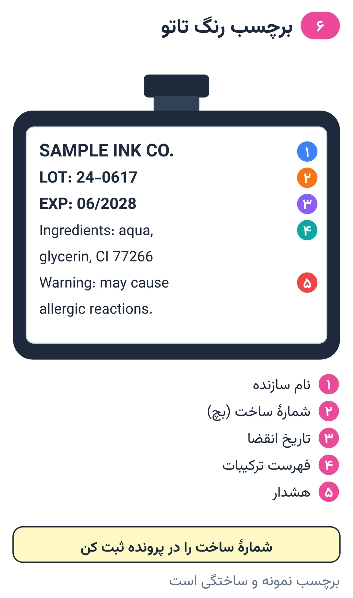
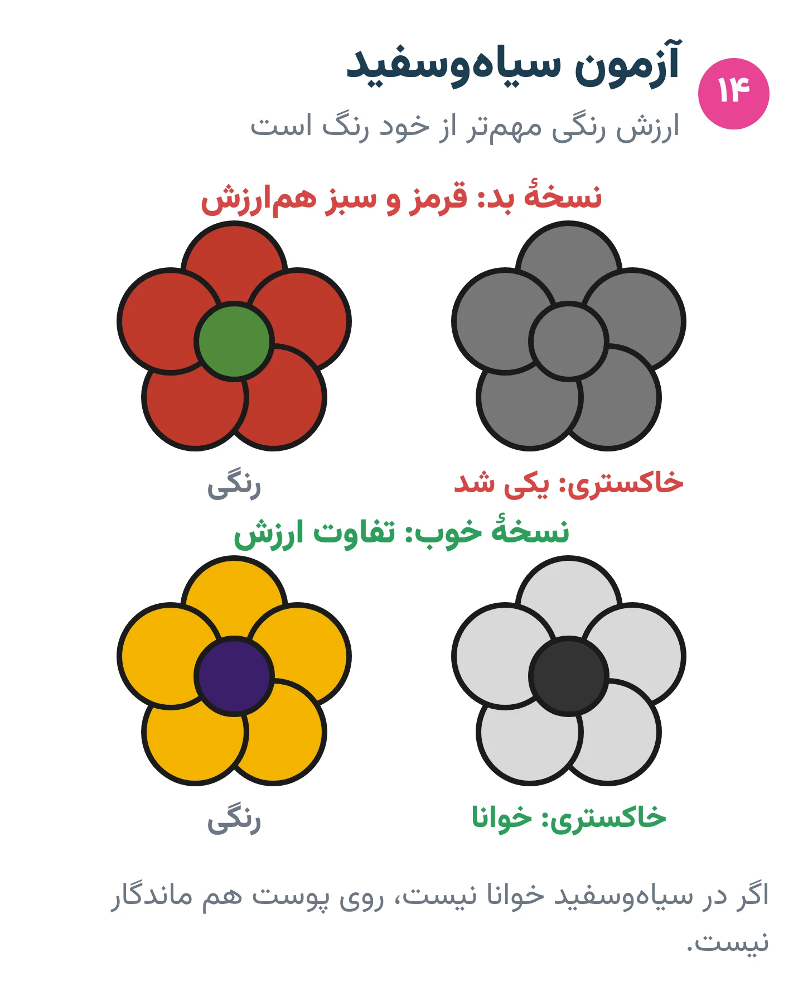

# فصل ۶ — رنگ تاتو

*بخش ۲ — ابزار و مواد*

## درس ۱۳: رنگ تاتو: ترکیب، ایمنی و مقررات

<!-- id: cur-13 -->
**سطح:** مبتدی

رنگ تاتو مخلوطی از رنگدانهٔ نامحلول و مایع حامل است که مستقیم وارد میان‌پوست می‌شود. انتخاب رنگ از سازندهٔ شفاف، نگهداری درست و مصرف بهداشتی، بخشی از ایمنی مشتری است.

**در این درس یاد می‌گیری:**

- اجزای اصلی رنگ تاتو را بشناسی.
- اطلاعات لازم روی برچسب رنگ را بخوانی.
- خطرهای آلودگی میکروبی و شیمیایی رنگ را بدانی.

### ترکیب

- رنگدانه: ذرهٔ رنگی نامحلول (آلی یا معدنی) که در میان‌پوست می‌ماند.
- مایع حامل: آب و مواد دیگر برای پخش یکنواخت رنگدانه و روان شدن آن.
- مواد کمکی: نگهدارنده، تنظیم‌کنندهٔ غلظت و مانند آن، طبق فرمول سازنده.

*پیش از خرید، این پنج مورد را روی برچسب پیدا کن.*

### مقررات در یک نگاه

در اتحادیهٔ اروپا از ۴ ژانویهٔ ۲۰۲۲ (و برای دو رنگدانهٔ آبی و سبز مشخص از ۴ ژانویهٔ ۲۰۲۳) مقررات ریچ (REACH) استفاده از مواد خطرناک مشخص‌شده در رنگ تاتو را بالاتر از حد تعیین‌شده ممنوع کرده و برچسب‌گذاری با فهرست ترکیبات و شمارهٔ ساخت را لازم دانسته است.

در آمریکا رنگ تاتو زیر نظر سازمان غذا و داروی آمریکا (FDA) در دستهٔ فراورده‌های آرایشی است و این سازمان دربارهٔ آلودگی میکروبی برخی رنگ‌ها هشدار و فراخوان داده است؛ خود کار تاتو را عموماً مقررات محلی تنظیم می‌کند.

قانون هر کشور جداست. این‌ها به‌عنوان معیار ایمنی شناخته‌شده آورده شده‌اند؛ مقررات محل کار خودت را از مرجع بهداشت محلی بپرس.

### انتخاب و نگهداری

- رنگی بخر که نام سازنده، فهرست ترکیبات، شمارهٔ ساخت (بچ) و تاریخ انقضا را درج کرده باشد.
- پلمب سالم؛ نگهداری دور از آفتاب و گرما؛ تاریخ باز کردن روی بطری.
- رقیق کردن فقط با مایع توصیه‌شدهٔ سازنده و آب استریل، نه آب لوله‌کشی.
- شمارهٔ ساخت رنگ‌های مصرفی هر مشتری در پروندهٔ او ثبت شود تا در صورت واکنش قابل پیگیری باشد.

### خطرها

- آلودگی میکروبی رنگ می‌تواند عفونت ایجاد کند، حتی با کار تمیز.
- واکنش حساسیتی، به‌ویژه به بعضی رنگ‌های قرمز، ممکن است حتی سال‌ها بعد رخ دهد.
- تاتو ممکن است در تصویربرداری MRI به‌ندرت باعث سوزش یا تورم شود؛ مشتری باید پیش از MRI تاتو را اطلاع دهد.

> **هشدار**
>
> - رنگ صنعتی، رنگ چاپ و جوهر خودکار هرگز برای تاتو استفاده نمی‌شود.
> - متن مقررات، مشاورهٔ حقوقی نیست؛ قانون محلی مقدم است.

**نکته‌های کلیدی:**

- رنگ بدون برچسب کامل و شمارهٔ ساخت نخر.
- آب لوله‌کشی برای رقیق کردن ممنوع.
- شمارهٔ ساخت رنگ هر مشتری ثبت شود.

### تمرین

**هدف:** برچسب سه رنگ را بررسی و یک رنگ را برای پرونده ثبت کنی.

**ابزار:** سه بطری رنگ، فرم پروندهٔ مشتری

۱. برای هر بطری سازنده، شمارهٔ ساخت، انقضا و ترکیبات را بنویس.
۲. یک بطری فاقد اطلاعات لازم را رد کن و دلیلش را بنویس.
۳. ثبت رنگ را در فرم نمونهٔ پرونده انجام بده.

**معیار قبولی:**

- هر سه برچسب کامل بررسی و ثبت شوند.

**واژه‌ها:** رنگدانه (Pigment)

**مرتبط:** درس ۱۴، درس ۳۱، درس ۳۸

**منابع:**

- European Chemicals Agency (ECHA)، «Tattoo inks and permanent make-up» — <https://echa.europa.eu/hot-topics/tattoo-inks>
- EUR-Lex، «Commission Regulation (EU) 2020/2081 — REACH Annex XVII entry 75 (substances in tattoo inks)» — <https://eur-lex.europa.eu/eli/reg/2020/2081/oj/eng>
- U.S. FDA، «Tattoos, Temporary Tattoos & Permanent Makeup» — <https://www.fda.gov/cosmetics/cosmetic-products/tattoos-temporary-tattoos-permanent-makeup>
- U.S. FDA، «Think Before You Ink: Tattoo Safety» — <https://www.fda.gov/consumers/consumer-updates/think-you-ink-tattoo-safety>
- American Academy of Dermatology، «Tattoos: 7 unexpected skin reactions and what to do about them» — <https://www.aad.org/public/everyday-care/skin-care-basics/tattoos/tattoo-skin-reactions>

---

## درس ۱۴: ماندگاری رنگ‌ها و رنگ‌شناسی کاربردی

<!-- id: cur-14 -->
**سطح:** متوسط

رنگ‌ها روی پوست یکسان پیر نمی‌شوند: پژوهش‌ها نشان می‌دهند آفتاب بعضی رنگدانه‌های زرد و قرمز را تجزیه می‌کند و مقدار رنگدانهٔ قرمز در پوست با گذشت سال‌ها بسیار کم می‌شود. طرح ماندگار بر کنتراست ارزش رنگی تکیه دارد، نه فقط فام.

**در این درس یاد می‌گیری:**

- رفتار رنگ‌های اصلی را در گذر زمان بدانی.
- از چرخهٔ رنگ و ارزش رنگی برای طرح ماندگار استفاده کنی.
- اثر آفتاب و رنگ پوست بر رنگ را در طرح لحاظ کنی.

### ماندگاری

- مشکی: در تجربهٔ رایج هنرمندان پایدارترین رنگ و ستون خوانایی طرح است.
- زرد و قرمز آزو (Azo): در آزمایشگاه، رنگدانهٔ زرد ۷۴ (PY74) و قرمز ۲۲ (PR22) زیر نور خورشید یا فرابنفش تجزیه شده‌اند. در نمونه‌های پوست انسان، غلظت رنگدانهٔ قرمز سال‌ها پس از تاتو حدود ۸۷ تا ۹۹ درصد کمتر از مقدار تخمینی هنگام تاتو بود (بخشی با تجزیه، بخشی با انتقال از راه لنف).
- قرمز بیشتر از رنگ‌های دیگر با واکنش حساسیتی همراه بوده است، هرچند هر رنگی ممکن است حساسیت بدهد (انجمن پوست آمریکا).
- سفید و رنگ‌های خیلی روشن: به تجربهٔ هنرمندان زودتر از بقیه دیده‌نشدنی می‌شوند؛ روش استودیو این است که فقط برای هایلایت کوچک به کار روند، نه سطح اصلی.
- انجمن پوست آمریکا: فرابنفش بعضی رنگ‌های تاتو را محو می‌کند؛ پس از ترمیم کامل، ضدآفتاب با SPF ۳۰ یا بیشتر و دوری از سولاریوم جزو مراقبت دائمی است.

*اگر در سیاه‌وسفید خوانا نیست، روی پوست هم ماندگار نیست.*

### ارزش رنگی مهم‌تر از فام

این بخش اصل طراحی و تجربهٔ هنری است، نه یافتهٔ آزمایشگاهی. دو رنگ متفاوت با ارزش رنگی (روشنی) یکسان، از فاصلهٔ چند قدمی یا پس از چند سال در هم حل می‌شوند. آزمون ساده: طرح رنگی را سیاه‌وسفید کن؛ اگر شکل‌ها هنوز از هم جدا هستند، طرح ماندگار است.

### چرخهٔ رنگ در تاتو (اصل طراحی)

- رنگ‌های مکمل (مثل قرمز و سبز) کنار هم پرانرژی‌اند ولی مخلوطشان کدر و قهوه‌ای می‌شود.
- برای سایهٔ رنگ، بیشتر از رنگ تیره‌تر هم‌خانواده استفاده کن تا مشکی خالص.
- روی پوست تیره، دامنهٔ رنگ‌های قابل دیدن کمتر است؛ کنتراست ارزشی را بیشتر کن (درس ۵).

> **هشدار**
>
> - قول «رنگ هرگز کم‌رنگ نمی‌شود» نده؛ ماندگاری به رنگ، پوست، جای بدن، آفتاب و مراقبت بستگی دارد.

**نکته‌های کلیدی:**

- آفتاب دشمن رنگ است؛ ضدآفتاب دائمی.
- آزمون سیاه‌وسفید برای هر طرح رنگی.
- سفید فقط برای هایلایت.

### تمرین

**هدف:** یک طرح رنگی را با آزمون ارزش رنگی اصلاح کنی.

**ابزار:** طرح رنگی، تلفن یا اسکنر برای سیاه‌وسفید کردن

۱. طرح رنگی را سیاه‌وسفید کن.
۲. جاهایی را که شکل‌ها در هم حل شده‌اند علامت بزن.
۳. با تغییر ارزش رنگی (نه فقط فام) اصلاح کن و دوباره آزمون بگیر.

**معیار قبولی:**

- در نسخهٔ سیاه‌وسفید نهایی همهٔ شکل‌های اصلی جدا دیده شوند.

**واژه‌ها:** ارزش رنگی (روشنی و تیرگی) (Value)، رنگدانه (Pigment)، ملانین (Melanin)

**مرتبط:** درس ۵، درس ۱۳، درس ۱۵، درس ۲۷

**منابع:**

- American Academy of Dermatology، «Caring for tattooed skin» — <https://www.aad.org/public/everyday-care/skin-care-basics/tattoos/caring-for-tattooed-skin>
- American Academy of Dermatology، «Tattoos: 7 unexpected skin reactions and what to do about them» — <https://www.aad.org/public/everyday-care/skin-care-basics/tattoos/tattoo-skin-reactions>
- U.S. FDA، «Tattoos, Temporary Tattoos & Permanent Makeup» — <https://www.fda.gov/cosmetics/cosmetic-products/tattoos-temporary-tattoos-permanent-makeup>
- Photochem Photobiol 2004 (PubMed 15362942)، «Photodecomposition of Pigment Yellow 74, a pigment used in tattoo inks» — <https://pubmed.ncbi.nlm.nih.gov/15362942/>
- J Dtsch Dermatol Ges 2007 (Engel E. et al., PubMed 17610608)، «Photochemical cleavage of a tattoo pigment by UVB radiation or natural sunlight» — <https://pubmed.ncbi.nlm.nih.gov/17610608/>
- J Eur Acad Dermatol Venereol 2011 (Lehner K. et al., PubMed 21349116)، «The decrease of pigment concentration in red tattooed skin years after tattooing» — <https://pubmed.ncbi.nlm.nih.gov/21349116/>

---
