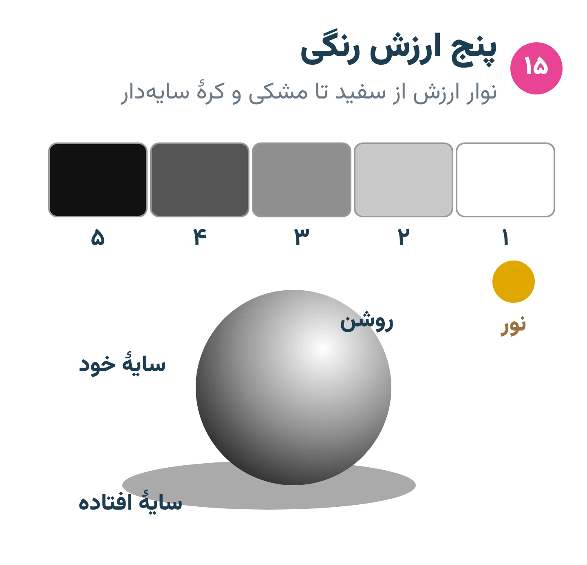
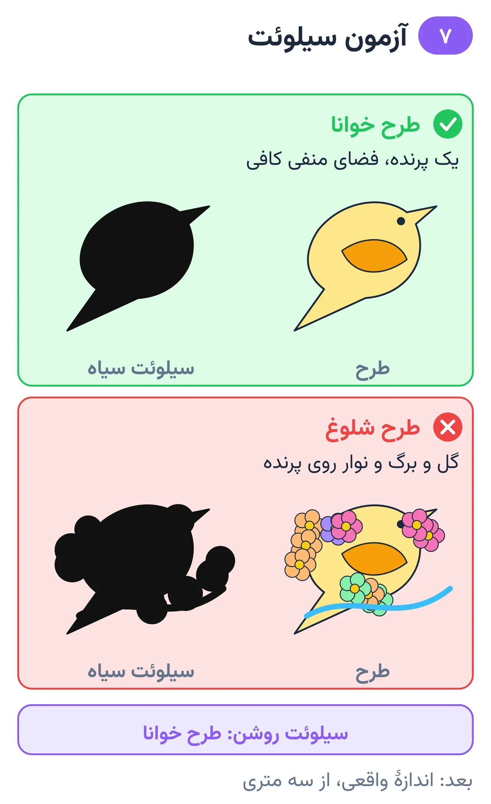
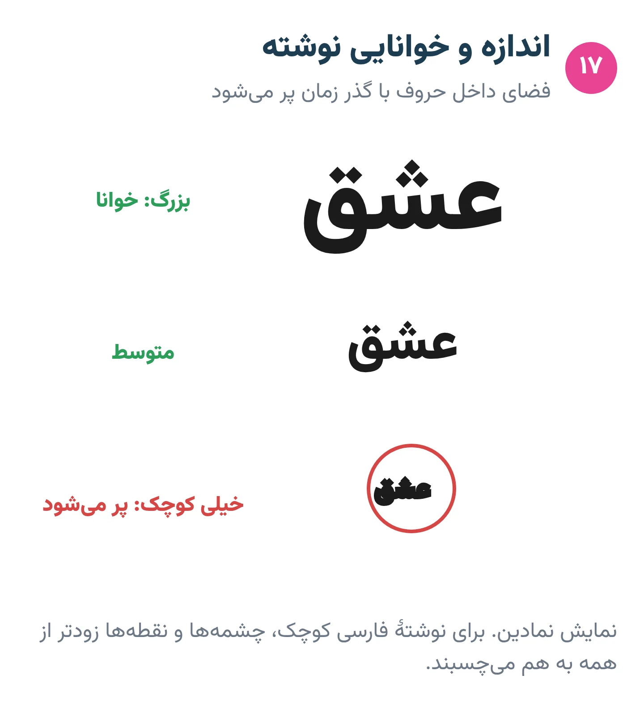
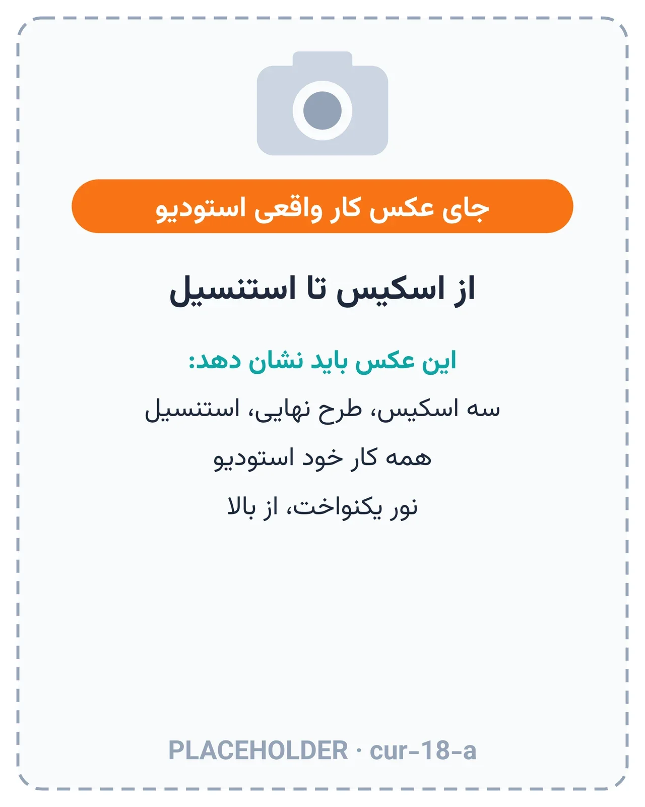

# فصل ۷ — طراحی

*بخش ۳ — طراحی و بدن*

## درس ۱۵: خط، شکل، حجم و نوار ارزش رنگی

<!-- id: cur-15 -->
**سطح:** مبتدی

طراحی تاتو پیش از سوزن روی کاغذ ساخته می‌شود. خط مطمئن، شکل ساده، حجم با نور و نوار ارزش رنگی، الفبای هر سبکی است.

**در این درس یاد می‌گیری:**

- خط پیوسته و مطمئن با یک حرکت بکشی.
- شکل‌های پیچیده را به شکل‌های پایه بشکنی.
- نوار پنج‌پله‌ای ارزش رنگی و سایهٔ کره را بسازی.

### خط

- خط را با حرکت شانه و آرنج بکش، نه فقط مچ؛ خط بلند با مچ می‌لرزد.
- یک حرکت پیوسته بهتر از چند خط کوتاه روی هم است؛ همین عادت بعداً «خط یک‌عبوره» روی پوست می‌شود.
- ضخامت خط سلسله‌مراتب می‌سازد: دور شکل اصلی ضخیم‌تر، جزئیات داخلی نازک‌تر.

*پنج ارزش رنگی، پایهٔ هر سایه‌زنی.*

### شکل و حجم

هر موضوعی از چند شکل پایه ساخته شده است: دایره، بیضی، مستطیل، مثلث، استوانه. اول شکل‌های پایه، بعد جزئیات. حجم با یک منبع نور مشخص ساخته می‌شود: سمت نور روشن، سمت مقابل تیره، سایهٔ افتاده روی زمین.

### نوار ارزش رنگی

- پنج خانه از سفید تا مشکی با فاصلهٔ برابر بساز.
- سپس همان پنج ارزش را روی یک کره پیاده کن.
- روی پوست، ارزش‌های خیلی نزدیک به هم با گذر زمان یکی می‌شوند؛ پس در طرح تاتو ارزش‌ها را واضح‌تر از طراحی کاغذی جدا کن.

**نکته‌های کلیدی:**

- حرکت از شانه، خط یک‌حرکته.
- اول شکل پایه، بعد جزئیات.
- ارزش‌های روی پوست باید واضح‌تر از کاغذ جدا شوند.

### تمرین

**هدف:** کنترل خط و ارزش رنگی را نشان بدهی.

**ابزار:** کاغذ A4، مداد نرم، ماژیک

۱. یک صفحه خط مستقیم و منحنی بلند با یک حرکت.
۲. یک صفحه دایره‌های آزاد در سه اندازه.
۳. نوار پنج‌پله‌ای و کرهٔ سایه‌دار.

**معیار قبولی:**

- پله‌های نوار ارزش فاصلهٔ برابر داشته باشند.
- خط‌ها بدون لرزش و تکه‌تکه نباشند.

**واژه‌ها:** ارزش رنگی (روشنی و تیرگی) (Value)

**مرتبط:** درس ۱۶، درس ۲۵، درس ۲۶

**منابع:**

- استودیو پیمان زیبائی‌فر، «روش و قانون کارگاهی همین استودیو (تجربهٔ استاد؛ منبع بیرونی ندارد)»

---

## درس ۱۶: ترکیب‌بندی، سیلوئت و خوانایی

<!-- id: cur-16 -->
**سطح:** مبتدی

تاتوی خوب از چند قدم و پس از سال‌ها هم خوانا است. سیلوئت روشن، یک نقطهٔ تمرکز، فضای منفی کافی و موضوع‌های درست‌ساده‌شده (گل، حیوان، دست، چهره) این خوانایی را می‌سازند.

**در این درس یاد می‌گیری:**

- نقطهٔ تمرکز و مسیر چشم را در طرح تعیین کنی.
- خوانایی طرح را با آزمون سیلوئت و فاصله بسنجی.
- موضوع‌های رایج را برای تاتو ساده کنی.

### ترکیب‌بندی

- یک نقطهٔ تمرکز اصلی؛ بقیهٔ عناصر در خدمت آن.
- تضاد اندازه: یک عنصر بزرگ، چند متوسط، چند کوچک.
- فضای منفی (پوست خالی) بخشی از طرح است و به چشم استراحت می‌دهد.

*سیلوئت روشن یعنی طرح خوانا.*

### سیلوئت و آزمون فاصله

طرح را کاملاً سیاه پر کن. اگر از سیلوئت معلوم است چیست، شکل کلی درست است. سپس طرح را در اندازهٔ واقعی چاپ کن و از سه متری نگاه کن؛ جزئیاتی که دیده نمی‌شوند یا حذف یا بزرگ شوند.

### موضوع‌های رایج

- گل: شکل کلی گلبرگ‌ها مهم‌تر از رگبرگ‌هاست؛ گلبرگ‌های روی هم با ارزش رنگی متفاوت جدا شوند.
- حیوان: ژست و سیلوئت را از مرجع بگیر؛ چشم معمولاً نقطهٔ تمرکز است.
- دست: آن را به کف (مکعب) و انگشت‌ها (استوانه‌های سه‌بندی) بشکن.
- سر و چهره: خط وسط و خط چشم‌ها را اول بکش؛ چشم‌ها تقریباً در نیمهٔ ارتفاع سر قرار دارند. اندازه‌گیری خطاهای کوچک چهره در تاتو بزرگ دیده می‌شوند.

> **هشدار**
>
> - طرح خیلی شلوغ و ریز با گذشت سال‌ها در هم می‌رود؛ این را صادقانه به مشتری بگو.

**نکته‌های کلیدی:**

- یک نقطهٔ تمرکز.
- آزمون سیلوئت و آزمون سه‌متری.
- جزئیاتی که از فاصله دیده نمی‌شوند حذف یا بزرگ شوند.

### تمرین

**هدف:** یک طرح شلوغ را خوانا کنی.

**ابزار:** کاغذ، طرح نمونهٔ شلوغ

۱. سیلوئت سیاه طرح را بکش.
۲. نقطهٔ تمرکز را علامت بزن و عناصر مزاحم را حذف کن.
۳. نسخهٔ نهایی را در اندازهٔ واقعی از سه متری بررسی کن.

**معیار قبولی:**

- طرح نهایی از سه متری قابل تشخیص باشد.

**واژه‌ها:** ارزش رنگی (روشنی و تیرگی) (Value)

**مرتبط:** درس ۱۵، درس ۱۹، درس ۳۵

**منابع:**

- استودیو پیمان زیبائی‌فر، «روش و قانون کارگاهی همین استودیو (تجربهٔ استاد؛ منبع بیرونی ندارد)»

---

## درس ۱۷: نوشته، لترینگ و خوشنویسی فارسی

<!-- id: cur-17 -->
**سطح:** متوسط

نوشته تاتوی پرخطاتری از تصویر است: یک حرف اشتباه یا فاصلهٔ غلط به‌وضوح دیده می‌شود. املا، خوانایی در اندازهٔ واقعی و یکنواختی خط مهم‌تر از ظرافت است.

**در این درس یاد می‌گیری:**

- متن را پیش از استنسیل از نظر املا و معنا با مشتری تأیید کنی.
- حداقل اندازهٔ خوانای نوشته را با آزمون چاپ بسنجی.
- اصول خوشنویسی فارسی و عربی را در طرح تاتو رعایت کنی.

### تأیید متن

- متن را مشتری کتبی بفرستد و پس از طراحی، نسخهٔ نهایی را با امضا تأیید کند.
- متن به زبانی که نمی‌دانی را بدون تأیید یک فرد مسلط به آن زبان اجرا نکن.
- اعراب، نقطه‌ها و سرکش‌ها را حرف‌به‌حرف بررسی کن.

*در اندازهٔ کوچک، فضای داخل حروف با گذر زمان پر می‌شود.*

### خوانایی

- فاصلهٔ داخل حروف (مثل چشمهٔ «ه» و «م») با گذر زمان پر می‌شود؛ نوشتهٔ خیلی کوچک یکی می‌شود.
- یکنواختی ضخامت و فاصلهٔ حروف از نازکی خط مهم‌تر است.
- نوشته را در اندازهٔ واقعی چاپ کن و از فاصلهٔ معمول دیدن بخوان.

### خوشنویسی فارسی و عربی

- قلم (نستعلیق، شکسته، ثلث، کوفی و…) را با مشتری مشخص کن؛ ترکیب قلم‌ها بدون آگاهی خطاست.
- اتصال حروف و کشیدگی‌ها قاعده دارند؛ از نمونه‌های خوشنویسان معتبر الهام بگیر و برای طرح خاص از خوشنویس کمک بگیر.
- روی بدن، خط کرسی (خط پایهٔ نوشته) را با جریان بدن تنظیم کن.

> **هشدار**
>
> - کپی نوشتهٔ خوشنویسی یک هنرمند بدون اجازه، نقض حق اثر است (درس ۱۸).

**نکته‌های کلیدی:**

- تأیید کتبی متن.
- آزمون چاپ در اندازهٔ واقعی.
- یکنواختی مهم‌تر از نازکی.

### تمرین

**هدف:** یک کلمهٔ فارسی را برای تاتو آماده کنی.

**ابزار:** کاغذ، قلم یا نرم‌افزار طراحی

۱. کلمه را در دو قلم متفاوت بنویس.
۲. هر دو را در سه اندازه چاپ و خوانایی را بسنج.
۳. فرم تأیید متن را با هم‌کلاسی به‌عنوان مشتری پر کن.

**معیار قبولی:**

- کوچک‌ترین اندازهٔ خوانا مشخص و ثبت شده باشد.

**واژه‌ها:** استنسیل (Stencil)

**مرتبط:** درس ۱۸، درس ۲۰، درس ۲۵

**منابع:**

- Complex (2011)، «The Complex Guide To Tattoo Lettering» — <https://www.complex.com/style/a/nick-schonberger/the-complex-guide-to-tattoo-lettering>
- استودیو پیمان زیبائی‌فر، «روش و قانون کارگاهی همین استودیو (تجربهٔ استاد؛ منبع بیرونی ندارد)»
- WIPO، «Understanding Copyright and Related Rights» — <https://www.wipo.int/publications/en/details.jsp?id=4081>

---

## درس ۱۸: مرجع، حق اثر و طرح اختصاصی

<!-- id: cur-18 -->
**سطح:** متوسط

مرجع برای فهمیدن شکل و نور است، نه برای کپی. طرح اختصاصی از ترکیب چند مرجع، طراحی خودت و نیاز مشتری ساخته می‌شود و حق صاحب اثر را محترم می‌شمارد.

**در این درس یاد می‌گیری:**

- از عکس مرجع درست استفاده کنی: نور، نسبت و جزئیات.
- تفاوت الهام گرفتن و کپی کردن را بدانی.
- فرایند ساخت طرح اختصاصی و فلش را اجرا کنی.

### خواندن عکس مرجع

- عکس با کیفیت و نور مشخص انتخاب کن؛ عکس تار جزئیات ساختگی می‌سازد.
- جهت نور، ارزش‌های اصلی و نسبت‌ها را از عکس بخوان.
- برای پرتره، عکس با وضوح کافی از چشم‌ها ضروری است (درس ۳۵).

*از اسکیس تا استنسیل: طرح اختصاصی همین استودیو.* — جای عکس واقعی استودیو

### حق اثر

طرح، نقاشی، عکس و خوشنویسی آثار خلاقه‌اند و معمولاً صاحب حق دارند. کپی کامل کار هنرمند دیگر، حتی اگر مشتری بخواهد، با اخلاق حرفه‌ای و در بسیاری از کشورها با قانون حق اثر در تضاد است. قانون هر کشور متفاوت است؛ اصل حرفه‌ای این است: یا اجازه بگیر، یا طرح تازه بساز.

- الهام: گرفتن ایده، سبک یا موضوع و ساختن ترکیب تازه.
- کپی: بازتولید همان اثر با تغییر جزئی.
- تاتوی خاص یک فرد دیگر را کپی نکن؛ آن تاتو بخشی از هویت اوست.

### طرح اختصاصی و فلش

- طرح اختصاصی: گفت‌وگو ← چند اسکیس کوچک ← انتخاب ← طرح نهایی ← تأیید.
- فلش: طرح آمادهٔ استودیو که چند بار اجرا می‌شود؛ باید کار خود استودیو باشد.
- پیش‌نویس‌ها و منابع را در پروندهٔ طرح نگه دار.

> **هشدار**
>
> - این درس مشاورهٔ حقوقی نیست؛ برای مورد خاص با متخصص حقوقی مشورت کن.

**نکته‌های کلیدی:**

- مرجع برای فهم، نه کپی.
- یا اجازه، یا طرح تازه.
- فلش فقط از کار خود استودیو.

### تمرین

**هدف:** از سه مرجع یک طرح تازه بسازی.

**ابزار:** سه عکس مرجع، کاغذ

۱. از هر مرجع فقط یک چیز بگیر (ژست، نور، جزئیات).
۲. سه اسکیس کوچک ترکیبی بکش.
۳. یکی را نهایی کن و تفاوتش با مرجع‌ها را توضیح بده.

**معیار قبولی:**

- طرح نهایی با هیچ‌کدام از مرجع‌ها یکی نباشد.

**واژه‌ها:** فلش (Flash)

**مرتبط:** درس ۱۶، درس ۱۷، درس ۳۷

**منابع:**

- WIPO، «Understanding Copyright and Related Rights» — <https://www.wipo.int/publications/en/details.jsp?id=4081>
- استودیو پیمان زیبائی‌فر، «روش و قانون کارگاهی همین استودیو (تجربهٔ استاد؛ منبع بیرونی ندارد)»

---
