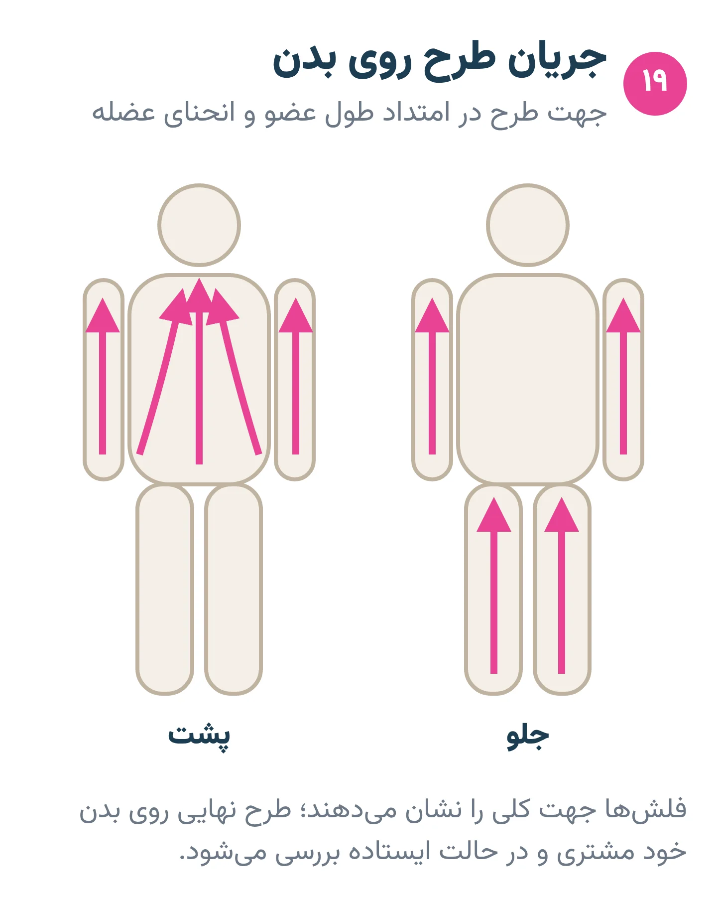
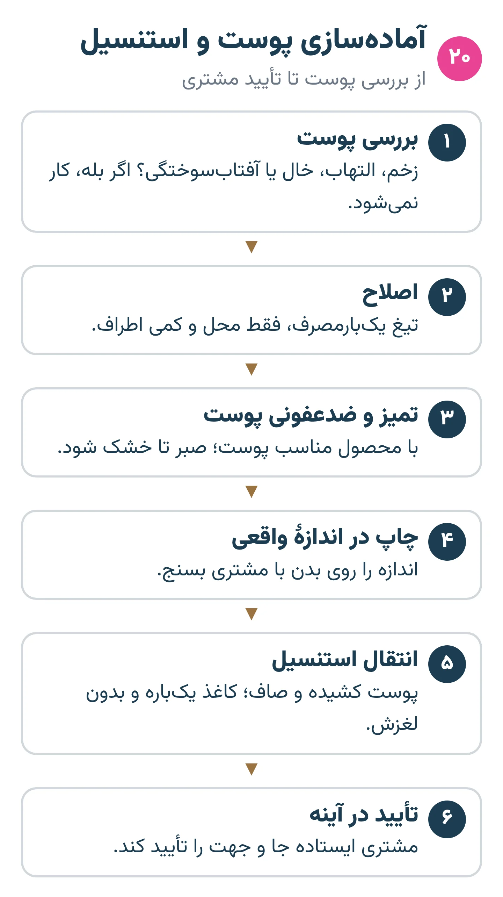

# فصل ۸ — بدن و استنسیل

*بخش ۳ — طراحی و بدن*

## درس ۱۹: جای طرح روی بدن و جریان بدن

<!-- id: cur-19 -->
**سطح:** متوسط

بدن صفحهٔ صاف نیست. طرح باید با جهت عضلات، انحنا و حرکت هماهنگ شود؛ هر ناحیه هم از نظر درد، ترمیم و ماندگاری رفتار خودش را دارد.

**در این درس یاد می‌گیری:**

- جهت جریان طرح را برای نواحی اصلی بدن تعیین کنی.
- اثر انحنا و حرکت بر شکل طرح را پیش‌بینی کنی.
- محدودیت نواحی دشوار (دست، انگشت، پا، گردن، دنده، مفصل) را برای مشتری توضیح بدهی.

### جریان بدن

- طرح‌های کشیده روی بازو و ساق در امتداد طول عضو بهتر می‌نشینند.
- مرکز طرح متقارن باید روی محور واقعی بدن (ستون مهره، خط وسط سینه) باشد؛ بدن خودش کاملاً متقارن نیست.
- طرح را در حالت ایستاده و طبیعی مشتری ببین، نه فقط در حالت خوابیده روی تخت.

*جهت طرح با شکل عضو هماهنگ می‌شود.*

### انحنا و حرکت

- روی سطح استوانه‌ای (بازو، ساق) خط‌های صاف از کنار دیده خمیده می‌شوند؛ استنسیل را روی بدن بررسی کن.
- مفصل‌ها (آرنج، زانو) و ناحیه‌های پرحرکت کشش متغیر دارند؛ خط ظریف آن‌جا زودتر می‌شکند.

### نواحی دشوار

- انگشت، کف و کنار دست و پا: پوست پرحرکت و پرسایش؛ رنگ زودتر می‌ریزد و ترمیم بیشتری لازم است.
- گردن، دنده، شکم، روی استخوان‌ها: معمولاً دردناک‌تر؛ کشش پوست سخت‌تر است.
- شکم و پهلو با تغییر وزن یا بارداری تغییر شکل می‌دهند.
- تجربهٔ درد فردی است؛ «نقشهٔ درد» فقط راهنمای کلی است و قول بی‌دردی نده.

> **هشدار**
>
> - کار روی دست، گردن و صورت برای کارآموز و اولین کارها مناسب نیست.

**نکته‌های کلیدی:**

- طرح در امتداد عضو.
- استنسیل روی بدن ایستاده بررسی شود.
- نواحی پرحرکت ماندگاری کمتر و ترمیم بیشتر دارند.

### تمرین

**هدف:** یک طرح را روی سه ناحیهٔ بدن جانمایی کنی.

**ابزار:** طرح چاپی، هم‌کلاسی (فقط با کاغذ، بدون سوزن)

۱. طرح را روی ساعد، بازو و ساق بگذار و عکس بگیر.
۲. برای هر ناحیه جهت جریان و مشکل احتمالی را بنویس.
۳. بهترین جا را با دلیل انتخاب کن.

**معیار قبولی:**

- دلیل انتخاب شامل جریان بدن، ماندگاری و حرکت باشد.

**واژه‌ها:** استنسیل (Stencil)

**مرتبط:** درس ۱۶، درس ۲۰، درس ۳۴

**منابع:**

- استودیو پیمان زیبائی‌فر، «روش و قانون کارگاهی همین استودیو (تجربهٔ استاد؛ منبع بیرونی ندارد)»
- Mayo Clinic، «Tattoos: Understand risks and precautions» — <https://www.mayoclinic.org/healthy-lifestyle/adult-health/in-depth/tattoos-and-piercings/art-20045067>

---

## درس ۲۰: آماده‌سازی پوست و استنسیل

<!-- id: cur-20 -->
**سطح:** متوسط

استنسیل نقشهٔ خط روی پوست است. پوست باید پیش از استنسیل اصلاح و ضدعفونی شود؛ استنسیل باید تمیز، درست‌اندازه و هماهنگ با بدن باشد و پیش از شروع، مشتری آن را در آینه تأیید کند.

**در این درس یاد می‌گیری:**

- مراحل آماده‌سازی پوست را به ترتیب و بهداشتی انجام بدهی.
- استنسیل تمیز و درست‌اندازه تهیه و منتقل کنی.
- تأیید نهایی مشتری را پیش از شروع بگیری.

### آماده‌سازی پوست

- پوست را بررسی کن: زخم، جوش، آفتاب‌سوختگی یا ضایعه = توقف و تصمیم استاد.
- اصلاح با تیغ یک‌بارمصرف، آرام و بدون خراش؛ تیغ مستقیم به ظرف تیز.
- پاک کردن با مادهٔ ضدعفونی پوست روی گاز تمیز و صبر تا خشک شدن.

*از بررسی پوست تا تأیید مشتری.*

### تهیهٔ استنسیل

- طرح را در اندازهٔ واقعی چاپ کن و روی بدن بسنج.
- فقط خط‌های لازم برای اجرا را منتقل کن؛ سایه‌ها با چند خط راهنما.
- کاغذ استنسیل و مادهٔ انتقال یک‌بارمصرف یا مخصوص همان مشتری؛ ظرف مادهٔ انتقال با دست آلوده لمس نشود.

### انتقال و تأیید

- مشتری در حالت طبیعی (ایستاده یا نشسته) باشد تا طرح روی بدن واقعی درست بنشیند.
- کاغذ را بدون لغزش بگذار و صاف بردار.
- بگذار استنسیل چند دقیقه خشک شود.
- مشتری در آینه جا، اندازه و جهت را ببیند و تأیید کند. استنسیل کج را دوباره بزن؛ «وسط کار درستش می‌کنم» خطاست.

> **هشدار**
>
> - پس از استنسیل، شستن زیاد طرح را پاک می‌کند؛ پس ضدعفونی باید پیش از آن کامل باشد.

**نکته‌های کلیدی:**

- اصلاح و ضدعفونی پیش از استنسیل.
- استنسیل روی بدن در حالت طبیعی.
- تأیید مشتری در آینه پیش از سوزن.

### تمرین

**هدف:** یک استنسیل تمیز روی پوست مصنوعی منحنی منتقل کنی.

**ابزار:** پوست مصنوعی روی استوانه، کاغذ استنسیل، چاپگر یا قلم

۱. طرح را در اندازهٔ درست آماده کن.
۲. روی سطح منحنی منتقل کن.
۳. از سه زاویه عکس بگیر و کجی را بررسی کن.

**معیار قبولی:**

- خط‌ها بدون لک و لغزش و طرح در محور درست باشد.

**واژه‌ها:** استنسیل (Stencil)، آلودگی متقاطع (Cross-contamination)

**مرتبط:** درس ۸، درس ۱۹، درس ۲۱

**منابع:**

- CEN / BSI، «EN 17169:2020 Tattooing — Safe and hygienic practice» — <https://knowledge.bsigroup.com/products/tattooing-safe-and-hygienic-practice>
- استودیو پیمان زیبائی‌فر، «روش و قانون کارگاهی همین استودیو (تجربهٔ استاد؛ منبع بیرونی ندارد)»

---
