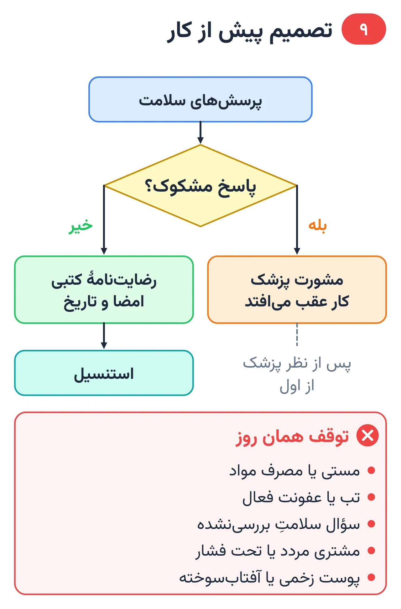
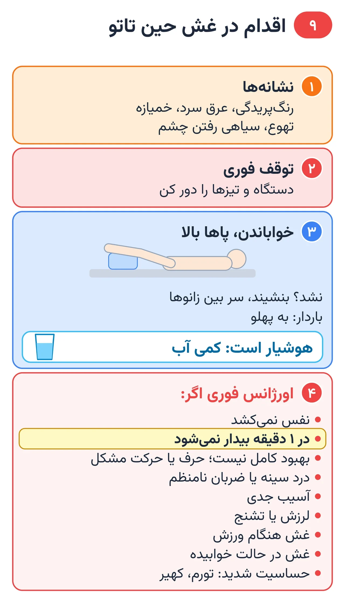

# فصل ۹ — مشتری و جلسه

*بخش ۴ — اجرا*

## درس ۲۱: مشاوره، رضایت‌نامه و فهرست توقف

<!-- id: cur-21 -->
**سطح:** متوسط

پیش از هر کار، گفت‌وگوی ساختارمند با مشتری انجام می‌شود: طرح، جا، اندازه، سلامت، خطرها و مراقبت. نتیجه در رضایت‌نامهٔ کتبی ثبت می‌شود و اگر موردی از فهرست توقف وجود داشت، کار عقب می‌افتد یا به نظر پزشک وابسته می‌شود.

**در این درس یاد می‌گیری:**

- یک مشاورهٔ کامل را با فرم استاندارد انجام بدهی.
- موارد توقف و احتیاط را بشناسی و بدون تشخیص پزشکی، ارجاع بدهی.
- رضایت‌نامهٔ آگاهانه را درست تکمیل کنی.

### گفت‌وگوی مشاوره

- ایده، معنا، سبک، اندازه، جای بدن و بودجه.
- محدودیت فنی: نوشتهٔ خیلی ریز، رنگ روشن روی پوست تیره، جای پرسایش.
- تعداد و طول جلسه‌ها، مراقبت و زمان ترمیم.
- سن و مدرک هویت طبق قانون محل.

*پرسش، ثبت، ارجاع؛ کار فقط پس از رضایت‌نامه.*

### پرسش‌های سلامت (برای ایمنی، نه تشخیص)

طبق مرور علمی کلوگر (۲۰۱۵) منع مطلق برای تاتو کم است، ولی در چند وضعیت فرد باید پیش از تاتو با پزشک مشورت کند. کار تو پرسیدن، ثبت و ارجاع است.

- بیماری پوستی فعال در محل (مثل پسوریازیس، اگزما، ویتیلیگو): خطر ظاهر شدن بیماری روی تاتو (پدیدهٔ کوبنر)؛ کار تا آرام شدن پوست و نظر پزشک عقب می‌افتد.
- اختلال انعقاد خون یا مصرف داروی ضدانعقاد.
- دیابت کنترل‌نشده، بیماری یا داروی سرکوب‌کنندهٔ ایمنی، بیماری مادرزادی قلب.
- بارداری و شیردهی: معمولاً کار به بعد موکول می‌شود.
- سابقهٔ کلوئید، حساسیت به رنگ، لاتکس، چسب یا مادهٔ ضدعفونی.
- خال یا ضایعهٔ تغییرکرده در محل طرح.

### فهرست توقف همان روز

- مستی یا مصرف مواد.
- تب، بیماری حاد یا عفونت فعال.
- پوست زخمی، آفتاب‌سوخته یا ملتهب در محل.
- مشتری مردد یا تحت فشار دیگران.
- هر پاسخ سلامت که استاد هنوز بررسی نکرده است.

### رضایت‌نامه

- طرح نهایی، جا، اندازه و رنگ‌ها.
- خطرهای اصلی (عفونت، حساسیت، جوشگاه، تغییر رنگ) و دستور مراقبت.
- پرسش‌های سلامت با پاسخ‌های مشتری.
- رضایت عکاسی (جداگانه).
- امضا و تاریخ؛ نگهداری محرمانه طبق قانون محل.

> **هشدار**
>
> - هرگز به مشتری نگو «این بیماری مشکلی ندارد»؛ این قضاوت پزشکی است.
> - کارآموز روی پوست مشتری تاتو نمی‌زند؛ همهٔ تمرین‌ها روی کاغذ، پوست مصنوعی یا میوه انجام می‌شود.

**نکته‌های کلیدی:**

- پرسیدن و ثبت، نه تشخیص.
- مورد مشکوک = مشورت پزشک پیش از کار.
- رضایت‌نامهٔ کتبی پیش از استنسیل.

### تمرین

**هدف:** یک مشاورهٔ کامل نقش‌آفرینی و فرم را پر کنی.

**ابزار:** فرم مشاوره و رضایت‌نامه

۱. با هم‌کلاسی در نقش مشتری مشاوره کن.
۲. استاد یک مورد احتیاط پنهان در نقش قرار می‌دهد؛ آن را پیدا کن.
۳. تصمیم و ارجاع را ثبت کن.

**معیار قبولی:**

- مورد احتیاط پیدا و بدون تشخیص پزشکی ارجاع شود.
- همهٔ بخش‌های فرم کامل باشد.

**واژه‌ها:** رضایت‌نامهٔ آگاهانه (Informed consent)، موارد توقف و احتیاط (Contraindication)، پدیدهٔ کوبنر (Koebner phenomenon)، کلوئید (Keloid)

**مرتبط:** درس ۵، درس ۲۲، درس ۳۱

**منابع:**

- Karger — Curr Probl Dermatol 2015;48:76-87 (Tattooed Skin and Health)، «Kluger N. Contraindications for tattooing» — <https://pubmed.ncbi.nlm.nih.gov/25833628/>
- CEN / BSI، «EN 17169:2020 Tattooing — Safe and hygienic practice» — <https://knowledge.bsigroup.com/products/tattooing-safe-and-hygienic-practice>
- Mayo Clinic، «Tattoos: Understand risks and precautions» — <https://www.mayoclinic.org/healthy-lifestyle/adult-health/in-depth/tattoos-and-piercings/art-20045067>
- American Academy of Dermatology، «Do tattoos cause skin cancer?» — <https://www.aad.org/public/diseases/skin-cancer/do-tattoos-cause-skin-cancer>

---

## درس ۲۲: روز جلسه: آمادگی مشتری، غذا، الکل، بی‌حسی و غش

<!-- id: cur-22 -->
**سطح:** متوسط

آمادگی مشتری روی درد، خونریزی، ترمیم و ایمنی جلسه اثر دارد. این درس برگهٔ آمادگی استودیو، قواعد بی‌حسی و اقدام در غش را یکجا می‌آورد.

**در این درس یاد می‌گیری:**

- برگهٔ آمادگی پیش از جلسه را برای مشتری توضیح بدهی.
- قواعد استفاده از بی‌حسی موضعی را بدانی.
- نشانه‌های پیش از غش را بشناسی و اقدام درست انجام بدهی.

### برگهٔ آمادگی استودیو

- از دو روز قبل آب کافی بنوشد؛ پوست خشک را شب‌ها با کرم بدون عطر نرم کند، ولی صبح جلسه روی پوست کرم نباشد.
- آفتاب و سولاریوم نرود؛ پوست سوخته یا پوسته‌دار کار نمی‌شود.
- از ۲۴ ساعت قبل الکل ننوشد؛ همان روز قهوه و نوشابهٔ گازدار زیاد نخورد.
- شب قبل زود و کافی (حدود ۸ ساعت) بخوابد.
- محل را خودش نتراشد.
- یک تا دو ساعت قبل غذای سبک بخورد و خوراکی همراه بیاورد.
- داروی تجویزی، از جمله داروهای مؤثر بر انعقاد خون، را خودسر قطع یا شروع نکند؛ اگر چنین دارویی مصرف می‌کند، پیش از نوبت با پزشک خودش هماهنگ کند و به استودیو اطلاع دهد.
- لباس آزاد بپوشد و سر وقت بیاید.

*نشانهٔ غش را جدی بگیر: توقف، خواباندن، پایش.*

### بی‌حسی موضعی

- قانون فروش و استفادهٔ کرم‌های بی‌حسی در کشورها متفاوت است؛ اگر در محل تو مجاز نیست، استفاده نکن.
- بی‌حسی را تو تجویز نمی‌کنی؛ اگر مشتری خودش چیزی زده، نام و زمان آن را بپرس و ثبت کن.
- مصرف زیاد روی سطح بزرگ یا زیر پوشش طولانی جذب را بیشتر و خطر را زیاد می‌کند.
- پوست بی‌حس درد را که علامت ضربهٔ زیاد است پنهان می‌کند؛ عمق را با چشم و نتیجه کنترل کن.

### غش (واکنش وازوواگال)

درد، ترس، گرسنگی و ایستادن طولانی می‌توانند با افت ناگهانی ضربان و فشار به غش برسند. این واکنش معمولاً گذراست ولی افتادن می‌تواند آسیب بزند.

- نشانه‌های پیش از غش: رنگ‌پریدگی، عرق سرد، تهوع، خمیازه، سیاهی رفتن چشم، گفتن «حالم بد است».
- اقدام: کار را فوراً قطع کن، دستگاه را کنار بگذار، مشتری را بخوابان و در صورت امکان پاهایش را بالا بگذار؛ اطراف را از وسایل تیز خالی کن.
- پس از به‌هوش آمدن کامل، آب یا نوشیدنی شیرین بدهد؛ کار را فقط اگر حالش کاملاً خوب است و با تصمیم استاد ادامه بده.
- اگر بیهوشی بیش از چند لحظه طول کشید، تشنج، درد قفسهٔ سینه، تنگی نفس یا آسیب سر رخ داد، با اورژانس تماس بگیر.

> **هشدار**
>
> - کارآموز دارو و بی‌حسی تجویز نمی‌کند.
> - نشانه‌های حساسیت شدید (تنگی نفس، تورم صورت یا گلو، کهیر گسترده) = تماس فوری با اورژانس.

**نکته‌های کلیدی:**

- غذا بله، الکل نه.
- داروی تجویزی خودسر قطع نشود؛ هماهنگی با پزشک.
- نشانهٔ غش = توقف فوری و خواباندن.

### تمرین

**هدف:** برگهٔ آمادگی را توضیح بدهی و سناریوی غش را اجرا کنی.

**ابزار:** برگهٔ آمادگی، تخت

۱. برگه را در دو دقیقه برای مشتری فرضی توضیح بده.
۲. سناریوی «مشتری رنگش پرید» را اجرا کن.
۳. معیار تماس با اورژانس را بگو.

**معیار قبولی:**

- کار در کمتر از چند ثانیه متوقف و مشتری خوابانده شود.
- هیچ توصیهٔ دارویی داده نشود.

**واژه‌ها:** غش وازوواگال (Vasovagal episode)، موارد توقف و احتیاط (Contraindication)

**مرتبط:** درس ۲۱، درس ۲۳، درس ۳۱

**منابع:**

- استودیو پیمان زیبائی‌فر، «روش و قانون کارگاهی همین استودیو (تجربهٔ استاد؛ منبع بیرونی ندارد)»
- StatPearls / NCBI Bookshelf، «Vasovagal Episode» — <https://www.ncbi.nlm.nih.gov/books/NBK470277/>
- Mayo Clinic، «Tattoos: Understand risks and precautions» — <https://www.mayoclinic.org/healthy-lifestyle/adult-health/in-depth/tattoos-and-piercings/art-20045067>

---
