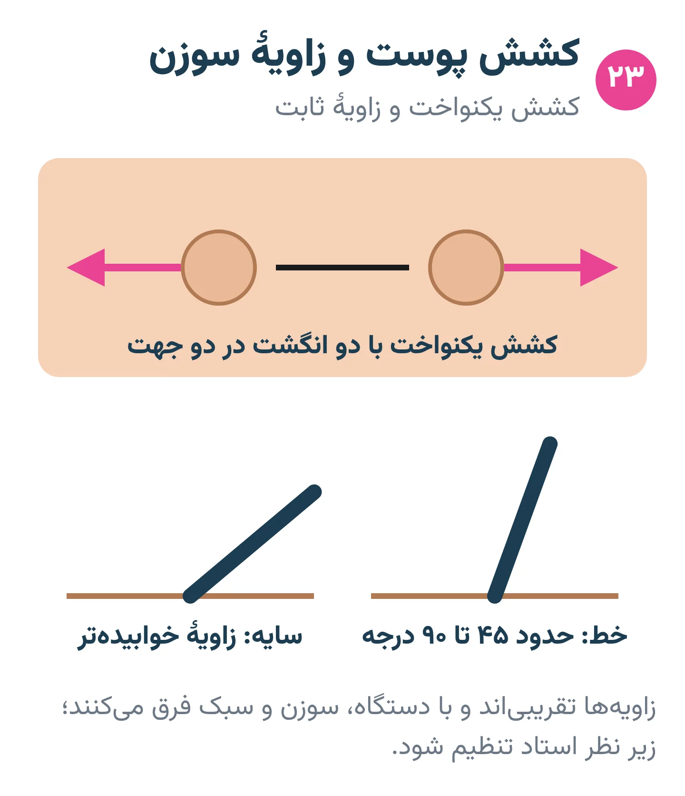
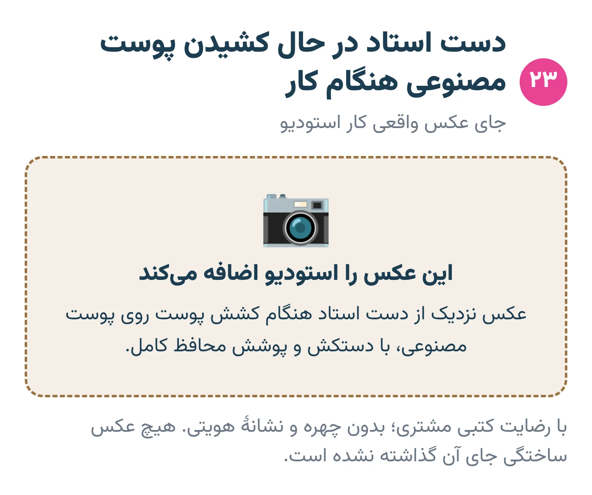
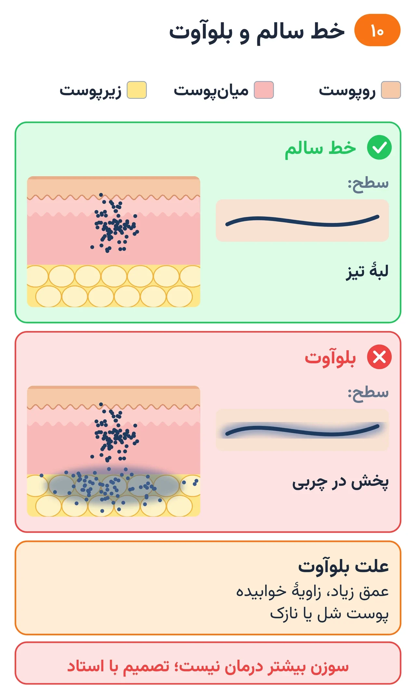

# فصل ۱۰ — دست روی پوست

*بخش ۴ — اجرا*

## درس ۲۳: نشست، کشش پوست، زاویه و عمق

<!-- id: cur-23 -->
**سطح:** متوسط

خط خوب از بدن آرام، پوست کشیده، زاویهٔ پایدار و عمق درست می‌آید. عمق با خواندن نتیجه تنظیم می‌شود، نه با حفظ یک عدد.

**در این درس یاد می‌گیری:**

- نشست و تکیه‌گاه دست را درست تنظیم کنی.
- پوست را با دست غیرکاری یکنواخت بکشی.
- زاویهٔ ورود و بیرون‌زدگی سوزن را روی پوست مصنوعی تنظیم و نتیجه را بخوانی.

### نشست و تکیه‌گاه

- ارتفاع تخت و صندلی طوری که شانه بالا نرود و کمر خم نشود.
- انگشت کوچک یا لبهٔ دست کاری روی پوست یا تکیه‌گاه تکیه کند تا دست نلرزد.
- مشتری در وضعیت پایدار و راحت؛ عضوی که مدام حرکت می‌کند خط را خراب می‌کند.

*کشش یکنواخت و زاویهٔ ثابت.*

### کشش پوست

پوست شل زیر سوزن موج برمی‌دارد و عمق یکی در میان می‌شود. با دست غیرکاری (و در صورت نیاز کمک دستیار) پوست را در دو جهت صاف کن؛ کشش زیاد هم طرح را پس از رها شدن تغییر شکل می‌دهد.

*کشش درست با دست غیرکاری.* — جای عکس واقعی استودیو

### زاویه

- در خط، سوزن معمولاً نزدیک به عمود تا کمی مایل وارد می‌شود؛ دستگاه را مثل خودکار خوابیده نگیر.
- در سایه با مگنوم، زاویهٔ مایل‌تر رایج است.
- زاویه در طول یک خط ثابت بماند؛ تغییر زاویه وسط خط ضخامت را تغییر می‌دهد.

### بیرون‌زدگی سوزن و عمق

- بیرون‌زدگی نوک سوزن از سر کارتریج یا تیوب، در خط معمولاً کم است؛ عدد دقیق به دستگاه و کارتریج بستگی دارد و روی پوست مصنوعی تنظیم می‌شود.
- نشانهٔ عمق درست: خط پس از پاک کردن پیوسته و تیز می‌ماند و بلوآوت ندارد.
- خیلی سطحی: پس از پاک کردن خط کم‌رنگ یا بریده است.
- خیلی عمیق: خونریزی زیاد، پوست جویده یا هالهٔ آبی دور خط.

> **هشدار**
>
> - فشار دادن دستگاه به پوست جایگزین سوزن تیز و پوست کشیده نیست.

**نکته‌های کلیدی:**

- تکیه‌گاه دست، کشش یکنواخت.
- زاویهٔ ثابت در طول خط.
- عمق را از نتیجه بخوان.

### تمرین

**هدف:** اثر کشش و زاویه را با چشم ببینی.

**ابزار:** پوست مصنوعی شل‌شونده (روی فوم)، لاینر

۱. سه خط بدون کشش، با کشش کم و با کشش درست بزن.
۲. سه خط با زاویهٔ خوابیده، مایل و عمود بزن.
۳. نتیجه را عکس بگیر و توضیح بده.

**معیار قبولی:**

- بهترین خط از نظر پیوستگی و تیزی انتخاب و دلیلش گفته شود.

**واژه‌ها:** بیرون‌زدگی سوزن (Needle hang / give)، بلوآوت (پخش‌شدگی رنگ) (Blowout)، میان‌پوست (Dermis)

**مرتبط:** درس ۳، درس ۱۰، درس ۲۴، درس ۲۵

**منابع:**

- استودیو پیمان زیبائی‌فر، «روش و قانون کارگاهی همین استودیو (تجربهٔ استاد؛ منبع بیرونی ندارد)»
- StatPearls / NCBI Bookshelf، «Anatomy, Skin (Integument)» — <https://www.ncbi.nlm.nih.gov/books/NBK441980/>

---

## درس ۲۴: پوست خسته، بلوآوت و قضاوت حین کار

<!-- id: cur-24 -->
**سطح:** متوسط

پوست ظرفیت محدودی دارد. با عبور زیاد، ضربهٔ سنگین یا جلسهٔ طولانی ملتهب می‌شود، رنگ را پس می‌زند و ترمیمش سخت می‌شود. تشخیص لحظهٔ توقف مهارت حرفه‌ای است.

**در این درس یاد می‌گیری:**

- نشانه‌های پوست خسته و ملتهب را بشناسی.
- علت‌های بلوآوت را بدانی و از آن پیشگیری کنی.
- پاک کردن درست حین کار و قضاوت دربارهٔ ادامه یا توقف را انجام بدهی.

### پوست خسته

- نشانه‌ها: تورم، سفتی، براق شدن، ترشح زیاد، رنگی که دیگر نمی‌نشیند و با دستمال می‌آید.
- علت‌ها: چند بار رد شدن روی یک ناحیه، سوزن کلفت با دست کند، ضربهٔ بیش از حد، جلسهٔ خیلی طولانی.
- پاسخ: کار را در آن ناحیه متوقف کن و ادامه را به جلسهٔ بعد بسپار؛ محکم‌تر کار کردن پاسخ نیست.

*بلوآوت: رنگ در لایهٔ چربی پخش می‌شود.*

### بلوآوت

- علت‌های رایج: عمق زیاد، زاویهٔ خیلی خوابیده، پوست شل، پوست نازک.
- بلوآوت را با سوزن بیشتر درست نکن؛ گاهی با طراحی (خط ضخیم‌تر یا سایه) پنهان‌کردنی است و تصمیمش با استاد است.

### پاک کردن حین کار

- با دستمال تمیز و ضربه‌ای ملایم پاک کن، نه مالش محکم که استنسیل را پاک و پوست را تحریک کند.
- جهت پاک کردن طوری باشد که دستمال روی خط‌های تازه و استنسیل اجرا نشده کشیده نشود.
- لایهٔ ضخیم وازلین یا مادهٔ لغزنده سوزن را لیز و دید را کم می‌کند؛ لایه نازک باشد.

> **هشدار**
>
> - الکل روی زخم باز ریخته نمی‌شود.
> - قرمزی رو به افزایش، ترشح بدبو یا تب پس از جلسه، ارجاع به پزشک است (درس ۳۱).

**نکته‌های کلیدی:**

- پوست خسته رنگ نمی‌گیرد؛ توقف.
- بلوآوت با سوزن بیشتر درست نمی‌شود.
- پاک کردن ضربه‌ای و نازک.

### تمرین

**هدف:** اثر عبور زیاد را روی پوست مصنوعی ببینی و قضاوت کنی.

**ابزار:** پوست مصنوعی، شیدر

۱. یک مربع را با یک عبور و مربع دیگر را با پنج عبور پر کن.
۲. سطح و لبه‌ها را مقایسه کن.
۳. یک برنامهٔ دوجلسه‌ای برای یک کار بزرگ بنویس.

**معیار قبولی:**

- آسیب عبور زیاد در عکس دیده و توضیح داده شود.

**واژه‌ها:** بلوآوت (پخش‌شدگی رنگ) (Blowout)، اشباع (Saturation / packing)

**مرتبط:** درس ۲۳، درس ۲۹، درس ۳۴

**منابع:**

- استودیو پیمان زیبائی‌فر، «روش و قانون کارگاهی همین استودیو (تجربهٔ استاد؛ منبع بیرونی ندارد)»
- American Academy of Dermatology، «Tattoos: 7 unexpected skin reactions and what to do about them» — <https://www.aad.org/public/everyday-care/skin-care-basics/tattoos/tattoo-skin-reactions>

---
