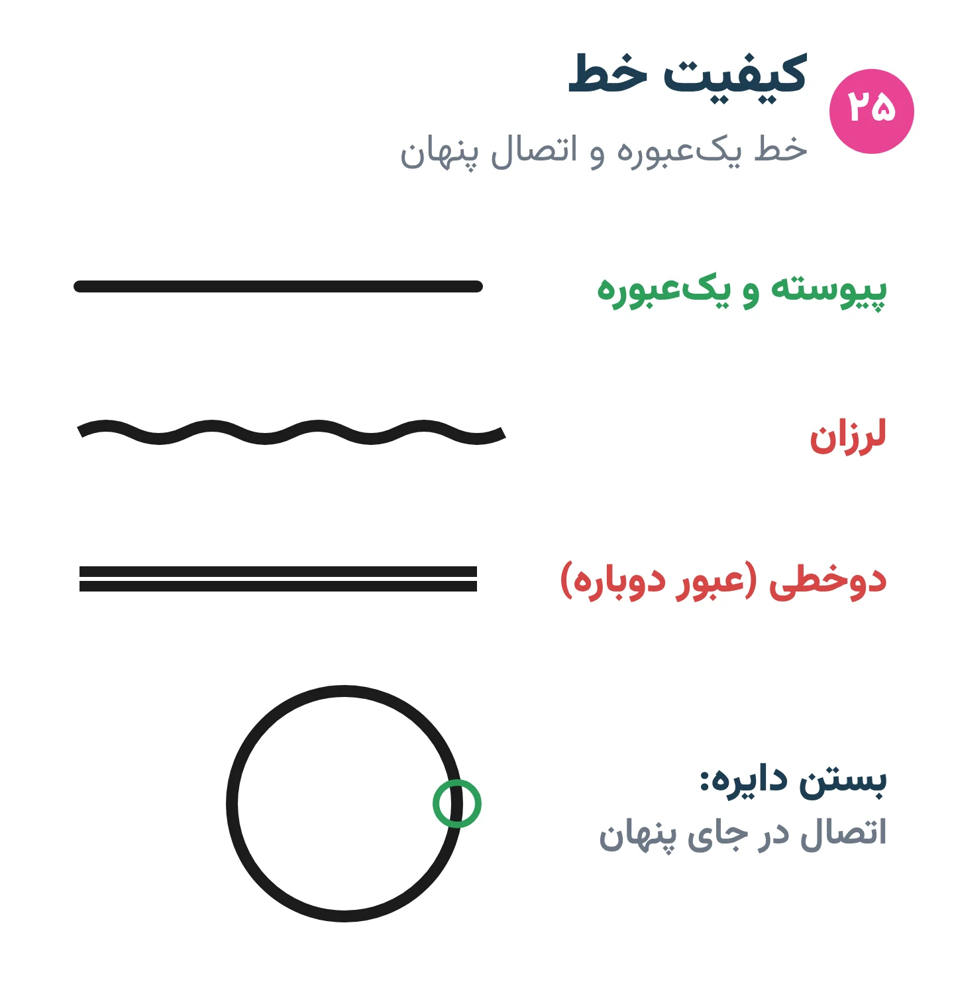
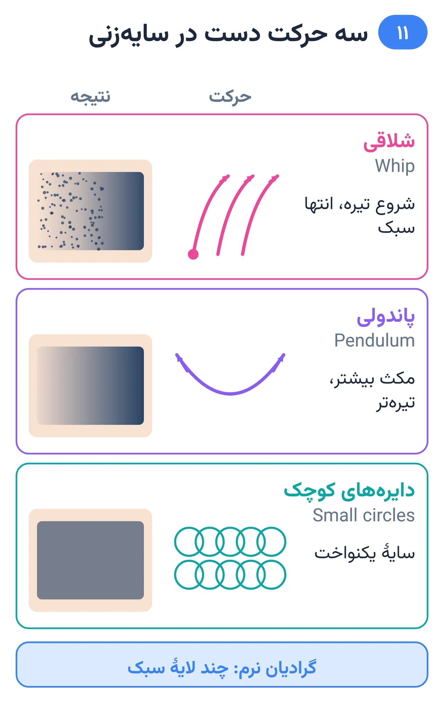
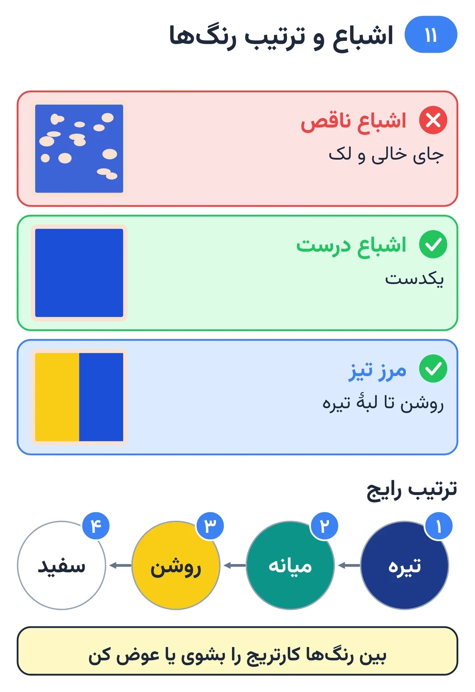
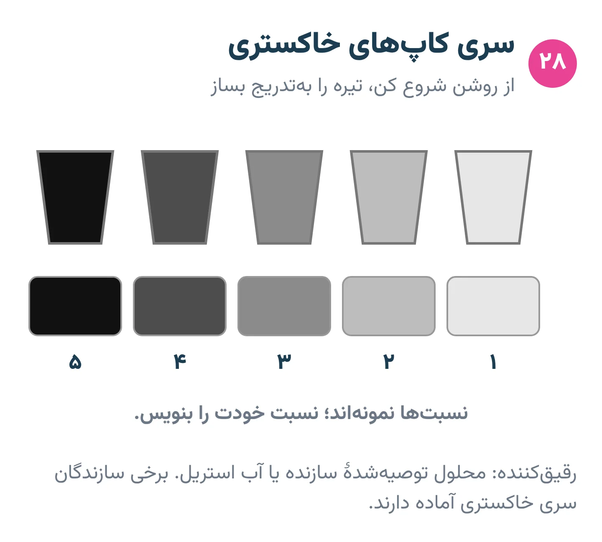
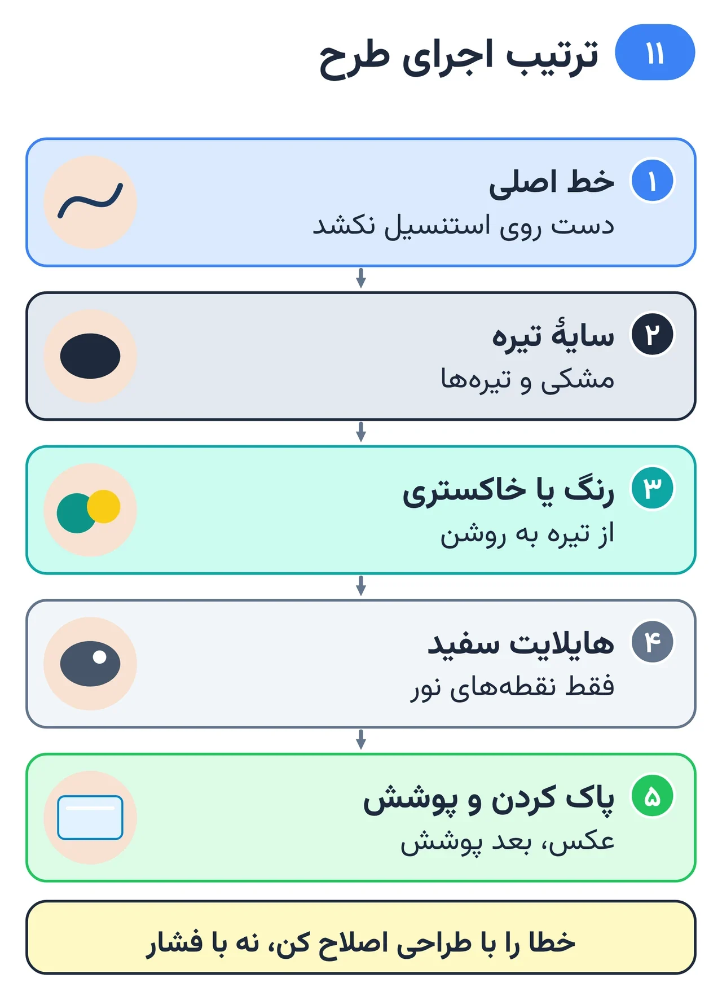

# فصل ۱۱ — خط، سایه و رنگ

*بخش ۴ — اجرا*

## درس ۲۵: خط‌کشی: خط یک‌عبوره، ضخامت و بستن شکل

<!-- id: cur-25 -->
**سطح:** متوسط

خط اسکلت تاتوست. هدف خطی پیوسته، یکنواخت و تیز با یک عبور است؛ ضخامت با انتخاب سوزن تعیین می‌شود، نه با چند بار رد شدن.

**در این درس یاد می‌گیری:**

- خط مستقیم، منحنی و دایره را با یک عبور بزنی.
- ضخامت خط را با انتخاب سوزن کنترل کنی.
- شکل‌ها را بدون پله و هم‌پوشانی ببندی.

### خط یک‌عبوره

- دستگاه را پیش از تماس با پوست روشن کن و حرکت را بلافاصله پس از ورود شروع کن.
- سرعت یکنواخت از ابتدا تا انتها؛ در انتها هم‌زمان با ادامهٔ حرکت دست را بالا بیاور.
- خط بلند را در چند تکهٔ کوتاه‌تر با اتصال نامرئی بزن، نه با یک حرکت لرزان.

*خط یک‌عبوره و اتصال پنهان.*

### ضخامت

- خط ضخیم‌تر = لاینر بزرگ‌تر (مثلاً ۹ یا ۱۱)، نه چند عبور با لاینر کوچک.
- سلسله‌مراتب: دور شکل اصلی ضخیم‌تر، جزئیات داخلی نازک‌تر.

### بستن شکل و ترتیب

- اتصال‌ها را در جای پنهان (گوشه یا پشت شکل دیگر) بگذار.
- معمولاً خط‌ها از پایین به بالا یا از سمتی اجرا می‌شوند که دست و دستمال روی استنسیل اجرا نشده کشیده نشود.
- پیش از سایه، همهٔ خط‌ها کامل و بررسی شوند.

> **هشدار**
>
> - رد شدن مکرر روی خط برای پهن کردن، بلوآوت و التهاب می‌آورد.

**نکته‌های کلیدی:**

- یک عبور، سرعت یکنواخت.
- ضخامت از سوزن، نه از تکرار.
- اتصال‌ها در جای پنهان.

### تمرین

**هدف:** صفحهٔ آزمون خط را با کیفیت قبولی اجرا کنی.

**ابزار:** پوست مصنوعی، لاینر ۵ و ۹

۱. ده خط مستقیم ۵ سانتی، ده منحنی S و ده دایره.
۲. یک شکل ستاره با اتصال‌های پنهان.
۳. همان شکل با دو ضخامت.

**معیار قبولی:**

- دست‌کم ۸۰٪ خط‌ها پیوسته و بدون لرزش باشند.
- اتصال‌ها پله نداشته باشند.

**واژه‌ها:** لاینر گرد (Round Liner, RL)

**مرتبط:** درس ۱۱، درس ۱۵، درس ۲۳، درس ۲۹

**منابع:**

- استودیو پیمان زیبائی‌فر، «روش و قانون کارگاهی همین استودیو (تجربهٔ استاد؛ منبع بیرونی ندارد)»

---

## درس ۲۶: سایه‌زنی: شلاقی، پاندولی، یکنواخت و نقطه‌ای

<!-- id: cur-26 -->
**سطح:** متوسط

سایه گذار ارزش رنگی روی پوست است. حرکت دست (شلاقی، پاندولی، دایره‌های کوچک) و تراکم نقطه‌ها شدت سایه را می‌سازد. گرادیان نرم با چند لایهٔ سبک ساخته می‌شود، نه یک عبور سنگین.

**در این درس یاد می‌گیری:**

- سایهٔ شلاقی و پاندولی را از هم تشخیص و اجرا کنی.
- گرادیان سه‌پله‌ای روی پوست مصنوعی بسازی.
- سایهٔ نقطه‌ای (فلفلی و نقطه‌گذاری) را کنترل کنی.

### شلاقی (Whip)

حرکت قوسی کوتاه که در ابتدا عمیق‌تر است و با بالا آمدن دست در انتها سبک می‌شود؛ سمت شروع تیره و انتها نقطه‌ای و روشن است. برای سایهٔ نرم و بافت‌دار و کار با لاینر یا شیدر کوچک.

*حرکت دست، بافت سایه را می‌سازد.*

### پاندولی (Pendulum)

تاب خوردن مچ به چپ و راست مانند آونگ، با مگنوم؛ جایی که مکث بیشتری داری تیره‌تر می‌شود. برای گرادیان در سطح بزرگ‌تر.

### یکنواخت و گرادیان

- سایهٔ یکنواخت با دایره‌های کوچک هم‌پوشان یا حرکت رفت‌وبرگشتی کنترل‌شده.
- گرادیان: از تیره شروع کن و با کم کردن مکث و تراکم به سمت روشن برو؛ لایه‌ها سبک باشند.
- جهت حرکت سایه از شکل حجم پیروی کند.

### نقطه‌ای

- فلفلی (Pepper): ضربه‌های پراکنده با دست تندتر یا ولتاژ پایین‌تر که بافت نقطه‌ای و دانه‌دار می‌سازد.
- نقطه‌گذاری: نقطه‌های جدا و کنترل‌شده؛ تراکم بیشتر = تیره‌تر. حوصله و ثبات دست می‌خواهد.
- نقطه‌ها با گذر زمان کمی پخش می‌شوند؛ فاصلهٔ خیلی کم در طرح ریز یکی می‌شود.

> **هشدار**
>
> - یک عبور سنگین برای «زود تمام کردن» سایه، پوست را خسته و سایه را لک‌دار می‌کند.

**نکته‌های کلیدی:**

- شلاقی: قوس با انتهای سبک.
- پاندولی: تاب مچ با مگنوم.
- گرادیان با لایه‌های سبک.

### تمرین

**هدف:** نوار گرادیان و کرهٔ سایه‌دار روی پوست مصنوعی.

**ابزار:** پوست مصنوعی، مگنوم خمیده، شیدر، رنگ مشکی و کاپ رقیق

۱. یک نوار ۸ سانتی گرادیان با پاندولی.
۲. یک نوار با شلاقی.
۳. یک کرهٔ نقطه‌ای.

**معیار قبولی:**

- گرادیان بدون پله و لک باشد.
- تفاوت بافت دو روش دیده شود.

**واژه‌ها:** سایهٔ شلاقی (Whip shading)، سایهٔ پاندولی (Pendulum shading)، نقطه‌گذاری (Stippling / dotwork)، مگنوم تخت (Weaved Magnum, M1)، مگنوم خمیده (Curved Magnum, CM/RM)

**مرتبط:** درس ۱۲، درس ۱۵، درس ۲۸

**منابع:**

- استودیو پیمان زیبائی‌فر، «روش و قانون کارگاهی همین استودیو (تجربهٔ استاد؛ منبع بیرونی ندارد)»

---

## درس ۲۷: پر کردن رنگ، اشباع و مرز رنگ‌ها

<!-- id: cur-27 -->
**سطح:** متوسط

رنگ یکدست و اشباع از حرکت منظم با مگنوم یا شیدر، سرعت دست کنترل‌شده و ترتیب درست رنگ‌ها می‌آید. مرز دو رنگ تمیز است اگر رنگ تیره‌تر اول و روشن‌تر بعد اجرا شود.

**در این درس یاد می‌گیری:**

- سطح را یکدست و بدون جای خالی پر کنی.
- ترتیب اجرای رنگ‌ها و تعویض کارتریج را رعایت کنی.
- مرز و ترکیب دو رنگ را تمیز بسازی.

### اشباع

- حرکت دایره‌ای کوچک یا رفت‌وبرگشتی کوتاه با هم‌پوشانی.
- سرعت دست آهسته‌تر از خط ولی بدون ماندن روی یک نقطه.
- یک لایهٔ کامل بهتر از چند لایهٔ ناقص؛ عبور بیش از حد پوست را خسته می‌کند (درس ۲۴).

*تیره اول، روشن بعد، سفید آخر.*

### ترتیب رنگ‌ها

- معمولاً از تیره به روشن؛ رنگ روشن دیرتر تا آلوده به تیره نشود.
- سفید و هایلایت در پایان.
- بین رنگ‌ها کارتریج را شست‌وشو بده یا عوض کن؛ کارتریج آلوده به رنگ تیره، رنگ روشن را کدر می‌کند.

### مرز و ترکیب

- مرز تیز: رنگ دوم تا لبهٔ رنگ اول بیاید و کمی روی آن.
- ترکیب نرم: در ناحیهٔ مرز، هر دو رنگ با تراکم کاهنده هم‌پوشانی داشته باشند.
- ترکیب رنگ‌های مکمل کدر می‌شود؛ ترکیب را روی پوست مصنوعی امتحان کن.

> **هشدار**
>
> - رنگ کاپ‌ها برای هر مشتری جداست و باقی‌مانده دور ریخته می‌شود.

**نکته‌های کلیدی:**

- تیره به روشن.
- یک لایهٔ کامل.
- کارتریج تمیز برای رنگ روشن.

### تمرین

**هدف:** یک مربع تک‌رنگ اشباع و یک مرز دورنگ بسازی.

**ابزار:** پوست مصنوعی، مگنوم، دو رنگ

۱. مربع ۴×۴ را یکدست پر کن.
۲. دو مربع کنار هم با مرز تیز.
۳. دو مربع با ترکیب نرم.

**معیار قبولی:**

- بدون جای خالی و بدون لبهٔ کثیف.

**واژه‌ها:** اشباع (Saturation / packing)، مگنوم تخت (Weaved Magnum, M1)، مگنوم خمیده (Curved Magnum, CM/RM)

**مرتبط:** درس ۱۴، درس ۲۶، درس ۲۸

**منابع:**

- استودیو پیمان زیبائی‌فر، «روش و قانون کارگاهی همین استودیو (تجربهٔ استاد؛ منبع بیرونی ندارد)»

---

## درس ۲۸: سیاه و خاکستری: کاپ‌های رقیق، محو، فضای منفی و هایلایت

<!-- id: cur-28 -->
**سطح:** متوسط

در کار سیاه و خاکستری، ارزش‌ها با رقیق کردن مشکی در چند کاپ ساخته می‌شوند. لبه‌های محو، فضای منفی (پوست خالی) و هایلایت کنترل‌شده، حجم و نور را می‌سازند.

**در این درس یاد می‌گیری:**

- سری کاپ‌های خاکستری رقیق را بسازی و برچسب بزنی.
- لبهٔ محو در پوست و فضای منفی را طراحی و اجرا کنی.
- هایلایت سفید را محدود و درست به کار ببری.

### کاپ‌های رقیق

- از رقیق‌کنندهٔ توصیه‌شدهٔ سازنده یا آب استریل استفاده کن.
- سه تا پنج کاپ از روشن به تیره؛ نسبت‌ها را بنویس تا قابل تکرار باشد.
- از روشن‌ترین کاپ شروع کن و تیره را به‌تدریج بساز؛ تیره کردن آسان‌تر از روشن کردن است.
- برخی سازندگان سری خاکستری آماده دارند؛ یکنواختی بیشتری می‌دهد.

*سری کاپ‌های خاکستری؛ نسبت‌ها را ثبت کن.*

### محو در پوست و فضای منفی

- لبهٔ محو با کم کردن تراکم و فشار در انتهای حرکت شلاقی یا پاندولی ساخته می‌شود.
- پوست خالی روشن‌ترین ارزش طرح است؛ آن را در طراحی برنامه‌ریزی کن، نه اینکه بعداً با سفید پر کنی.

### هایلایت سفید

- سفید در پایان و فقط روی نقاط کوچک بیشترین نور.
- سفید روی پوست زودتر از بقیه محو یا زرد می‌شود؛ ماندگاری را به آن نسپار.

> **هشدار**
>
> - آب لوله‌کشی برای رقیق کردن ممنوع است.

**نکته‌های کلیدی:**

- از روشن به تیره.
- پوست خالی = روشن‌ترین ارزش.
- سفید فقط برای نقطهٔ نور.

### تمرین

**هدف:** یک کرهٔ سیاه و خاکستری با سه کاپ و فضای منفی.

**ابزار:** پوست مصنوعی، مگنوم خمیده، رقیق‌کننده، سه کاپ

۱. سه کاپ با نسبت ثبت‌شده بساز.
۲. کره را از روشن به تیره اجرا کن.
۳. یک هایلایت کوچک سفید اضافه کن.

**معیار قبولی:**

- سه ارزش جدا دیده شوند و لبهٔ محو بدون پله باشد.

**واژه‌ها:** کاپ‌های رقیق خاکستری (Grey wash)، ارزش رنگی (روشنی و تیرگی) (Value)

**مرتبط:** درس ۱۵، درس ۲۶، درس ۳۶

**منابع:**

- استودیو پیمان زیبائی‌فر، «روش و قانون کارگاهی همین استودیو (تجربهٔ استاد؛ منبع بیرونی ندارد)»

---

## درس ۲۹: ترتیب اجرا و اصلاح خطا در همان جلسه

<!-- id: cur-29 -->
**سطح:** متوسط

ترتیب اجرا جلوی پاک شدن استنسیل، آلوده شدن رنگ‌ها و خستگی پوست را می‌گیرد. خطای حین کار با آرامش و اغلب با طراحی اصلاح می‌شود، نه با کوبیدن بیشتر پوست.

**در این درس یاد می‌گیری:**

- ترتیب استاندارد اجرای یک طرح را بدانی.
- خطاهای رایج حین کار را تشخیص بدهی.
- راه اصلاح هر خطا یا تصمیم به توقف را انتخاب کنی.

### ترتیب رایج

- خط اصلی (از پایین یا از سمتی که دست روی استنسیل نکشد).
- سایهٔ تیره و مشکی.
- خاکستری‌ها یا رنگ‌ها از تیره به روشن.
- هایلایت سفید.
- پاک کردن نهایی، عکس و پوشش.

*ترتیب اجرا جلوی خطا را می‌گیرد.*

### خطاهای رایج و پاسخ

- خط لرزان یا کج: اگر کوچک است، با ضخیم‌تر کردن یکدست خط یا سایه اصلاح؛ اگر بزرگ است، توقف و مشورت با استاد.
- استنسیل پاک‌شده: با قلم پوستی تمیز دوباره بکش، نه حدسی.
- رنگ اشتباه: روی رنگ روشن، رنگ تیره‌تر ممکن است؛ برعکس معمولاً نه.
- پوست خسته: توقف در آن ناحیه (درس ۲۴).

### صداقت با مشتری

خطا را پنهان نکن. توضیح بده چه شده و راه‌حل چیست؛ تصمیم دربارهٔ تغییر طرح با رضایت مشتری است.

> **هشدار**
>
> - اصلاح بزرگ وسط جلسه بدون نظر استاد ممنوع.

**نکته‌های کلیدی:**

- خط ← تیره ← روشن ← سفید.
- اصلاح با طراحی، نه با فشار.
- صداقت دربارهٔ خطا.

### تمرین

**هدف:** یک طرح کامل کوچک را با ترتیب درست اجرا کنی.

**ابزار:** پوست مصنوعی، طرح کوچک خط و سایه

۱. ترتیب را پیش از شروع بنویس.
۲. اجرا کن؛ استاد یک خطای عمدی (مثلاً پاک شدن استنسیل) ایجاد می‌کند.
۳. اصلاح را انجام و ثبت کن.

**معیار قبولی:**

- ترتیب رعایت و خطا بدون آسیب اضافه اصلاح شود.

**واژه‌ها:** استنسیل (Stencil)

**مرتبط:** درس ۲۴، درس ۲۵، درس ۲۷، درس ۳۲

**منابع:**

- استودیو پیمان زیبائی‌فر، «روش و قانون کارگاهی همین استودیو (تجربهٔ استاد؛ منبع بیرونی ندارد)»

---
