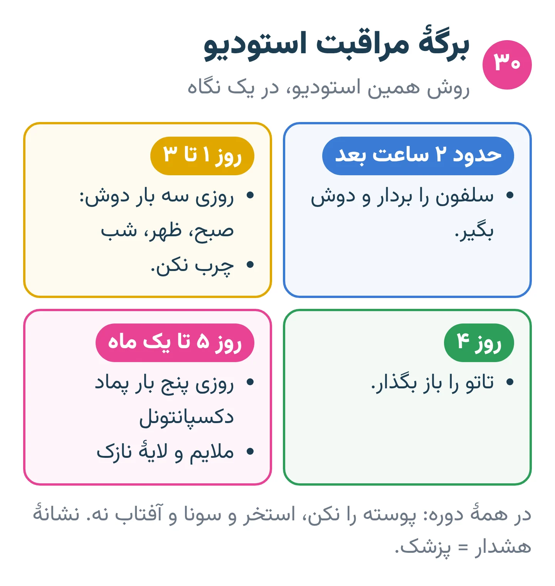
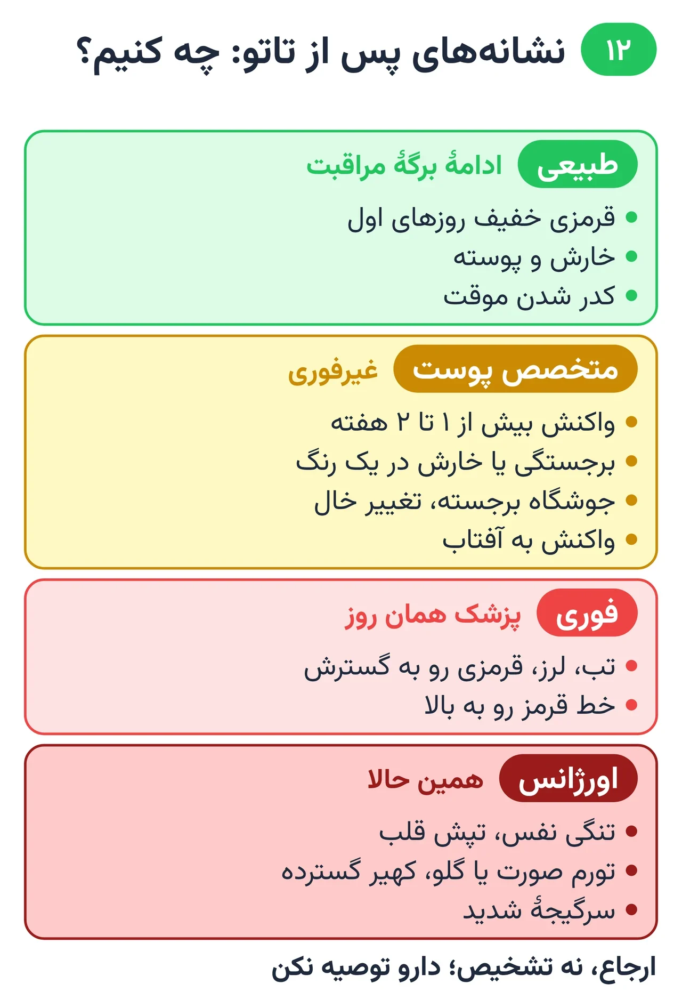

# فصل ۱۲ — بعد از جلسه

*بخش ۴ — اجرا*

## درس ۳۰: مراقبت بعد از تاتو: روش استودیو

<!-- id: cur-30 -->
**سطح:** مبتدی

مشتری فقط یک دستور مراقبت می‌گیرد: برگهٔ همین استودیو، کتبی. کارآموز آن را دقیق و بدون افزودن روش‌های دیگر توضیح می‌دهد.

**در این درس یاد می‌گیری:**

- روش مراقبت استودیو را کامل و به ترتیب توضیح بدهی.
- نکته‌های عمومی پرهیز را بگویی.
- مرز پوستهٔ طبیعی و نشانهٔ هشدار را به مشتری بفهمانی.

### روش این استودیو

این زمان‌ها روی کاغذ به مشتری داده می‌شود؛ گفتن شفاهی تنها کافی نیست.

- سلفون را حدود دو ساعت بعد بردار و دوش بگیر.
- سه روز اول، هر روز صبح و ظهر و شب دوش بگیر. در این سه روز چرب نکن.
- روز چهارم تاتو را باز بگذار.
- از روز پنجم تا یک ماه، روزی پنج بار با پماد دکسپانتونل، ملایم و لایهٔ نازک، چرب کن.

*برگهٔ مراقبت استودیو در یک نگاه.*

### نکته‌های عمومی

- شستن ملایم با آب ولرم و شویندهٔ ملایم بدون عطر؛ خشک کردن با ضربهٔ آرام حولهٔ تمیز، نه کشیدن.
- پوسته را نکن و نخاران.
- تا بسته شدن کامل سطح: استخر، دریا، سونا، وان و خیس ماندن طولانی نه.
- آفتاب مستقیم و سولاریوم نه؛ پس از ترمیم کامل، ضدآفتاب با عامل محافظت ۳۰ یا بیشتر برای ماندگاری رنگ.
- لباس تنگ و زبر روی تاتو نمالد.

### طبیعی یا هشدار

- طبیعی: قرمزی و تورم خفیف روزهای اول که کم می‌شود، خارش و پوسته، کدر شدن موقت.
- هشدار: قرمزی یا درد رو به افزایش، چرک، بوی بد، تب یا لرز، تاول یا جوش دردناک ⇐ مراجعه به پزشک (درس ۳۱).

> **هشدار**
>
> - روش‌های اینترنتی یا روش استودیوهای دیگر (مثل پانسمان فیلمی) را با این روش قاطی نکن، مگر استاد روش استودیو را تغییر دهد.
> - اگر مشتری به پماد حساسیت نشان داد، مصرف را قطع کند و با استودیو و در صورت نیاز پزشک تماس بگیرد.

**نکته‌های کلیدی:**

- یک برگه، یک روش.
- سه روز دوش بدون چرب کردن، روز چهارم باز، از روز پنجم دکسپانتونل نازک.
- نشانهٔ هشدار = پزشک.

### تمرین

**هدف:** برگهٔ مراقبت را بدون خطا برای مشتری توضیح بدهی.

**ابزار:** برگهٔ مراقبت استودیو

۱. برگه را در دو دقیقه توضیح بده.
۲. به سه پرسش رایج مشتری (استخر، پوسته، باشگاه) جواب بده.
۳. یک نشانهٔ هشدار را تشخیص و ارجاع بده.

**معیار قبولی:**

- هیچ دستوری خارج از برگهٔ استودیو گفته نشود.

**مرتبط:** درس ۴، درس ۳۱

**منابع:**

- استودیو پیمان زیبائی‌فر، «روش و قانون کارگاهی همین استودیو (تجربهٔ استاد؛ منبع بیرونی ندارد)»
- American Academy of Dermatology، «Caring for tattooed skin» — <https://www.aad.org/public/everyday-care/skin-care-basics/tattoos/caring-for-tattooed-skin>
- American Academy of Dermatology، «Tattoos: 7 unexpected skin reactions and what to do about them» — <https://www.aad.org/public/everyday-care/skin-care-basics/tattoos/tattoo-skin-reactions>
- Mayo Clinic، «Tattoos: Understand risks and precautions» — <https://www.mayoclinic.org/healthy-lifestyle/adult-health/in-depth/tattoos-and-piercings/art-20045067>

---

## درس ۳۱: عوارض پوستی و زمان ارجاع به پزشک

<!-- id: cur-31 -->
**سطح:** متوسط

بیشتر تاتوها بدون مشکل خوب می‌شوند، ولی عفونت، حساسیت، واکنش به آفتاب، گرانولوم، کلوئید و شعله‌ور شدن بیماری پوستی ممکن است رخ دهد؛ گاهی سال‌ها بعد. کار تاتوکار شناختن نشانهٔ هشدار و ارجاع سریع است.

**در این درس یاد می‌گیری:**

- عوارض اصلی تاتو و زمان احتمالی بروز آن‌ها را نام ببری.
- نشانه‌های فوری و غیرفوری ارجاع را جدا کنی.
- واکنش حرفه‌ای به پیام مشتری دربارهٔ مشکل را اجرا کنی.

### عوارض اصلی

- عفونت: قرمزی و دردِ رو به افزایش، چرک، تب، لرز، زخم باز؛ ممکن است روزها و گاهی دیرتر رخ دهد.
- حساسیت به رنگ: بثورات خارش‌دار، برجستگی یا پوسته در بخشی از طرح (اغلب یک رنگ خاص)؛ ممکن است سال‌ها بعد ظاهر شود.
- واکنش به آفتاب: تورم، قرمزی یا جوش‌های خارش‌دار روی تاتو پس از آفتاب.
- گرانولوم و کلوئید: برآمدگی یا جوشگاه برجسته.
- پدیدهٔ کوبنر: ظاهر شدن بیماری پوستی موجود (مثل پسوریازیس) روی تاتو.
- سوزش یا تورم نادر هنگام MRI.

*از نشانه تا اقدام: طبیعی، پزشک، اورژانس.*

### ارجاع فوری

- تنگی نفس، تپش قلب، تورم صورت یا گلو، کهیر گسترده، سرگیجه شدید ⇐ اورژانس.
- تب، لرز، قرمزی که سریع گسترش می‌یابد یا خط قرمز رو به بالا ⇐ پزشک همان روز.

### ارجاع غیرفوری

- واکنش خفیف یا متوسط که بیش از یک تا دو هفته طول بکشد ⇐ متخصص پوست.
- هر تغییر ماندگار در پوست تاتو، از جمله برجستگی یا تغییر خال ⇐ متخصص پوست.

### رفتار حرفه‌ای

- پیام مشتری را جدی بگیر؛ عکس روشن بخواه یا حضوری ببین.
- تشخیص نده و دارو یا پماد درمانی توصیه نکن؛ ارجاع بده.
- شمارهٔ ساخت رنگ‌ها را از پرونده به مشتری بده تا به پزشک نشان دهد.
- اتفاق را در پرونده ثبت کن.

> **هشدار**
>
> - جملهٔ «طبیعی است، پماد بزن» برای نشانهٔ هشدار ممنوع است.

**نکته‌های کلیدی:**

- عارضه ممکن است دیر بیاید.
- نشانه‌های تنفسی و تورم صورت = اورژانس.
- ارجاع، نه تشخیص.

### تمرین

**هدف:** ده پیام فرضی مشتری را دسته‌بندی و پاسخ بدهی.

**ابزار:** کارت‌های سناریو

۱. هر پیام را در سه دسته بگذار: طبیعی، پزشک غیرفوری، فوری.
۲. برای هر کدام پاسخ کوتاه و مؤدبانه بنویس.
۳. با استاد بازبینی کن.

**معیار قبولی:**

- هیچ مورد فوری در دستهٔ طبیعی قرار نگیرد.

**واژه‌ها:** گرانولوم (Granuloma)، کلوئید (Keloid)، پدیدهٔ کوبنر (Koebner phenomenon)

**مرتبط:** درس ۴، درس ۱۳، درس ۲۱، درس ۳۰

**منابع:**

- American Academy of Dermatology، «Tattoos: 7 unexpected skin reactions and what to do about them» — <https://www.aad.org/public/everyday-care/skin-care-basics/tattoos/tattoo-skin-reactions>
- U.S. FDA، «Tattoos, Temporary Tattoos & Permanent Makeup» — <https://www.fda.gov/cosmetics/cosmetic-products/tattoos-temporary-tattoos-permanent-makeup>
- Mayo Clinic، «Tattoos: Understand risks and precautions» — <https://www.mayoclinic.org/healthy-lifestyle/adult-health/in-depth/tattoos-and-piercings/art-20045067>
- Karger — Curr Probl Dermatol 2015;48:76-87 (Tattooed Skin and Health)، «Kluger N. Contraindications for tattooing» — <https://pubmed.ncbi.nlm.nih.gov/25833628/>

---
