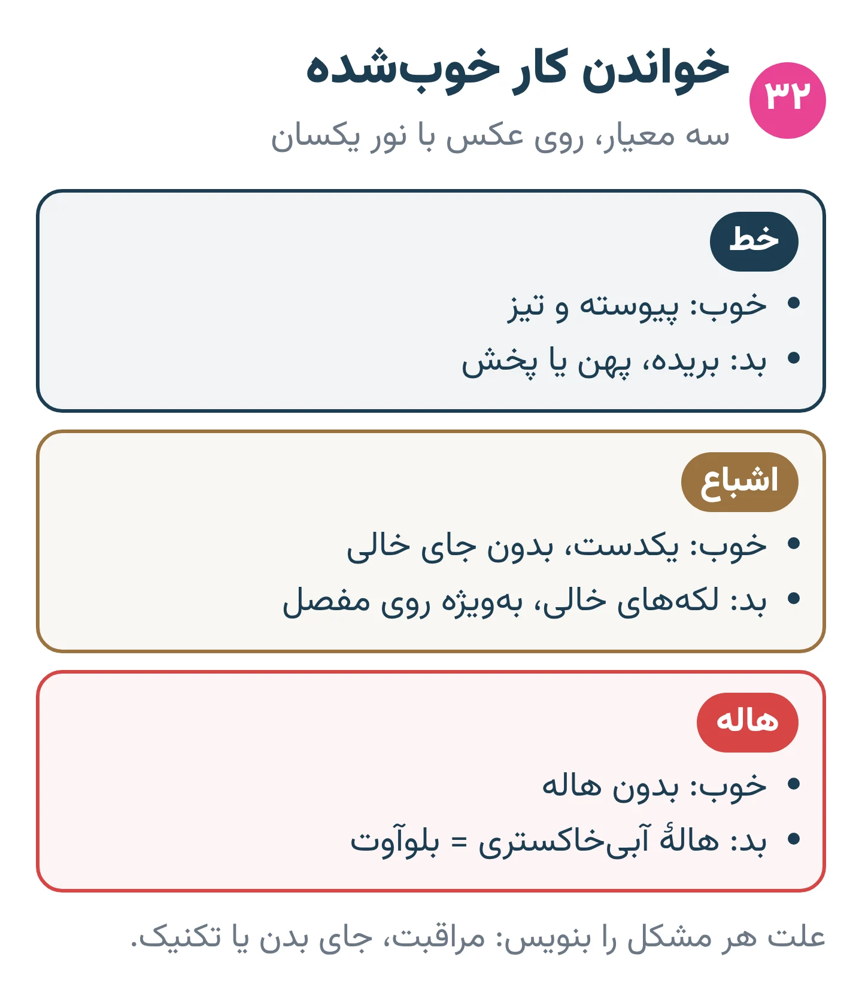
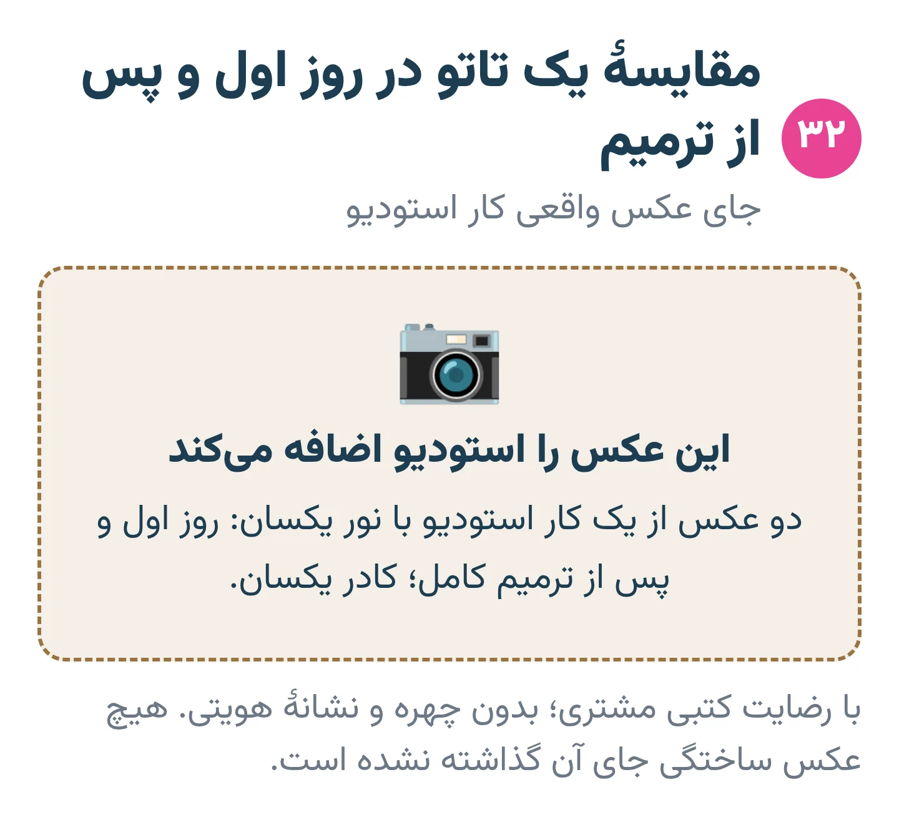
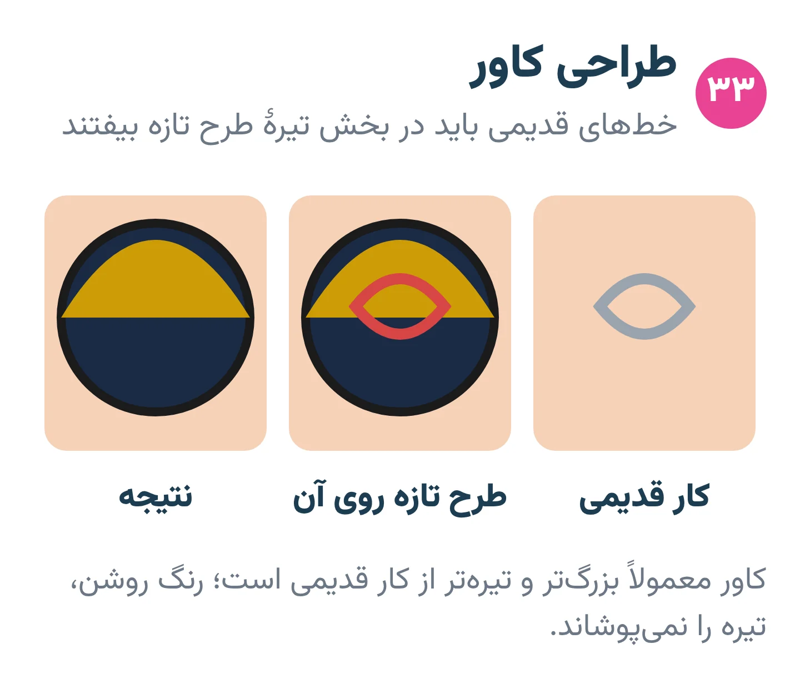
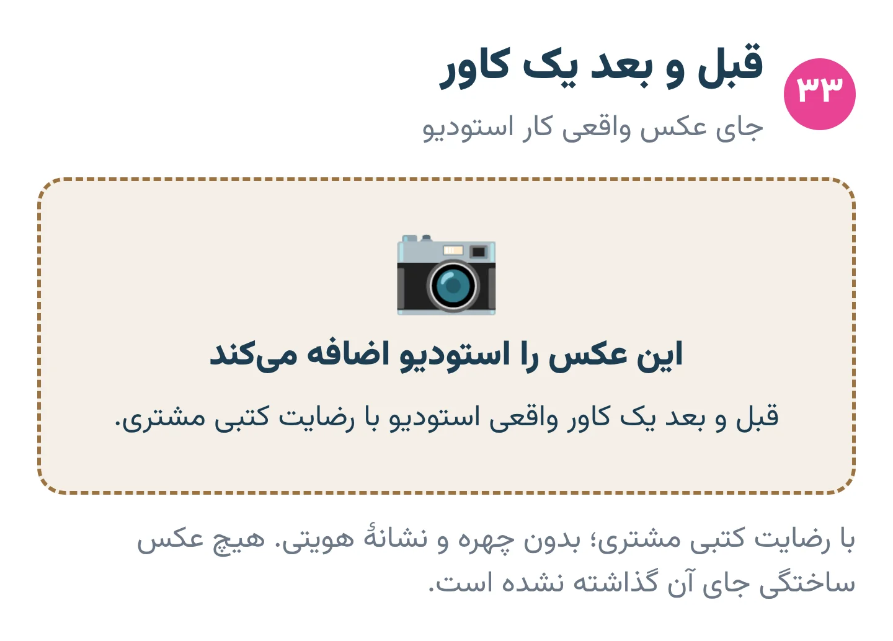
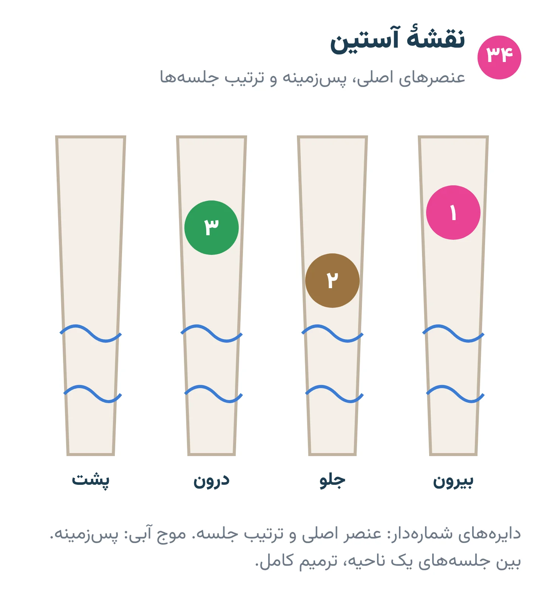
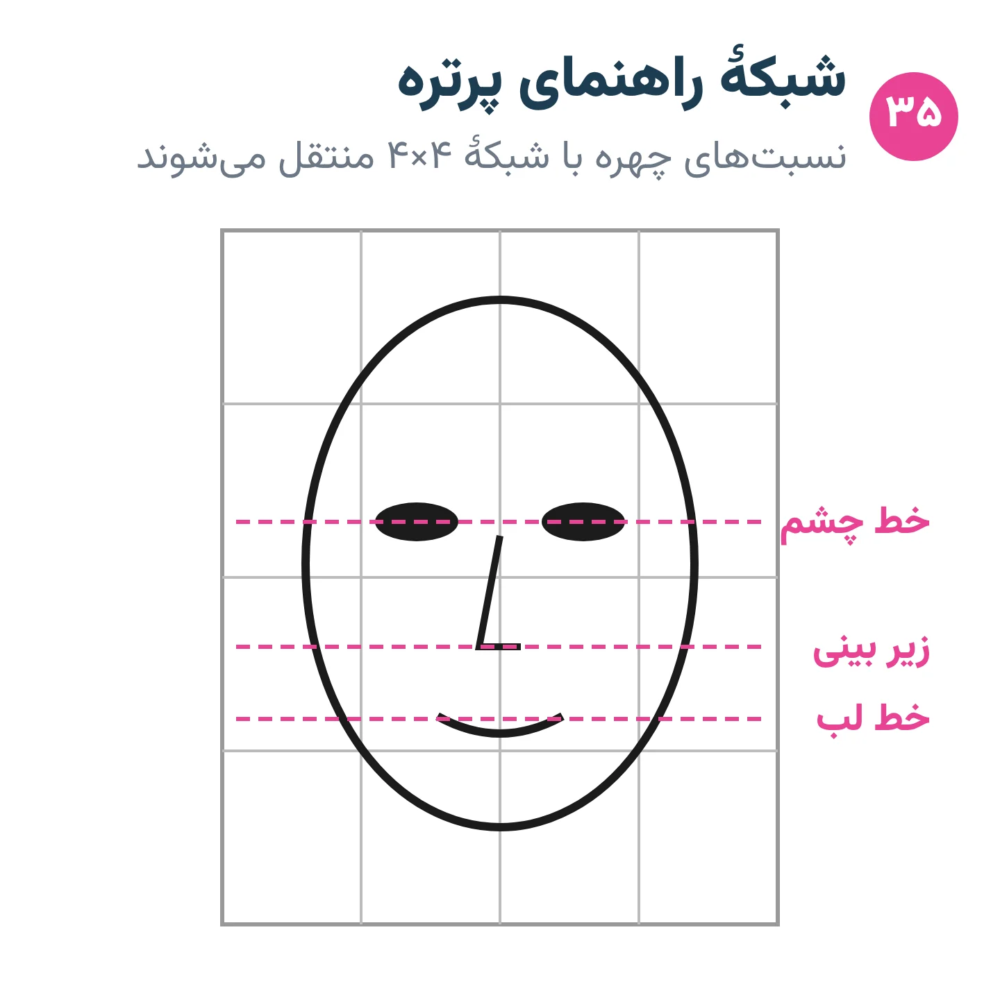
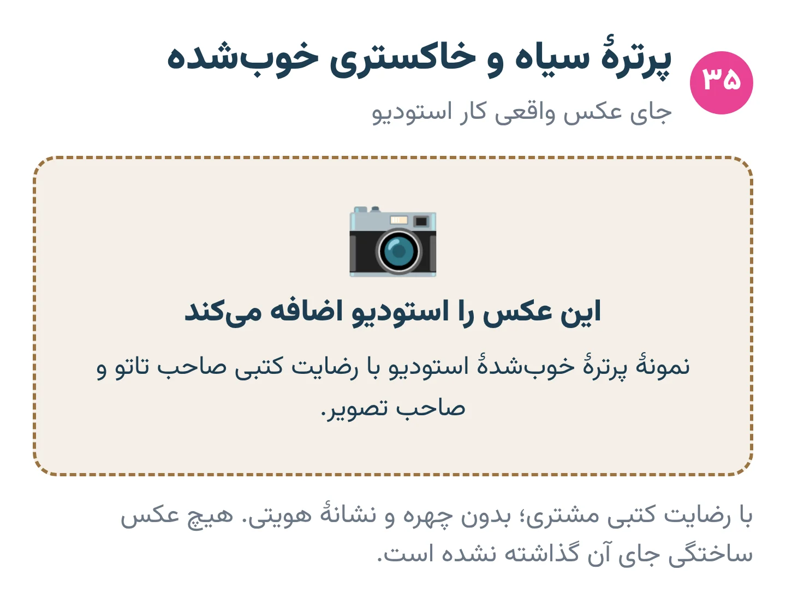

# فصل ۱۳ — کار پیشرفته

*بخش ۵ — پیشرفته و حرفه‌ای*

## درس ۳۲: ترمیم و خواندن کار خوب‌شده

<!-- id: cur-32 -->
**سطح:** پیشرفته

کیفیت واقعی تاتو پس از ترمیم کامل دیده می‌شود. خواندن کار خوب‌شده بهترین معلم تکنیک است و ترمیم (تاچ‌آپ) فقط روی پوست کاملاً آرام و برای جاهای مشخص انجام می‌شود.

**در این درس یاد می‌گیری:**

- کار خوب‌شده را از نظر خط، اشباع و بلوآوت ارزیابی کنی.
- زمان و دامنهٔ ترمیم را تعیین کنی.
- تفاوت ترمیم، تقویت کار قدیمی و اصلاح خطای بزرگ را بدانی.

### خواندن کار خوب‌شده

- عکس با نور یکسان از روز اول و پس از ترمیم کامل مقایسه شود.
- خط: پیوسته و تیز یا بریده و پخش؟
- اشباع: لکه‌های خالی، به‌ویژه روی مفصل و جاهای پرسایش.
- بلوآوت و هاله: در کدام جهت و چه ناحیه‌ای؟ معمولاً نشانهٔ زاویه یا کشش.
- نتیجه را در برگهٔ تمرین یا پرونده ثبت کن تا تکنیک اصلاح شود.

*کار خوب‌شده را با این سه معیار بخوان.*

### ترمیم (تاچ‌آپ)

- فقط پس از بسته شدن کامل سطح و آرام شدن پوست (درس ۴).
- فقط جاهای مشخص؛ کار دوباره روی کل طرح پوست را خسته می‌کند.
- علت کم‌رنگی را پیدا کن: مراقبت، جای بدن یا تکنیک؛ اگر تکنیک بوده، در ترمیم اصلاح کن.

*کیفیت واقعی پس از ترمیم دیده می‌شود.* — جای عکس واقعی استودیو

### تقویت کار قدیمی

- تاتوی سال‌ها مانده خط پهن‌تر و ارزش‌های نزدیک‌تر دارد؛ تقویت معمولاً با خط و سایهٔ تیره‌تر انجام می‌شود، نه با تکرار خط‌های ریز اولیه.
- کار هنرمند دیگر را فقط با رضایت مشتری و با احترام به اثر اصلی تقویت کن.

> **هشدار**
>
> - وعدهٔ ترمیم در دورهٔ پوسته‌ریزی نده.

**نکته‌های کلیدی:**

- کیفیت را پس از ترمیم بخوان.
- ترمیم فقط روی پوست آرام و جای مشخص.
- علت را پیدا کن، نه فقط رنگ اضافه.

### تمرین

**هدف:** یک کار خوب‌شده را ارزیابی کنی.

**ابزار:** عکس‌های قبل و بعد سه کار استودیو

۱. برای هر کار جدول خط، اشباع، بلوآوت پر کن.
۲. علت احتمالی هر مشکل را بنویس.
۳. برنامهٔ ترمیم بنویس.

**معیار قبولی:**

- علت‌ها فنی و قابل‌اصلاح باشند.

**واژه‌ها:** ترمیم (تاچ‌آپ) (Touch-up)، بلوآوت (پخش‌شدگی رنگ) (Blowout)، اشباع (Saturation / packing)

**مرتبط:** درس ۴، درس ۲۴، درس ۳۳

**منابع:**

- استودیو پیمان زیبائی‌فر، «روش و قانون کارگاهی همین استودیو (تجربهٔ استاد؛ منبع بیرونی ندارد)»
- StatPearls / NCBI Bookshelf، «Physiology, Wound Healing» — <https://www.ncbi.nlm.nih.gov/books/NBK535406/>

---

## درس ۳۳: کاور، بلست‌اور، ادامهٔ کار قبلی، جای زخم و لیزر

<!-- id: cur-33 -->
**سطح:** پیشرفته

کار روی پوستی که قبلاً تاتو، زخم یا لیزر دیده، طراحی و قضاوت بیشتری می‌خواهد. کاور یعنی پنهان کردن کامل با طرح تیره‌تر و بزرگ‌تر؛ بلست‌اور یعنی کار تازه روی کار قدیمی بدون پنهان کردن کامل.

**در این درس یاد می‌گیری:**

- امکان‌پذیری کاور را بسنجی و انتظار مشتری را واقع‌بینانه کنی.
- تفاوت کاور و بلست‌اور را توضیح بدهی.
- احتیاط‌های کار روی جای زخم، ترک پوست و پوست لیزرشده را بدانی.

### کاور

- طرح تازه معمولاً بزرگ‌تر و تیره‌تر از کار قدیمی است؛ رنگ روشن روی رنگ تیره را نمی‌پوشاند.
- طرح را روی عکس کار قدیمی (با کاغذ پوستی یا نرم‌افزار) بکش تا محل خط‌های قدیمی در بخش‌های تیره یا بافت‌دار طرح تازه بیفتد.
- گاهی چند جلسه لیزر کم‌رنگ‌کننده پیش از کاور نتیجه را خیلی بهتر می‌کند؛ لیزر کار پزشک یا متخصص دارای صلاحیت است.

*خط‌های قدیمی باید در بخش‌های تیرهٔ طرح تازه بیفتند.*

### بلست‌اور و ادامهٔ کار قبلی

- بلست‌اور: کار قدیمی دیده می‌ماند و طرح تازه روی آن جلوه می‌کند؛ انتخاب سبکی است، نه کاور ناموفق.
- ادامهٔ کار هنرمند دیگر: سبک، ارزش‌ها و جهت جریان کار قبلی را بخوان و با رضایت مشتری هماهنگ کن.

*نمونهٔ کاور استودیو.* — جای عکس واقعی استودیو

### جای زخم و ترک پوست

- زخم باید کاملاً بالغ شده باشد (اغلب ماه‌ها پس از ایجاد)؛ زمان دقیق را پزشک تعیین می‌کند.
- پوست جوشگاه رنگ را نامنظم می‌گیرد و ممکن است بیشتر خونریزی کند یا پخش شود؛ ضربه سبک و انتظار واقع‌بینانه.
- کلوئید و جوشگاه برجستهٔ فعال کار نمی‌شوند؛ ارجاع به متخصص پوست.
- زخم ناشی از آسیب به خود یا جراحی اخیر: با حساسیت و احترام، و در صورت نیاز با نظر پزشک.

### پوست لیزرشده

- پس از لیزر، پوست باید کاملاً خوب شده باشد؛ تاول، قرمزی یا لک فعال یعنی صبر.
- طبق انجمن پوست آمریکا، نتیجه و عارضهٔ لیزر به رنگ، عمق، رنگ پوست، سلامت و داروهای فرد بستگی دارد و مشاوره با متخصص پوست توصیه می‌شود.

> **هشدار**
>
> - وعدهٔ پوشاندن کامل هر تاتو را نده.
> - تاتوکار لیزر پزشکی انجام نمی‌دهد مگر صلاحیت و مجوز قانونی داشته باشد.

**نکته‌های کلیدی:**

- کاور = بزرگ‌تر و تیره‌تر.
- بلست‌اور انتخاب سبکی است.
- زخم و پوست لیزرشده پس از ترمیم کامل و با نظر پزشک.

### تمرین

**هدف:** طرح کاور برای یک تاتوی قدیمی فرضی.

**ابزار:** عکس چاپی تاتوی قدیمی، کاغذ پوستی

۱. کار قدیمی را با رنگ روشن روی کاغذ پوستی ردیابی کن.
۲. دو طرح کاور بکش که خط‌های قدیمی در بخش تیره بیفتند.
۳. امکان‌پذیری و تعداد جلسه را بنویس.

**معیار قبولی:**

- هیچ خط قدیمی زیر بخش روشن طرح نیفتد.

**واژه‌ها:** کاور (Cover-up)، بلست‌اور (Blast-over)، کلوئید (Keloid)

**مرتبط:** درس ۱۴، درس ۳۱، درس ۳۲

**منابع:**

- American Academy of Dermatology، «Tattoo removal: Lasers outshine other methods» — <https://www.aad.org/public/cosmetic/hair-removal/laser-tattoo-removal>
- American Academy of Dermatology، «Tattoos: 7 unexpected skin reactions and what to do about them» — <https://www.aad.org/public/everyday-care/skin-care-basics/tattoos/tattoo-skin-reactions>
- استودیو پیمان زیبائی‌فر، «روش و قانون کارگاهی همین استودیو (تجربهٔ استاد؛ منبع بیرونی ندارد)»

---

## درس ۳۴: پروژهٔ بزرگ، آستین، بک‌پیس و جلسهٔ طولانی

<!-- id: cur-34 -->
**سطح:** پیشرفته

کار بزرگ با نقشهٔ کلی، تقسیم به جلسه‌های منطقی و احترام به ظرفیت پوست و مشتری انجام می‌شود. جریان بدن، پس‌زمینه و جای کارهای قدیمی از ابتدا در طرح دیده می‌شوند.

**در این درس یاد می‌گیری:**

- نقشهٔ آستین یا بک‌پیس را با جریان بدن طراحی کنی.
- پروژه را به جلسه‌های ایمن تقسیم کنی.
- مرز توقف در جلسهٔ طولانی را تشخیص بدهی.

### طراحی کلی

- عنصر اصلی در بزرگ‌ترین و صاف‌ترین بخش (بیرون بازو، وسط پشت).
- پس‌زمینه (ابر، موج، باد، بافت هندسی) کارها را به هم وصل و فاصله‌ها را پر می‌کند.
- جای کارهای قدیمی، خال‌ها و جوشگاه‌ها در نقشه علامت بخورد.
- طرح را با ماژیک پوستی روی بدن ایستاده بکش یا روی عکس بدن طراحی کن.

*نقشهٔ کلی آستین پیش از اولین خط.*

### تقسیم جلسه

- اول خط کل یا خط بخش اصلی؛ سایه و رنگ در جلسه‌های بعد.
- بین جلسه‌های یک ناحیه، ترمیم کامل لازم است؛ روی پوست ترمیم‌نشده کار نکن.
- طول جلسه با تحمل مشتری و وضعیت پوست تعیین می‌شود، نه با برنامهٔ پرداخت.

### جلسهٔ طولانی

- استراحت کوتاه منظم، آب و خوراکی؛ پایش رنگ‌پریدگی و تعریق (درس ۲۲).
- پوست خسته رنگ نمی‌گیرد؛ توقف بهتر از اصرار است (درس ۲۴).
- تحمل درد مشتری معیار ادامه نیست؛ وضعیت پوست معیار است.

> **هشدار**
>
> - طول جلسه را برای «زود تمام شدن» از ظرفیت پوست بیشتر نکن.

**نکته‌های کلیدی:**

- نقشهٔ کلی پیش از اولین خط.
- ترمیم کامل بین جلسه‌های یک ناحیه.
- پوست معیار توقف است.

### تمرین

**هدف:** نقشهٔ یک آستین را با برنامهٔ جلسه بنویسی.

**ابزار:** قالب طرح دست، کاغذ پوستی

۱. سه عنصر اصلی و پس‌زمینه را جانمایی کن.
۲. جهت جریان را با فلش مشخص کن.
۳. برنامهٔ ۵ تا ۸ جلسه با فاصلهٔ ترمیم بنویس.

**معیار قبولی:**

- هیچ دو جلسهٔ پشت‌سرهم روی یک ناحیهٔ ترمیم‌نشده نباشد.

**مرتبط:** درس ۱۹، درس ۲۲، درس ۲۴

**منابع:**

- استودیو پیمان زیبائی‌فر، «روش و قانون کارگاهی همین استودیو (تجربهٔ استاد؛ منبع بیرونی ندارد)»

---

## درس ۳۵: پرتره، حیوان، یادبود و فری‌هند

<!-- id: cur-35 -->
**سطح:** پیشرفته

پرتره و تاتوی یادبود بار عاطفی دارند و خطای کوچک در آن‌ها بزرگ دیده می‌شود. عکس مرجع خوب، اندازهٔ کافی و صداقت دربارهٔ محدودیت پوست شرط کارند. فری‌هند طراحی مستقیم روی پوست با ماژیک است و تسلط طراحی می‌خواهد.

**در این درس یاد می‌گیری:**

- عکس مرجع مناسب پرتره را انتخاب کنی.
- حداقل اندازهٔ منطقی پرتره را توضیح بدهی.
- گفت‌وگوی حساس دربارهٔ تاتوی یادبود را حرفه‌ای انجام بدهی.

### پرتره انسان و حیوان

- عکس واضح، با نور جهت‌دار و وضوح کافی از چشم‌ها؛ عکس تار یعنی حدس زدن جزئیات.
- صورت باید آن‌قدر بزرگ باشد که چشم و لب جزئیات خوانا داشته باشند؛ پرترهٔ خیلی کوچک با گذر زمان در هم می‌رود.
- نسبت‌ها را با شبکه یا نقطه‌های راهنما در استنسیل دقیق منتقل کن.
- در حیوان، جهت مو و درخشش چشم بیشترین شباهت را می‌سازد.

*نسبت‌های چهره با شبکهٔ راهنما منتقل می‌شوند.*

### تاتوی یادبود

- گفت‌وگو با آرامش و بدون عجله؛ نام‌ها، تاریخ‌ها و دست‌خط را کتبی تأیید کن.
- دست‌خط عزیز ازدست‌رفته را با کیفیت بالا اسکن کن و در اندازهٔ خوانا اجرا کن.
- اگر عکس مرجع کیفیت ندارد، صادقانه بگو و گزینهٔ نمادین پیشنهاد کن.

*نمونهٔ پرترهٔ استودیو.* — جای عکس واقعی استودیو

### فری‌هند

- طرح مستقیماً با ماژیک پوستی روی بدن کشیده می‌شود تا با جریان عضله هماهنگ باشد.
- ماژیک یک‌بارمصرف یا مخصوص همان مشتری؛ پیش از سوزن، مشتری طرح را تأیید کند.
- برای کارآموز پس از تسلط کامل بر طراحی و استنسیل.

> **هشدار**
>
> - قول شباهت صددرصد نده؛ پوست کاغذ نیست.

**نکته‌های کلیدی:**

- عکس مرجع واضح، اندازهٔ کافی.
- تأیید کتبی نام و تاریخ.
- فری‌هند پس از تسلط طراحی.

### تمرین

**هدف:** پرترهٔ طراحی‌شده از یک عکس با کیفیت روی کاغذ.

**ابزار:** عکس مرجع، کاغذ، شبکهٔ راهنما

۱. عکس را با شبکهٔ ۴×۴ تقسیم و روی کاغذ منتقل کن.
۲. سه ارزش اصلی را مشخص کن.
۳. استنسیل نهایی را بساز.

**معیار قبولی:**

- نسبت چشم‌ها و بینی با مرجع هماهنگ باشد.

**واژه‌ها:** ارزش رنگی (روشنی و تیرگی) (Value)، استنسیل (Stencil)

**مرتبط:** درس ۱۶، درس ۱۸، درس ۲۸، درس ۳۶

**منابع:**

- استودیو پیمان زیبائی‌فر، «روش و قانون کارگاهی همین استودیو (تجربهٔ استاد؛ منبع بیرونی ندارد)»
- Wikipedia، «Jack Rudy — از پایه‌گذاران سیاه و خاکستری و خط تک‌سوزن» — <https://en.wikipedia.org/wiki/Jack_Rudy>

---
