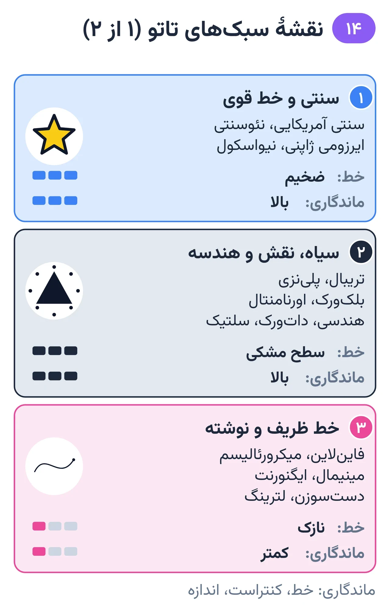
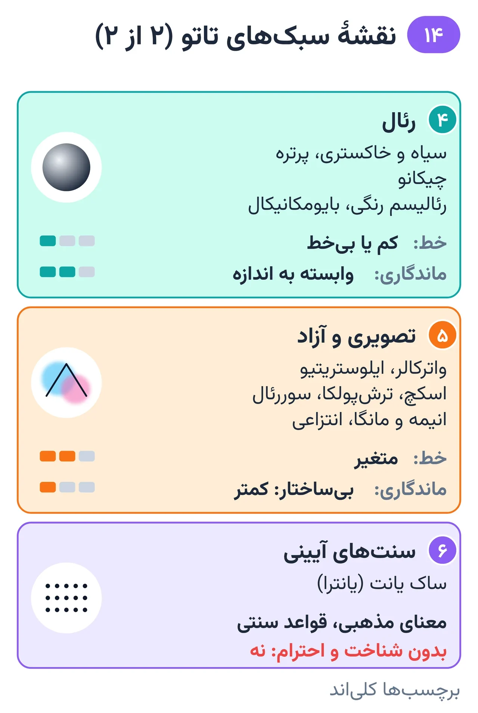

# فصل ۱۴ — سبک‌ها

*بخش ۵ — پیشرفته و حرفه‌ای*

## درس ۳۶: نقشهٔ سبک‌ها و نیاز فنی هر سبک

<!-- id: cur-36 -->
**سطح:** پیشرفته

سبک یعنی زبان تصویری و روش ساخت طرح، نه نوع سوزن. هر سبک خانوادهٔ مهارت‌های خودش را دارد و ماندگاری‌اش به خط، کنتراست و اندازه بستگی دارد. نام هنرمندان شاخص فقط برای مطالعه است؛ آثارشان کپی نمی‌شود.

**در این درس یاد می‌گیری:**

- سبک‌های اصلی را در شش خانواده دسته‌بندی کنی.
- نیاز فنی و ماندگاری هر خانواده را توضیح بدهی.
- برای هر خانواده منابع مطالعه و هنرمندان شاخص را بشناسی.

### ۱. سنتی و خط قوی

خط مشکی ضخیم، رنگ محدود و اشباع، سیلوئت خوانا؛ از ماندگارترین سبک‌ها.

- سنتی آمریکایی: نقش‌مایه‌های کلاسیک (عقاب، گل رز، لنگر)، خط ضخیم و رنگ اصلی. هنرمند شاخص: «سیلور جری» (نورمن کالینز) و «دان اد هاردی».
- نئوسنتی: ساختار سنتی با جزئیات، گرادیان و پالت گسترده‌تر.
- سنتی ژاپنی (ایرزومی): کار بزرگ با پس‌زمینهٔ باد، موج و ابر و قواعد نمادین؛ معمولاً تمام‌بدن یا آستین. هنرمند شاخص: «هوریوشی سوم».
- نیواسکول: اغراق کارتونی، رنگ تند و خط ضخیم.
- نیاز فنی: لاینر بزرگ، اشباع کامل، سیلوئت.

*شش خانوادهٔ سبک و نیاز فنی هر کدام. (بخش ۱ از ۲)*

### ۲. سیاه، نقش و هندسه

- تریبال: سطح‌های مشکی کامل و فرم‌های جاری با بدن. هنرمند شاخص: «لئو زولوئتا» (پدر تریبال مدرن).
- پلی‌نزی و سنت‌های بومی: نقش‌ها معنای فرهنگی و خانوادگی دارند؛ پیش از اجرا مطالعه و احترام فرهنگی لازم است.
- بلک‌ورک، اورنامنتال، هندسی، دات‌ورک، سلتیک: تقارن، تکرار دقیق، سطح مشکی یکدست یا نقطه‌ای.
- نیاز فنی: اشباع مشکی یکدست، تقارن روی بدن نامتقارن، نقطه‌گذاری کنترل‌شده.

*ادامه: رئال، تصویری و آزاد، سنت‌های آیینی. (بخش ۲ از ۲)*

### ۳. خط ظریف و نوشته

- فاین‌لاین و میکرورئالیسم: خط تک‌سوزن یا بسیار نازک و جزئیات ریز. هنرمند شاخص: «دکتر وو» (برایان وو).
- مینیمال، ایگنورنت (طراحی عمداً ساده و خام) و دست‌سوزن (استیک‌اندپوک).
- لترینگ و خوشنویسی (درس ۱۷).
- نیاز فنی: دست بسیار سبک و ثابت؛ ماندگاری کمتر روی جاهای پرحرکت و پوست تیره؛ ارزش‌ها با گذر زمان به هم نزدیک می‌شوند.

### ۴. رئال

- سیاه و خاکستری و پرتره: کاپ‌های رقیق و گرادیان نرم (درس ۲۸). هنرمند شاخص در شکل‌گیری این سبک: «جک رودی».
- چیکانو: سیاه و خاکستری با ریشه در فرهنگ مکزیکی‌تبار لس‌آنجلس، خط ظریف و لترینگ. چهرهٔ شناخته‌شدهٔ تاتو و گرافیتی لس‌آنجلس: «میستر کارتون».
- رئالیسم رنگی و بایومکانیکال (الهام‌گرفته از زیبایی‌شناسی آثار نقاش «اچ. آر. گیگر»).
- نیاز فنی: ارزش رنگی دقیق، عکس مرجع باکیفیت، اندازهٔ کافی.

### ۵. تصویری و آزاد

- واترکالر، ایلوستریتیو، اسکچ، ترش‌پولکا، سوررئال، انیمه و مانگا، انتزاعی.
- هنر تاریک: سیاه و خاکستری با فضای سوررئال تاریک؛ هنرمند شاخص: «پل بوث».
- نیاز فنی: برای ماندگاری، حتی در سبک‌های بی‌خط، ساختار ارزشی یا خط پنهان لازم است؛ لبه‌های نرم بدون ساختار با گذر زمان محو می‌شوند.

### ۶. سنت‌های آیینی

- ساک یانت (یانترا): تاتوی آیینی جنوب‌شرق آسیا با معنای مذهبی و قواعد سنتی؛ اجرای آن بدون شناخت و احترام به این سنت توصیه نمی‌شود.

### هنرمندان مرجع برای مطالعه (با منبع)

این فهرست فقط نام‌هایی را می‌آورد که برایشان منبع معتبر و قابل‌بررسی پیدا شد. جمله‌هایی که با «به گفتهٔ خودش» آمده‌اند دیدگاه خود هنرمندند، نه واقعیت تأییدشده. هیچ اثری از این هنرمندان در درس‌نامه آورده نشده است؛ برای دیدن کارها به صفحهٔ رسمی و منبع هر نام رجوع کن.

- سنتی آمریکایی — «سیلور جری» (نورمن کالینز): به نوشتهٔ رادیو و تلویزیون عمومی کالیفرنیای شمالی (KQED)، بسیاری او را پدر تاتوی مدرن آمریکایی می‌دانند؛ از نخستین کسانی بود که سبک آسیایی و غربی را تلفیق کرد و تا ۱۹۷۳ در هاوایی کار می‌کرد.
- سنتی ژاپنی — هوریوشی سوم: استاد معاصر ایرزومی و شاگرد هوریوشی اول. به گفتهٔ خودش، تاتوی دستی ژاپنی (تبوری) را فقط زیر نظر استاد می‌توان آموخت.
- سیاه و خاکستری و چیکانو — به گزارش رادیو ملی آمریکا (NPR)، این سبک در شرق لس‌آنجلس از تاتوی زندان با تک‌سوزن و مشکیِ رقیق‌شده شکل گرفت و فردی نگرته از کسانی بود که آن را به جریان اصلی آورد. به نوشتهٔ سایت رسمی کارگاه «گود تایم چارلی» (محل کار جک رودی)، آن‌جا این سبک حرفه‌ای شد و سیاه پایهٔ اثر قرار گرفت. مجلهٔ تاتو لایف مارک ماهونی را از پیشگامان سیاه و خاکستری تک‌سوزن می‌داند.
- چیکانو و لترینگ — میستر کارتون: به نوشتهٔ لس‌آنجلس تایمز، فقط با مشکی و خاکستری و خط ظریف کار می‌کند و از پرسپکتیو و لایه‌های عمق بهره می‌برد.
- خط ظریف و تک‌سوزن — دکتر وو: طبق سایت رسمی‌اش، کار را زیر نظر مارک ماهونی آغاز کرد و ظرافت سبک تک‌سوزن را از او آموخت.
- رئالیسم رنگی — نیکو هورتادو: به نوشتهٔ ال‌اِی ویکلی، از شناخته‌شده‌ترین رئالیست‌های رنگی است؛ به گفتهٔ خودش اصل کارش این است: «آنچه را می‌بینی بکش و زیاد تغییرش نده».
- تریبال — لئو زولوئتا: نشریهٔ آن‌آربر آبزرور او را «پدر تاتوی تریبال مدرن» می‌نامد؛ سبکی الهام‌گرفته از سنت‌های اقیانوس آرام با الگوهای درهم‌تنیده و کنتراست شدید.
- بلک‌ورک و الگو — توماس هوپر: به گفتهٔ خودش، از تاتو و چاپ چوبی ژاپنی آموخته که زیبایی در تکرار است و بخش بزرگ کارش را خط تمیز با کشش درست پوست می‌داند.
- هندسی و ماندالا با دست‌سوزن — گریس نوترال: به گفتهٔ خودش در گاردین، بیشتر با روش دستی کار می‌کند و به تقارن و الگوهای سایه‌دار شناخته می‌شود.
- آبرنگی — آماندا واچوب: به نوشتهٔ موزهٔ هنر معاصر دنور، سبکی الهام‌گرفته از نقاشی مدرن با ضربه‌قلم، واش و پاشیدگی رنگ را پایه گذاشت.
- ترش‌پولکا — سیمونه پفاف و فولکر مرشکی: به نوشتهٔ مجلهٔ آرت آن اسکین، این سبک به آن دو نسبت داده می‌شود؛ معمولاً مشکی و قرمز، کلاژی از تصویر واقعی، لکه، شکل هندسی و حروف، روی سطح بزرگ بدن.
- لترینگ — بی‌جی بتز: نویسندهٔ راهنماهای حروف‌نگاری تاتو. به گفتهٔ خودش: خوانایی بر تزئین مقدم است، املا باید بررسی شود و متن ریز در اندازهٔ کوچک جواب نمی‌دهد.

### اصل حرفه‌ای

از آثار هنرمندان شاخص برای فهم ترکیب، خط و ارزش رنگی بیاموز؛ تصویر کار آن‌ها را برای مشتری کپی نکن (درس ۱۸). برای دیدن آثار، به صفحهٔ رسمی، کتاب‌ها و نمایشگاه‌های خود هنرمند رجوع کن.

> **هشدار**
>
> - نقش‌های فرهنگی و آیینی (پلی‌نزی، ساک یانت) را بدون شناخت و احترام اجرا نکن.

**نکته‌های کلیدی:**

- سبک = زبان تصویری، نه سوزن.
- ماندگاری = خط + کنتراست + اندازه.
- یادگیری از هنرمندان شاخص، بدون کپی.

### تمرین

**هدف:** یک موضوع را در سه سبک طراحی کنی.

**ابزار:** کاغذ، ماژیک

۱. یک گل رز را در سبک سنتی، فاین‌لاین و سیاه و خاکستری بکش.
۲. برای هر نسخه سوزن و ماندگاری را بنویس.
۳. یک هنرمند شاخص هر سبک را از منابع درس مطالعه و یک نکتهٔ فنی از او یادداشت کن.

**معیار قبولی:**

- تفاوت فنی سه نسخه روشن و درست توضیح داده شود.

**واژه‌ها:** لاینر گرد (Round Liner, RL)، مگنوم بافته (Weaved Magnum, M1)، کاپ‌های رقیق خاکستری (Grey wash)، نقطه‌گذاری (Stippling / dotwork)

**مرتبط:** درس ۱۷، درس ۲۵، درس ۲۸، درس ۳۵

**منابع:**

- KQED، «Hori Smoku Sailor Jerry» — <https://www.kqed.org/arts/31163/hori_smoku_sailor_jerry>
- Wikipedia، «Sailor Jerry (Norman Collins) — از پایه‌گذاران سبک سنتی آمریکایی» — <https://en.wikipedia.org/wiki/Sailor_Jerry>
- Wikipedia، «Don Ed Hardy — اثرگذار بر شکل‌گیری سبک‌های مدرن و پیوند سنت ژاپنی و آمریکایی» — <https://en.wikipedia.org/wiki/Don_Ed_Hardy>
- Tattoo Society Magazine، «Horiyoshi III» — <https://tattoosocietymagazine.com/web/horiyoshi-iii/>
- Wikipedia، «Horiyoshi III — استاد تاتوی سنتی ژاپنی تمام‌بدن (هوریمونو)» — <https://en.wikipedia.org/wiki/Horiyoshi_III>
- Wikipedia، «Irezumi — تاتوی سنتی ژاپنی» — <https://en.wikipedia.org/wiki/Irezumi>
- NPR Code Switch (2018)، «Black And Gray … And Brown: A Tattoo Style's Chicano Roots» — <https://www.npr.org/sections/codeswitch/2018/04/15/602169159/black-and-gray-and-brown-a-tattoo-styles-chicano-roots>
- Good Time Charlie (official site)، «About» — <https://www.goodtimecharlie.net/pages/about>
- Tattoo Life (2018)، «Mark Mahoney: from the Pike to Beverly Hills» — <https://www.tattoolife.com/mark-mahoney-from-the-pike-to-beverly-hills/>
- Wikipedia، «Jack Rudy — از پایه‌گذاران سیاه و خاکستری و خط تک‌سوزن» — <https://en.wikipedia.org/wiki/Jack_Rudy>
- Los Angeles Times (2002)، «More than skin deep (Mister Cartoon)» — <https://www.latimes.com/archives/la-xpm-2002-oct-17-wk-alt17-story.html>
- Wikipedia، «Mister Cartoon (Mark Machado) — تاتو و گرافیتی لس‌آنجلس» — <https://en.wikipedia.org/wiki/Mister_Cartoon>
- Dr. Woo (official site)، «Bio» — <https://drwoo.com/bio>
- Wikipedia، «Dr. Woo (Brian Woo) — فاین‌لاین تک‌سوزن و میکرورئالیسم» — <https://en.wikipedia.org/wiki/Dr._Woo>
- LA Weekly (2017)، «Meet the local tattoo artist making headlines (Nikko Hurtado)» — <https://www.laweekly.com/meet-the-local-tattoo-artist-making-headlines-for-dwayne-johnsons-new-ink/>
- Ann Arbor Observer (2009)، «Leo Zulueta and Jared Leathers» — <https://annarborobserver.com/leo-zulueta-and-jared-leathers/>
- Wikipedia، «Leo Zulueta — شناخته‌شده به «پدر تریبال مدرن»» — <https://en.wikipedia.org/wiki/Leo_Zulueta>
- The Creative Independent (2019)، «Artist Thomas Hooper on juggling creative outlets» — <https://thecreativeindependent.com/people/artist-thomas-hooper-on-juggling-creative-outlets/>
- The Guardian / Observer (2022)، «Meet the world's best tattoo artists» — <https://www.theguardian.com/fashion/2022/nov/06/my-parents-werent-impressed-at-first-but-now-i-do-my-mum-meet-the-worlds-best-tattoo-artists>
- MCA Denver، «Amanda Wachob: Tattoo This» — <https://mcadenver.org/exhibitions/amanda-wachob>
- Art on Skin Magazine، «Style Feature: Trash Polka» — <https://www.aosmag.com/style-feature-trash-polka/>
- Complex (2011)، «The Complex Guide To Tattoo Lettering» — <https://www.complex.com/style/a/nick-schonberger/the-complex-guide-to-tattoo-lettering>
- Wikipedia، «H. R. Giger — نقاش؛ الهام‌بخش زیبایی‌شناسی بایومکانیکال» — <https://en.wikipedia.org/wiki/H._R._Giger>
- Wikipedia، «Paul Booth — سیاه و خاکستری با فضای سوررئال تاریک» — <https://en.wikipedia.org/wiki/Paul_Booth_(tattoo_artist)>
- Wikipedia، «Yantra tattooing (ساک یانت)» — <https://en.wikipedia.org/wiki/Yantra_tattooing>
- WIPO، «Understanding Copyright and Related Rights» — <https://www.wipo.int/publications/en/details.jsp?id=4081>

---
