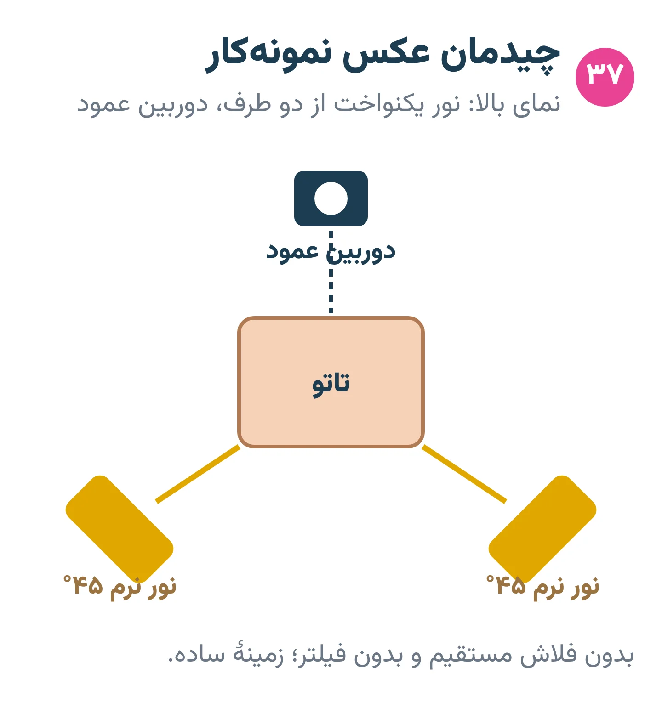
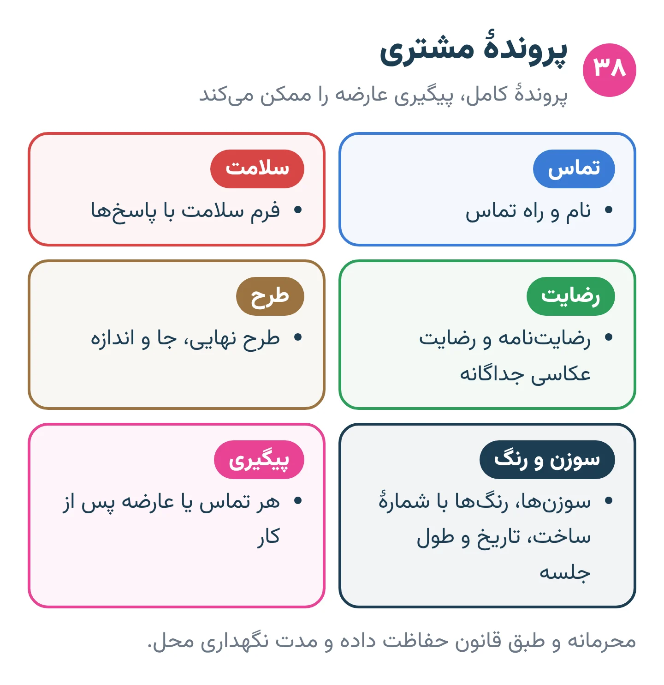
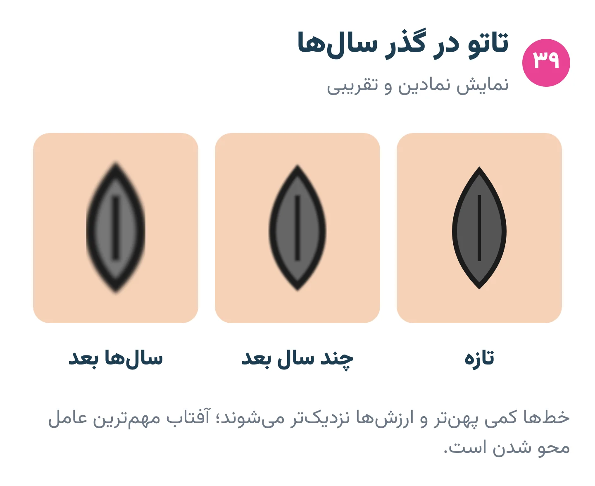

# فصل ۱۵ — حرفه و مسئولیت

*بخش ۵ — پیشرفته و حرفه‌ای*

## درس ۳۷: عکاسی و نمونه‌کار

<!-- id: cur-37 -->
**سطح:** پیشرفته

نمونه‌کار ویترین استودیوست. عکس درست، کار را همان‌طور که هست نشان می‌دهد: نور یکنواخت، بدون فیلتر، با رضایت مشتری و ترجیحاً با یک عکس از کار خوب‌شده.

**در این درس یاد می‌گیری:**

- عکس تمیز و واقعی از تاتو بگیری.
- رضایت و حریم خصوصی مشتری را رعایت کنی.
- نمونه‌کار منظم و صادقانه بسازی.

### عکاسی

- نور یکنواخت و غیرمستقیم (نور روز یا دو منبع نرم)؛ بدون فلاش مستقیم که براقی می‌سازد.
- پوست تمیز و بدون لایهٔ براق ضخیم.
- دوربین عمود بر مرکز تاتو؛ روی بدن منحنی چند زاویه یا عکس پیوسته.
- بدون فیلتر و تغییر رنگ؛ برش و صاف کردن نور مجاز، تغییر خود کار نه.
- زمینهٔ ساده و بدون شلوغی.

*نور یکنواخت از دو طرف و دوربین عمود.*

### رضایت و حریم خصوصی

- رضایت کتبی جداگانه برای عکس و انتشار.
- چهره، خال‌کوبی‌های شناسایی‌کننده و نام مشتری بدون اجازه منتشر نشود.
- عکس کار پیش از رضایت در شبکه‌های اجتماعی گذاشته نشود.

### نمونه‌کار

- کار تازه و، هرجا ممکن است، همان کار پس از ترمیم.
- فقط کار خودت؛ کار دیگران یا تصویر تولیدی نرم‌افزار به‌جای کار واقعی ممنوع.
- دسته‌بندی بر اساس سبک.

> **هشدار**
>
> - ویرایش عکس برای پنهان کردن خطا فریب مشتری است.

**نکته‌های کلیدی:**

- نور یکنواخت، بدون فیلتر.
- رضایت کتبی برای انتشار.
- نمونه‌کار فقط از کار واقعی خودت.

### تمرین

**هدف:** عکس استاندارد از یک کار تمرینی بگیری.

**ابزار:** پوست مصنوعی تمرین‌شده، تلفن، دو منبع نور

۱. با نور یکنواخت و عمود عکس بگیر.
۲. یک عکس بد (فلاش مستقیم، زاویه) هم بگیر.
۳. تفاوت را توضیح بده.

**معیار قبولی:**

- عکس نهایی بدون بازتاب و اعوجاج باشد.

**مرتبط:** درس ۱۸، درس ۳۲، درس ۳۸

**منابع:**

- استودیو پیمان زیبائی‌فر، «روش و قانون کارگاهی همین استودیو (تجربهٔ استاد؛ منبع بیرونی ندارد)»

---

## درس ۳۸: قیمت، بیعانه، پروندهٔ مشتری و نگهداری تجهیزات

<!-- id: cur-38 -->
**سطح:** پیشرفته

حرفه‌ای بودن یعنی قیمت شفاف، قاعدهٔ روشن بیعانه، پروندهٔ کامل و محرمانه، و تجهیزات نگهداری‌شده با دفتر ثبت. این درس برای آشنایی کارآموز است؛ قیمت و بیعانهٔ این استودیو را فقط استاد تعیین می‌کند.

**در این درس یاد می‌گیری:**

- اجزای منطقی قیمت‌گذاری را بشناسی.
- اجزای پروندهٔ مشتری را تکمیل کنی.
- برنامهٔ نگهداری دستگاه، اتوکلاو و فضای کار را اجرا کنی.

### قیمت و بیعانه (آشنایی)

- قیمت معمولاً بر پایهٔ زمان، اندازه، پیچیدگی، جای بدن و هزینهٔ مواد تعیین می‌شود.
- بیعانه وقت طراحی و نوبت را تضمین می‌کند؛ شرایط بازگشت یا انتقال آن پیش از پرداخت کتبی گفته شود.
- کارآموز قیمت یا بیعانه وعده نمی‌دهد.

*پروندهٔ کامل، پیگیری عارضه را ممکن می‌کند.*

### پروندهٔ مشتری

- مشخصات تماس، فرم سلامت، رضایت‌نامه، رضایت عکاسی.
- طرح نهایی، جای بدن، سوزن‌ها، رنگ‌ها با شمارهٔ ساخت، تاریخ و طول جلسه.
- هر عارضه یا تماس پس از کار.
- نگهداری محرمانه و طبق قانون حفاظت داده و مدت نگهداری محل.

### نگهداری تجهیزات

- دستگاه و منبع تغذیه: تمیز کردن بیرونی پس از هر کار طبق دستور سازنده؛ بازرسی کابل و اتصال‌ها.
- اتوکلاو: پایش هر چرخه و آزمون اسپور دوره‌ای (دست‌کم هفتگی طبق توصیهٔ مرکز کنترل بیماری آمریکا) با ثبت در دفتر.
- انبار: کارتریج و رنگ با تاریخ انقضا؛ اول‌وارد-اول‌مصرف؛ بستهٔ آسیب‌دیده دور ریخته شود.
- فضای کار: برنامهٔ تمیز کردن روزانه و هفتگی؛ ظرف تیز طبق قاعدهٔ پسماند محل تحویل شود.

> **هشدار**
>
> - اطلاعات سلامت مشتری را در گروه‌های پیام‌رسان یا جای عمومی نگذار.

**نکته‌های کلیدی:**

- قیمت و بیعانه شفاف و کتبی.
- پرونده کامل با شمارهٔ ساخت رنگ.
- دفتر نگهداری اتوکلاو و تجهیزات.

### تمرین

**هدف:** یک پروندهٔ کامل و یک دفتر نگهداری هفتگی پر کنی.

**ابزار:** فرم پرونده، دفتر نگهداری

۱. پروندهٔ یک مشتری فرضی را کامل کن.
۲. برنامهٔ نگهداری یک هفته را بنویس.
۳. سه مورد انقضای انبار را بررسی کن.

**معیار قبولی:**

- هیچ بخش پرونده خالی نماند.

**واژه‌ها:** اتوکلاو (Autoclave)، آزمون اسپور (Biological indicator / spore test)، رضایت‌نامهٔ آگاهانه (Informed consent)

**مرتبط:** درس ۷، درس ۱۳، درس ۲۱

**منابع:**

- CDC، «Sterilizing Practices — monitoring with mechanical, chemical and biological indicators» — <https://www.cdc.gov/infection-control/hcp/disinfection-sterilization/sterilizing-practices.html>
- CEN / BSI، «EN 17169:2020 Tattooing — Safe and hygienic practice» — <https://knowledge.bsigroup.com/products/tattooing-safe-and-hygienic-practice>
- استودیو پیمان زیبائی‌فر، «روش و قانون کارگاهی همین استودیو (تجربهٔ استاد؛ منبع بیرونی ندارد)»

---

## درس ۳۹: مقررات، مسئولیت حرفه‌ای و تاتو در گذر سال‌ها

<!-- id: cur-39 -->
**سطح:** پیشرفته

تاتوکار مسئول ایمنی مشتری، رعایت مقررات محل کار و صداقت دربارهٔ آیندهٔ تاتوست. قوانین در هر کشور و شهر متفاوت‌اند؛ این درس اصول عمومی را می‌گوید و جای مشاورهٔ حقوقی را نمی‌گیرد.

**در این درس یاد می‌گیری:**

- حوزه‌های اصلی مقررات کار تاتو را نام ببری.
- مسئولیت حرفه‌ای در برابر مشتری را توضیح بدهی.
- تغییرات تاتو در گذر سال‌ها را برای مشتری توضیح بدهی.

### حوزه‌های مقررات (کلی)

- مجوز کسب و بهداشت محل کار طبق مرجع محلی.
- حداقل سن و رضایت ولی یا قیم طبق قانون محل.
- کنترل عفونت، پسماند تیز و پسماند آلوده طبق مقررات بهداشت محیط.
- ایمنی و برچسب رنگ (نمونهٔ مرجع بین‌المللی: مقررات ریچ اتحادیهٔ اروپا).
- حفاظت از داده‌های شخصی و سلامت مشتری.
- در ایران و هر کشور دیگر، مقررات و رویهٔ مراجع را از مرجع بهداشت و صنف محل بپرس؛ این درس قانون مشخصی را ادعا نمی‌کند.

*نمایش نمادین: خط‌ها پهن‌تر و ارزش‌ها نزدیک‌تر می‌شوند.*

### مسئولیت حرفه‌ای

- اطلاع‌رسانی صادقانه دربارهٔ خطرها، محدودیت‌ها و مراقبت.
- ارجاع به پزشک در هر نشانهٔ هشدار؛ نه تشخیص و نه درمان.
- آموزش مداوم: کنترل عفونت و کمک‌های اولیه را به‌روز نگه دار.
- نپذیرفتن کاری که با مهارت، اخلاق یا ایمنی تو هم‌خوان نیست.

### تاتو در گذر سال‌ها

- خط‌ها کمی پهن و ارزش‌ها به هم نزدیک می‌شوند؛ جزئیات خیلی ریز زودتر در هم می‌روند.
- آفتاب بیشترین عامل محو شدن است؛ ضدآفتاب پس از ترمیم کامل.
- تغییر وزن، بارداری و پیری شکل پوست را تغییر می‌دهند.
- واکنش پوستی ممکن است سال‌ها بعد رخ دهد (درس ۳۱).
- تاتو بررسی خال‌ها را سخت‌تر می‌کند؛ معاینهٔ دوره‌ای پوست با پزشک ارزشمند است.

> **هشدار**
>
> - این درس مشاورهٔ حقوقی یا پزشکی نیست.

**نکته‌های کلیدی:**

- قانون محل مقدم است؛ از مرجع محلی بپرس.
- صداقت دربارهٔ آیندهٔ تاتو.
- آموزش مداوم.

### تمرین

**هدف:** فهرست مقررات محل کار خودت را تهیه کنی.

**ابزار:** کاغذ، پرسش از استاد و مرجع محلی

۱. پنج حوزهٔ مقررات را بنویس.
۲. برای هر حوزه مرجع پاسخ‌گو در شهر خودت را پیدا کن (با کمک استاد).
۳. یک متن دودقیقه‌ای دربارهٔ تاتو در گذر سال‌ها برای مشتری آماده کن.

**معیار قبولی:**

- هیچ قانونی بدون منبع ادعا نشود.

**واژه‌ها:** رضایت‌نامهٔ آگاهانه (Informed consent)

**مرتبط:** درس ۱، درس ۱۳، درس ۳۱

**منابع:**

- CEN / BSI، «EN 17169:2020 Tattooing — Safe and hygienic practice» — <https://knowledge.bsigroup.com/products/tattooing-safe-and-hygienic-practice>
- European Chemicals Agency (ECHA)، «Tattoo inks and permanent make-up» — <https://echa.europa.eu/hot-topics/tattoo-inks>
- U.S. FDA، «Tattoos, Temporary Tattoos & Permanent Makeup» — <https://www.fda.gov/cosmetics/cosmetic-products/tattoos-temporary-tattoos-permanent-makeup>
- American Academy of Dermatology، «Caring for tattooed skin» — <https://www.aad.org/public/everyday-care/skin-care-basics/tattoos/caring-for-tattooed-skin>
- American Academy of Dermatology، «Do tattoos cause skin cancer?» — <https://www.aad.org/public/diseases/skin-cancer/do-tattoos-cause-skin-cancer>
- OSHA (U.S. Department of Labor)، «Bloodborne Pathogens and Needlestick Prevention» — <https://www.osha.gov/bloodborne-pathogens>

---
